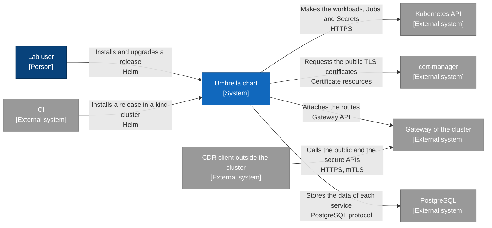

# Umbrella chart

The umbrella chart `cdr-lab` deploys the lab to one namespace of a Kubernetes cluster with one Helm release: the mock CDR Register and a set of the four preset brands of the mock data holder. Its values give the seed data. It makes the mock CDR CA when it is absent, gets the CDR certificates from the Register and renews them, and gets the public TLS certificates from cert-manager or from existing Secrets. A [cluster deployment](../../docs/spec/glossary.md#cluster-deployment) is a lab, not a production service ([ADR 0033][adr-0033]).

## Context

## Library specifications

None.

## Goals

- One release that deploys the Register and a set of the preset brands, with no step on a host other than the databases and the Secrets of the deployment.
- No way to give a brand values that disagree with its Register record.
- CDR certificates that the Register issues, and that are replaced before they expire with no manual step.
- A CI job that installs the chart and runs the conformance suite against it.

## Non-goals

- PostgreSQL, the mail server, cert-manager and the Gateway. The cluster or the lab user gives them ([ADR 0033][adr-0033]).
- A brand from a mounted brand directory. The [data holder chart](../dataholder/README.md) deploys it.
- Customer seed data, and the onboarding of software products with `cdrlab`. A later change adds them.
- More than one instance of a service, and data that stays across an upgrade before version 1.0.0 ([ADR 0027][adr-0027]).
- Operator identity and a login for the consoles ([production gaps][production-gaps]).

## Release and namespace

- **LAB-0001** One release of the chart deploys the Register and each brand that the values give. ([Judgement: one umbrella chart (ADR 0033)][adr-0033])
- **LAB-0002** The chart puts each resource in the namespace of the release. ([Judgement: one umbrella chart (ADR 0033)][adr-0033])
- **LAB-0003** The Service of the Register has the name `register`. The Service of each brand has the name of its preset brand, for example `wattle-bank`. ([Judgement: the Service names of compose](#lab-0100))
- **LAB-0004** The chart README says that a namespace holds one release of the chart. ([Judgement: the Service names of compose](#lab-0100))
- **LAB-0005** No default value of the chart is a value of one deployment. When a value that each deployment must give is absent, the chart does not render, and the error names the value. ([Judgement: no default for a value of one deployment](../../services/dataholder/design/deployment.md#dh-1375))
- **LAB-0006** The operator console of each service and the online bank site of each brand are off by default. Each has a value that turns it on. ([Judgement: the lab-only UIs are off by default in the chart](../../services/dataholder/design/deployment.md#dh-1381))
- **LAB-0007** The chart makes no PostgreSQL. The values give the database host and name, and the Secrets of the owner user and of the service user, of the Register and of each brand. ([Judgement: one umbrella chart (ADR 0033)][adr-0033]; [ADR 0020][adr-0020])
- **LAB-0008** The values give the name of an existing Secret with the operator token. The Register, each brand and each Job of the chart use that token. ([Judgement: one umbrella chart (ADR 0033)][adr-0033])

## Brands and participants

- **LAB-0010** The values give the brands of the release as a map. Each key is the name of a preset brand. For example, `wattle-bank`. ([the four preset brands](../../services/dataholder/design/brand.md#dh-0365); [Judgement: the brands as a map with the preset names as keys](#lab-0101))
- **LAB-0011** When a key of the brands is not the name of a preset brand, the chart does not render. The error gives the four names. ([Judgement: the brands as a map with the preset names as keys](#lab-0101))
- **LAB-0012** The chart has the Register record of each preset brand: the legal entity, the brand, their identifiers, their names, their statuses and the `websiteUri`. ([Judgement: the chart has the Register record of each preset brand](#lab-0102))
- **LAB-0013** The Register record of each preset brand in the chart has the identifiers, the names, the statuses and the `websiteUri` of its record in the example seed of the four preset brands. ([the example seed of the four preset brands](../../services/register/design/deployment.md#reg-0920); [Judgement: the chart has the Register record of each preset brand](#lab-0102))
- **LAB-0014** The values of a brand have no field of its Register record. The values give only the deployment settings of the brand. ([Judgement: the chart has the Register record of each preset brand](#lab-0102))
  - the host names and the ports of its listeners
  - its database
  - its mail settings
  - the lab-only UIs that are on
- **LAB-0015** The chart makes the participant seed file of the Register. The file has the Register record of each brand of the release, and the more participants of the values. ([Register: the participant seed in the chart](../../services/register/design/deployment.md#reg-0911); [Judgement: the chart makes the seed from its values](#lab-0103))
- **LAB-0016** The seed file has no record of a preset brand that the release does not run. ([Judgement: the chart makes the seed from its values](#lab-0103))
- **LAB-0017** The chart gives each brand the brand ID of its Register record. ([Judgement: the chart has the Register record of each preset brand](#lab-0102))
- **LAB-0018** The chart makes the base URIs, the logo URIs and the JWKS endpoint of the Register record of a brand from the same host names and ports that it gives to the data holder of that brand. ([CDS: Register API schemas][cds-register-schemas]; [Judgement: the chart has the Register record of each preset brand](#lab-0102))
  - the public listener: the public, product and infosec base URIs, the logo URIs and the JWKS endpoint
  - the mTLS listener: the resource base URI
- **LAB-0019** The values can give more participant records, in the format of the load file of the Register. For example, the data recipients of the conformance suite. ([Register: the load file uses the CDS field names](../../services/register/design/deployment.md#reg-0905); [Judgement: the chart makes the seed from its values](#lab-0103))
- **LAB-0020** When a record of the more participants has the identifier of a preset brand or of its legal entity, the chart does not render. The error names the identifier. ([Judgement: the chart has the Register record of each preset brand](#lab-0102))

## Host names and base URIs

- **LAB-0030** Each TLS listener of the release has an external host name and a port. ([Judgement: separate host names on port 443 (ADR 0034)][adr-0034])
  - the public listener and the mTLS listener of the Register
  - the public listener and the mTLS listener of each brand
  - the listener of the online bank site of a brand, when the site is on
- **LAB-0031** When the values give no host name for a listener, the host name is the name of its Service, and the port is the port of the listener. For example, `https://wattle-bank:8083` for the mTLS listener of `wattle-bank`. ([Judgement: the Service name when no host name is given](#lab-0104))
- **LAB-0032** When the values give a host name for a listener and no port, the port is 443. The base URI then has no port. For example, `https://mtls.wattle.lab.example`. ([RFC 9110, section 4.2.2][rfc9110-https]; [Judgement: separate host names on port 443 (ADR 0034)][adr-0034])
- **LAB-0033** The public base URI and the secure base URI of each service are `https://`, the host name of the listener and, when it is not 443, the port. ([Judgement: separate host names on port 443 (ADR 0034)][adr-0034])
- **LAB-0034** Each brand calls the Register at the Service name and the port of the public listener of the Register. For example, `https://register:8081`. ([Judgement: in-cluster callers use the Service names (ADR 0034)][adr-0034])
- **LAB-0035** The Host allowlist of each internal listener has the Service name and the port of the listener, and the hosts that the values give. For example, `register:8080`. ([Judgement: a Host allowlist with no default](../../pkg/platform/operatorhttp/DESIGN.md#opi-0009); [Judgement: in-cluster callers use the Service names (ADR 0034)][adr-0034])
- **LAB-0036** The CRL URL in each CDR certificate is `http://`, the external host name of the public listener of the Register, and the path `/crl/cdr-intermediate.crl`. With no external host name, the URL is `http://register:8080/crl/cdr-intermediate.crl`. ([CA library: the CRL distribution point](../../pkg/ca/DESIGN.md#ca-0034); [Judgement: one CRL URL for the cluster and the clients outside it](#lab-0105))
- **LAB-0037** The chart README says that each pod must reach the CRL URL and each base URI with an external host name. ([Judgement: one CRL URL for the cluster and the clients outside it](#lab-0105))

## Public TLS certificates

- **LAB-0040** When the values give a cert-manager issuer, the chart makes one cert-manager Certificate for each public listener of the release. ([cert-manager: Certificate][cert-manager-certificate]; [Judgement: one umbrella chart (ADR 0033)][adr-0033])
- **LAB-0041** The DNS names of the certificate of a public listener are its external host name and its Service name. The certificate of a brand also has the host name of its online bank site, when the site is on. ([Judgement: in-cluster callers use the Service names (ADR 0034)][adr-0034])
- **LAB-0042** When the values give no cert-manager issuer, the chart uses an existing `kubernetes.io/tls` Secret for each public listener, with the name that the chart README gives. ([Judgement: one umbrella chart (ADR 0033)][adr-0033])
- **LAB-0043** The values can give an existing Secret with a public root in the key `ca.crt`. The Register and each brand then trust that root, instead of the system roots. ([data holder chart][dataholder-chart]; [Judgement: one umbrella chart (ADR 0033)][adr-0033])
- **LAB-0044** cert-manager issues no CDR certificate. ([Judgement: CDR certificates from the Register (ADR 0032)][adr-0032])

## Mock CDR CA

- **LAB-0050** After each install and each upgrade, a Job of the chart runs [the CA set-up of `cdrlab`](../../cli/cdrlab/DESIGN.md#cli-0010). ([Judgement: CDR certificates from the Register (ADR 0032)][adr-0032])
- **LAB-0051** The CA Secrets have the names that the chart README gives. A deployment that makes them before the install gives its own mock CDR CA. ([Judgement: CDR certificates from the Register (ADR 0032)][adr-0032])
- **LAB-0052** The Register starts only after the CA Secrets exist. ([Judgement: CDR certificates from the Register (ADR 0032)][adr-0032])
- **LAB-0053** The CA Secrets and the certificate Secrets stay after an uninstall. After an install with the same values and the same databases, the Register has the same CA. ([Judgement: CDR certificates from the Register (ADR 0032)][adr-0032])
- **LAB-0054** The chart README gives the steps of a fresh deployment: an uninstall, a delete of the Secrets that the Jobs made, new databases and an install. ([production gaps][production-gaps]; [Judgement: CDR certificates from the Register (ADR 0032)][adr-0032])

## CDR certificates

- **LAB-0060** The Register issues the CDR server certificate of its own mTLS listener. The DNS names are the external host name and the Service name of that listener. ([Register: the certificate of its own mTLS listener](../../services/register/design/certificate-management.md#reg-1515); [Judgement: in-cluster callers use the Service names (ADR 0034)][adr-0034])
- **LAB-0061** After each install and each upgrade, a Job of the chart runs [the certificate command of `cdrlab`](../../cli/cdrlab/DESIGN.md#cli-0030) for the mTLS listener of each brand. ([Judgement: CDR certificates from the Register (ADR 0032)][adr-0032])
- **LAB-0062** A CronJob of the chart runs the same command for each brand one time each day. ([Judgement: CDR certificates from the Register (ADR 0032)][adr-0032])
- **LAB-0063** The CDR server certificate of a brand has the legal entity name of its Register record as O. Its CN is the external host name of its mTLS listener. Its DNS names are that host name and the Service name of the brand. ([data holder: the subject of the CDR server certificate](../../services/dataholder/design/deployment.md#dh-1307); [Register: the O of a server CSR](../../services/register/design/certificate-management.md#reg-0623))
- **LAB-0064** The certificate Job of a brand tries again until the Register is ready. It fails after 10 minutes. ([Kubernetes: Jobs][k8s-job]; [Judgement: a ready brand within 10 minutes of an install](#lab-0106))
- **LAB-0065** A brand starts only after its CDR server certificate Secret exists. ([Judgement: CDR certificates from the Register (ADR 0032)][adr-0032])
- **LAB-0066** Each service of the release mounts each certificate Secret as a directory, with no `subPath`, so that it gets a renewed Secret. ([Kubernetes: Secrets as files][k8s-secret-files]; [the reload of a certificate file](../../pkg/cds/DESIGN.md#cdsl-0089))

## Exposure

- **LAB-0070** The routes are off by default. With no routes, the chart makes ClusterIP Services only. ([Judgement: optional TLSRoutes in passthrough mode (ADR 0034)][adr-0034])
- **LAB-0071** When the routes are on, the chart makes one TLSRoute in `Passthrough` mode for each TLS listener of the release, with the external host name of the listener. ([Gateway API: TLSRoute][gateway-tlsroute]; [Judgement: optional TLSRoutes in passthrough mode (ADR 0034)][adr-0034])
- **LAB-0072** When the routes are on, each listener of [the host name group](#lab-0030) must have an external host name. If not, the chart does not render, and the error names the listener. ([Judgement: separate host names on port 443 (ADR 0034)][adr-0034])
- **LAB-0073** When the routes are on, the chart makes one HTTPRoute for the exact path `/crl/cdr-intermediate.crl` on the external host name of the public listener of the Register. It goes to the internal listener of the Register. ([Gateway API: HTTPRoute][gateway-httproute]; [Judgement: the CRL on the internal listener, with no authentication](../../services/register/design/certificate-revocation.md#reg-0751))
- **LAB-0074** Each route refers to the parent Gateways that the values give. The chart makes no Gateway and no Ingress. ([Judgement: optional TLSRoutes in passthrough mode (ADR 0034)][adr-0034])
- **LAB-0075** Security: the chart makes 0 routes and 0 Services of a type other than ClusterIP for an internal listener, except the HTTPRoute of the CRL path. ([Judgement: operator access through port-forward (ADR 0034)][adr-0034])
- **LAB-0076** The chart README gives an example of a Gateway listener on port 443 that routes the TLSRoutes by SNI, and an example with a port for each listener. ([Judgement: separate host names on port 443 (ADR 0034)][adr-0034])

## Operator access

- **LAB-0080** The chart README gives `kubectl port-forward` as the way to reach the operator interface and the console of each service. It gives the RBAC rule that permits a port-forward in the namespace, and the Host allowlist value that a port-forward needs. ([Kubernetes: RBAC][k8s-rbac]; [Judgement: operator access through port-forward (ADR 0034)][adr-0034])
- **LAB-0081** The chart README gives oauth2-proxy as an option for a browser URL to the console only. It says that the operator interface stays on port-forward. ([oauth2-proxy: configuration][oauth2-proxy-config]; [Judgement: operator access through port-forward (ADR 0034)][adr-0034])

## Images

- **LAB-0085** When the values give no image tag, the chart of a release deploys the image with the tag `vX.Y.Z` of the release, for each image. ([Judgement: promote the tested image with no rebuild (ADR 0029)][adr-0029])
  - the Register image
  - the data holder image
  - the `cdrlab` image
- **LAB-0086** When the values give no image tag, a chart from `main` deploys, for each image, the image of its [image commit](../../docs/spec/glossary.md#image-commit) at the commit of the chart. ([Judgement: promote the tested image with no rebuild (ADR 0029)][adr-0029])
- **LAB-0087** A value of the image tag of each image overrides the default. ([Helm: charts][helm-charts])

## Publication

- **LAB-0090** When the umbrella chart or the chart of a service changes, CI publishes the umbrella chart from `main` as `oci://ghcr.io/lukemundy/cdr-lab/charts/cdr-lab`. The version is `0.0.0-g<short commit>`. ([Judgement: commit ID tags and versions, as for the other published artifacts](../../services/dataholder/design/deployment.md#dh-1370))
- **LAB-0091** CI publishes the umbrella chart from `main` only when, for each image of [the default image tags](#lab-0085), no commit after the image commit changes an input of the image. ([Judgement: promote the tested image with no rebuild (ADR 0029)][adr-0029])
- **LAB-0092** CI publishes the umbrella chart of a commit only after the cluster job of that commit passes. ([Judgement: the umbrella chart publishes after the cluster job passes](#lab-0107))
- **LAB-0093** The umbrella chart of a [release](../../tools/release/DESIGN.md#rls-0009) has the version of the release. ([Judgement: one version from a manual workflow on main (ADR 0027)][adr-0027])

## CI

- **LAB-0110** A CI job installs the chart in a kind cluster on a standard hosted runner, and runs the conformance suite against it. ([Judgement: a kind cluster in CI (ADR 0036)][adr-0036])
- **LAB-0111** The cluster job runs when an input of an image changes, when a chart changes, and when the conformance suite changes. ([Judgement: the image job runs for each input of the image](../../services/dataholder/design/deployment.md#dh-1372); [Judgement: a kind cluster in CI (ADR 0036)][adr-0036])
- **LAB-0112** The cluster job uses the images that the lab jobs of its commit tested. It builds no image of a service. ([Judgement: a kind cluster in CI (ADR 0036)][adr-0036])
- **LAB-0113** Before the install, the cluster job installs cert-manager with a CA issuer, a PostgreSQL with the set-up SQL files of the lab, and the mail sink. ([Judgement: a kind cluster in CI (ADR 0036)][adr-0036])
- **LAB-0114** The release of the cluster job runs the default preset brand only, with no route and no external host name. ([Judgement: one preset brand by default](../../services/dataholder/design/deployment.md#dh-1360))
- **LAB-0115** The cluster job gets each CDR client certificate fixture of the suite from the Register issue path, before the suite starts. ([Judgement: CDR certificates from the Register (ADR 0032)][adr-0032])
- **LAB-0116** The cluster job fails when the suite fails. ([Judgement: a kind cluster in CI (ADR 0036)][adr-0036])
- **LAB-0118** `mise run lint:chart` renders the chart with each optional part on, also the routes, and checks the result against the Kubernetes and Gateway API schemas. ([Judgement: a kind cluster in CI (ADR 0036)][adr-0036])

## Non-functional requirements

- **LAB-0120** Availability: each CDR certificate of the release is replaced at least 30 days before it expires, with no manual step. ([CA library: the validity of a CDR certificate](../../pkg/ca/DESIGN.md#ca-0026); [Judgement: a renewal window of 30 days](../../cli/cdrlab/DESIGN.md#cli-0101))
- **LAB-0121** Availability: each service uses a renewed certificate within 5 minutes after its Secret changes, with no restart. ([Kubernetes: Secrets as files][k8s-secret-files]; [the reload of a certificate file](../../pkg/cds/DESIGN.md#cdsl-0089))
- **LAB-0122** Availability: after an install, each brand passes its readiness probe within 10 minutes with no manual step, when the databases, the users and the Secrets of the values exist. ([Judgement: a ready brand within 10 minutes of an install](#lab-0106))
- **LAB-0123** Security: 0 pods mount a Secret with the intermediate key, except the Register pod. ([Judgement: CDR certificates from the Register (ADR 0032)][adr-0032]; [Judgement: the Register is the CDR intermediate CA (ADR 0022)][adr-0022])
- **LAB-0124** Security: 0 Secrets of the release have the key of the mock CDR root. ([Judgement: CDR certificates from the Register (ADR 0032)][adr-0032])
- **LAB-0125** Security: the ServiceAccount of each Job and CronJob can get, update and patch only the Secrets that it writes, by name. It can also create Secrets in the namespace. It has no other permission. ([Kubernetes: RBAC][k8s-rbac]; [Judgement: CDR certificates from the Register (ADR 0032)][adr-0032])
- **LAB-0126** Integrity: an upgrade to a new version of the chart completes with no manual step, also when the image of a Job changes. ([Kubernetes: Jobs][k8s-job]; [Judgement: one umbrella chart (ADR 0033)][adr-0033])
- **LAB-0127** Integrity: each Job and CronJob of the chart gives the same result when it runs again with the same inputs. ([Judgement: CDR certificates from the Register (ADR 0032)][adr-0032])

## Judgements

### LAB-0100 The Service names of compose

- Kind: choice
- Basis: Step 3.3. The compose services, the seed files and the certificates of the lab use the names `register` and `wattle-bank` ([conformance: the suite runs on the network of the deployment](../../conformance/DESIGN.md#conf-0037)).
- Reason: The conformance suite and the seed then work in a cluster with no change of names. A fixed name permits one release in a namespace, and [all parts are in one namespace (ADR 0033)][adr-0033].

### LAB-0101 The brands as a map with the preset names as keys

- Kind: choice
- Basis: Step 3.2. Helm merges maps from two values files, but a list in a later values file replaces the full list ([Helm: values files][helm-values]).
- Reason: A lab user can then add a brand or change one setting of a brand in a second values file. A key is also the Service name of the brand.

### LAB-0102 The chart has the Register record of each preset brand

- Kind: choice
- Basis: Step 3.3. A data holder release with a brand ID or base URIs that disagree with its Register record becomes ready, but data recipients cannot find it ([Judgement: example values for each preset brand](../../services/dataholder/design/deployment.md#dh-1382)).
- Reason: When the values have no field of the record, no value can disagree with it. The base URIs come from the host names, which the chart gives to the record and to the data holder.

### LAB-0103 The chart makes the seed from its values

- Kind: choice
- Basis: Step 3.3. The Register chart loads a seed only from a ConfigMap that it does not make ([Register: the chart does not make the ConfigMap](../../services/register/design/deployment.md#reg-0912)).
- Reason: The umbrella chart has the Register records and the values, so it can make the file. A seed file from outside the chart can disagree with the brands of the release. The conformance suite needs data recipients and data holders that no brand runs, so the values can add them.

### LAB-0104 The Service name when no host name is given

- Kind: choice
- Basis: Step 3.3. A release with no routes has no external host names. The [lab seed](../../services/register/seed/example.json) gives `https://wattle-bank:8081` and `https://wattle-bank:8083`.
- Reason: A release in CI, or for callers in the cluster only, then needs no host name values. The base URIs agree with the lab seed.

### LAB-0105 One CRL URL for the cluster and the clients outside it

- Kind: choice
- Basis: Step 3.2. A certificate gives the CRL URL that each relying party uses ([RFC 5280, section 4.2.1.13][rfc5280-crldp]). The pods and the clients outside the cluster are relying parties.
- Reason: The external host name works for both when the pods can reach the Gateway. The public host name of the Register needs no new host name, because the CRL route is on a different Gateway listener.

### LAB-0106 A ready brand within 10 minutes of an install

- Kind: choice
- Basis: Step 3.3. No source gives the time of a lab install. A brand waits for the CA Job, the Register, its migrations and its certificate Job.
- Reason: 10 minutes covers an image pull and the retries of the Jobs on a CI runner. A longer wait is a defect that a lab user must see as a failed Job.

### LAB-0107 The umbrella chart publishes after the cluster job passes

- Kind: choice
- Basis: Step 3.3. The chart of a service publishes after only its own tests pass ([Judgement: the chart publishes after only its own tests pass](../../services/dataholder/design/deployment.md#dh-1373)).
- Reason: The cluster job is the only test that installs the umbrella chart. A chart that its own test did not install must not publish.

## Withdrawn

None.

[adr-0020]: ../../docs/adr/0020-service-migrations-create-roles-and-the-operator-creates-users.md
[adr-0022]: ../../docs/adr/0022-run-the-mock-cdr-intermediate-ca-in-the-register.md
[adr-0027]: ../../docs/adr/0027-release-all-artifacts-with-one-version-from-a-manual-workflow-on-main.md
[adr-0029]: ../../docs/adr/0029-promote-the-tested-image-of-each-service-to-a-release-with-no-rebuild.md
[adr-0032]: ../../docs/adr/0032-issue-each-cdr-certificate-of-a-deployment-through-the-register-and-renew-it-with-no-manual-step.md
[adr-0033]: ../../docs/adr/0033-deploy-the-lab-to-a-cluster-with-one-umbrella-chart-that-derives-each-brand-from-its-register-record.md
[adr-0034]: ../../docs/adr/0034-expose-the-tls-listeners-of-a-cluster-deployment-with-optional-gateway-api-tlsroutes-in-passthrough-mode.md
[adr-0036]: ../../docs/adr/0036-test-the-umbrella-chart-in-a-kind-cluster-in-ci-with-the-conformance-suite-as-a-job-in-the-cluster.md
[cds-register-schemas]: https://consumerdatastandardsaustralia.github.io/standards-archives/standards-1.36.0/#cdr-register-api-schemas
[cert-manager-certificate]: https://cert-manager.io/docs/usage/certificate/
[dataholder-chart]: ../dataholder/README.md
[gateway-httproute]: https://gateway-api.sigs.k8s.io/api-types/httproute/
[gateway-tlsroute]: https://gateway-api.sigs.k8s.io/reference/api-types/tlsroute/
[helm-charts]: https://helm.sh/docs/topics/charts/
[helm-values]: https://helm.sh/docs/chart_template_guide/values_files/
[k8s-job]: https://kubernetes.io/docs/concepts/workloads/controllers/job/
[k8s-rbac]: https://kubernetes.io/docs/reference/access-authn-authz/rbac/
[k8s-secret-files]: https://kubernetes.io/docs/concepts/configuration/secret/#using-secrets-as-files-from-a-pod
[oauth2-proxy-config]: https://oauth2-proxy.github.io/oauth2-proxy/configuration/overview
[production-gaps]: ../../docs/production-gaps.md
[rfc5280-crldp]: https://www.rfc-editor.org/rfc/rfc5280#section-4.2.1.13
[rfc9110-https]: https://www.rfc-editor.org/rfc/rfc9110#section-4.2.2
