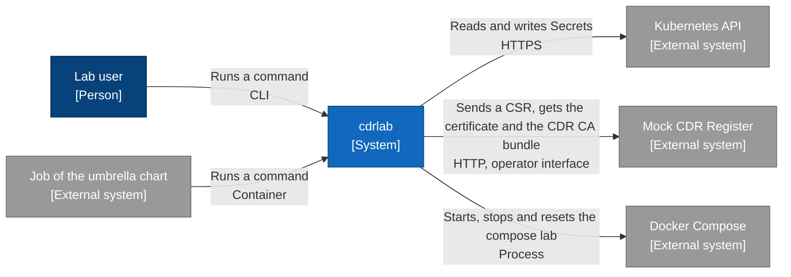

# cdrlab

`cdrlab` is the one CLI of the lab ([ADR 0035][adr-0035]). It makes the mock CDR CA and the mock public CA, gets CDR certificates through the Register, issues public TLS certificates, and starts, stops and resets the compose lab. The Jobs of a [cluster deployment](../../docs/spec/glossary.md#cluster-deployment) run its commands with Kubernetes Secrets as the output. A lab user on a host runs them with files as the output. This specification also gives the `cdrlab` image.

## Context

## Library specifications

| Library | Specification |
|---|---|
| `pkg/ca` | [CA library](../../pkg/ca/DESIGN.md) |
| `pkg/platform/buildinfo` | None. |

## Goals

- The commands that make the mock CDR CA and the CDR certificates of a cluster deployment, with no host step.
- The same commands with files as the output, for the compose lab.
- The start of the compose lab from a release, on a host that has only Docker with Compose ([ADR 0038][adr-0038]).
- One image that the Jobs of the umbrella chart run.

## Non-goals

- The public TLS certificates of a cluster deployment. cert-manager or the lab user gives them ([umbrella chart: public TLS certificates](../../charts/cdr-lab/DESIGN.md#lab-0040)).
- The revocation of a replaced certificate. It expires ([Judgement: no revocation of a replaced certificate](#cli-0102)).
- The conformance suite and the OpenID conformance suite from a release. They run the Go tests of a checkout ([ADR 0038][adr-0038]).
- Two labs on one Docker host. The compose project has one name and fixed host ports.
- A host that runs Windows with no WSL 2 ([release: the platforms of the binaries](../../tools/release/DESIGN.md#rls-0115)).

## Commands

| ID | Command | Function | Source |
|---|---|---|---|
| **CLI-0104** | `cdrlab version` | Gives the version and the commit of the build. | [Judgement: the release version only in the CLI (ADR 0039)][adr-0039] |
| **CLI-0105** | `cdrlab ca init` | Makes the mock CDR CA, with Secrets or a directory as the output. With a directory, it also makes the mock public CA. | [Judgement: one CLI for the lab (ADR 0035)][adr-0035] |
| **CLI-0106** | `cdrlab cert issue` | Gets a CDR certificate through the Register, with a Secret or files as the output. | [Judgement: CDR certificates from the Register (ADR 0032)][adr-0032] |
| **CLI-0107** | `cdrlab public-cert issue` | Issues a public TLS server certificate from the mock public CA in a directory, with files as the output. | [Judgement: public TLS certificates from the files of the public CA](#cli-0170) |
| **CLI-0108** | `cdrlab up` | Makes the CAs and the certificates of the compose lab, and starts the compose lab. | [Judgement: the compose lab from a compose project in the binary (ADR 0038)][adr-0038] |
| **CLI-0109** | `cdrlab down` | Stops the compose lab, and keeps its data. | [Judgement: the compose lab from a compose project in the binary (ADR 0038)][adr-0038] |
| **CLI-0110** | `cdrlab reset` | Stops the compose lab, and deletes its data, its CAs and its certificates. | [Judgement: the compose lab from a compose project in the binary (ADR 0038)][adr-0038] |

- **CLI-0111** The repository has no CLI for the lab other than `cdrlab`. The repository tools in `tools/` are not CLIs for the lab. ([Judgement: one CLI for the lab (ADR 0035)][adr-0035])
- **CLI-0112** `cdrlab` has no command that revokes a certificate, signs a CRL or keeps a list of revocations. ([Judgement: the Register is the CDR intermediate CA (ADR 0022)][adr-0022])
- **CLI-0113** A command that has files as the output makes 0 calls to the Kubernetes API. ([Judgement: the compose lab from a compose project in the binary (ADR 0038)][adr-0038])

## Version

- **CLI-0114** The version command gives the version, the full commit ID and the build time. For example: `cdrlab v0.3.1, commit 0123…cdef, built 2026-12-01T03:00:00Z`. ([Judgement: the release version only in the CLI (ADR 0039)][adr-0039])
- **CLI-0115** When the build sets a version, the command gives that version. For example, a release binary gives the version of its release. ([Judgement: the release version only in the CLI (ADR 0039)][adr-0039])
- **CLI-0116** When the build sets no version, and the Go module version of the binary is a [release version](../../tools/release/DESIGN.md#rls-0004), the command gives the module version. For example, `go install github.com/lukemundy/cdr-lab/cli/cdrlab/cmd/cdrlab@v0.3.1` gives `v0.3.1`. ([Go: runtime/debug.ReadBuildInfo][go-buildinfo]; [Judgement: the release version only in the CLI (ADR 0039)][adr-0039])
- **CLI-0117** When the version has neither source, it is `dev`. For example, a pseudo-version of `go install …@main` and a `go run` in a checkout give `dev`. ([Judgement: the release version only in the CLI (ADR 0039)][adr-0039])
- **CLI-0118** When the build gives no commit, the output gives `unknown` as the commit. ([Judgement: the release version only in the CLI (ADR 0039)][adr-0039])

## Kubernetes access

- **CLI-0001** In a pod, the commands use the ServiceAccount of the pod and its namespace. ([Kubernetes: access the API from a pod][k8s-api-from-pod])
- **CLI-0002** The commands read and write Secrets only in the namespace of the pod. ([Judgement: CDR certificates from the Register (ADR 0032)][adr-0032])
- **CLI-0003** When a command fails, it exits with a status that is not 0, and it writes the cause to its error output. ([POSIX: exit status][posix-exit])

## CA set-up

- **CLI-0010** With Secrets as the output, the CA set-up makes the mock CDR CA and writes two Secrets: the intermediate Secret and the CDR CA bundle Secret. The command takes the name of each Secret. ([Judgement: CDR certificates from the Register (ADR 0032)][adr-0032])
- **CLI-0011** The CA set-up makes each CA with the profiles of the CA library, and each CA key is an RSA 4096 key. ([CA library: one root CA and one issuing intermediate CA](../../pkg/ca/DESIGN.md#ca-0001); [CA library: a public CA that is separate from the CDR CA](../../pkg/ca/DESIGN.md#ca-0009); [PKI: the CA keys](../../pki/DESIGN.md#pki-0003))
- **CLI-0012** The intermediate Secret has the type `kubernetes.io/tls`. `tls.crt` has the intermediate certificate, and `tls.key` has the intermediate key. ([Kubernetes: TLS Secrets][k8s-tls-secret])
- **CLI-0013** The CDR CA bundle Secret has the CDR CA bundle in the key `ca.crt`: the intermediate certificate and then the root certificate, in PEM. ([relying parties trust the CDR CA bundle](../../pki/DESIGN.md#pki-0013))
- **CLI-0014** When the two Secrets exist, the CA set-up changes nothing, and it exits with the status 0. ([Judgement: the CA set-up changes no CA that exists](#cli-0100))
- **CLI-0015** When only one of the two Secrets exists, the CA set-up changes nothing, and it fails. The error names the Secret that is absent. ([Judgement: the CA set-up changes no CA that exists](#cli-0100))
- **CLI-0016** Security: the CA set-up writes the root key of the mock CDR CA to 0 Secrets and 0 files. ([Judgement: CDR certificates from the Register (ADR 0032)][adr-0032])
- **CLI-0017** When the CA set-up writes the first Secret and the write of the second Secret fails, it deletes the first Secret. Thus a failed run leaves no Secret of the two. ([Judgement: the CA set-up changes no CA that exists](#cli-0100))
- **CLI-0119** With a directory as the output, the CA set-up makes the mock CDR CA and the mock public CA, and writes these files in the directory. ([PKI: only the owner reads a root key](../../pki/DESIGN.md#pki-0073); [PKI: the deployment sets who reads the intermediate key](../../pki/DESIGN.md#pki-0074))
  - `cdr/root.crt`, `cdr/intermediate.crt`, `cdr/ca-bundle.pem` and `public/root.crt`, which any user can read
  - `cdr/intermediate.key`, which any user can read
  - `public/root.key`, which only the owner can read
- **CLI-0120** `cdr/ca-bundle.pem` is the CDR CA bundle: the intermediate certificate and then the root certificate, in PEM. ([relying parties trust the CDR CA bundle](../../pki/DESIGN.md#pki-0013))
- **CLI-0121** When each file of the directory exists, the CA set-up changes nothing, and it exits with the status 0. ([Judgement: the CA set-up changes no CA that exists](#cli-0100))
- **CLI-0122** When only some files of the directory exist, the CA set-up changes nothing, and it fails. The error names a file that is absent. ([Judgement: the CA set-up changes no CA that exists](#cli-0100))
- **CLI-0123** When a write of a file fails, the CA set-up deletes each file that it wrote in that run. ([Judgement: the CA set-up changes no CA that exists](#cli-0100))

## CDR certificate

- **CLI-0030** The certificate command gets a CDR certificate through the Register issue path, and writes it to the output: a Secret or files. ([Judgement: CDR certificates from the Register (ADR 0032)][adr-0032])
  - a server certificate for a data holder brand, [through its issue path](../../services/register/design/certificate-management.md#reg-0634)
  - a client certificate for a software product, [through its issue path](../../services/register/design/certificate-management.md#reg-0632)
- **CLI-0031** The command takes these inputs. ([Register: certificate management](../../services/register/design/certificate-management.md#reg-0600))
  - the URL of the Register operator interface, and the operator token
  - the kind of the certificate, and the identifiers of the legal entity and of the brand or the software product
  - the CN and the O of the subject
  - for a server certificate, the DNS names
  - the output: the name of the Secret, or the certificate file and the key file
- **CLI-0032** The command makes a new RSA 2048 key and a CSR with [the CSR profile of the CA library](../../pkg/ca/DESIGN.md#ca-0010). ([CDS: Certificate Signing Request Profile][cds-csr-profile])
- **CLI-0033** Security: the command sends the CSR only, never the private key. ([Register: no private key](../../services/register/design/certificate-management.md#reg-0603))
- **CLI-0034** With a Secret as the output, the Secret has the type `kubernetes.io/tls`. ([Kubernetes: TLS Secrets][k8s-tls-secret])
  - `tls.crt`: the certificate chain of the issue response
  - `tls.key`: the private key
  - `ca.crt`: the CDR CA bundle from the Register
- **CLI-0035** When the output has a certificate that meets each of these conditions, the command changes nothing, and it exits with the status 0. ([Judgement: a renewal window of 30 days](#cli-0101))
  - It expires more than the renewal window after the time of the run.
  - It chains to the CDR CA bundle of the Register.
  - It has the subject and the DNS names of the inputs.
  - Its key agrees with the key of the output.
- **CLI-0036** The renewal window is 30 days. An input can give a different window. ([Judgement: a renewal window of 30 days](#cli-0101))
- **CLI-0037** Integrity: when the issue fails, the command does not change the output, and it fails. For example, the Register is not ready, or it refuses the CSR. ([Judgement: a renewal window of 30 days](#cli-0101))
- **CLI-0038** When the Register refuses the CSR, the error gives the status and the `detail` of the response. ([RFC 9457][rfc9457])
- **CLI-0039** The command does not revoke the certificate that it replaces. ([Judgement: no revocation of a replaced certificate](#cli-0102))
- **CLI-0124** With files as the output, the command writes the certificate chain of the issue response to the certificate file, and the private key to the key file, in PEM. ([RFC 8555, section 9.1][rfc8555-chain]; [RFC 7468][rfc7468])
- **CLI-0125** Only the owner can read a key file that the command writes. When an input permits it, any user can read the key file. ([Judgement: a key file for the owner only, by default](#cli-0171))
- **CLI-0126** Integrity: the command replaces each file as one unit. A reader of the file gets the earlier file or the new file, never a part of a file. ([the reload of a certificate file](../../pkg/cds/DESIGN.md#cdsl-0089))
- **CLI-0127** When an input gives a CSR file, the command sends that CSR, and it writes only the certificate file. It takes the subject and the DNS names from the CSR. ([Judgement: an issue from the CSR of a lab user](#cli-0172))
- **CLI-0128** When an input gives a CSR file and also a subject, a DNS name or a key file, the command fails. ([Judgement: an issue from the CSR of a lab user](#cli-0172))
- **CLI-0129** With a CSR file, the key of [the renewal check](#cli-0035) is the public key of the CSR. ([Judgement: an issue from the CSR of a lab user](#cli-0172))

## Public TLS certificate

- **CLI-0130** The public certificate command issues a TLS server certificate from the mock public CA in the directory of the input, for the DNS names of the input. The first DNS name is the CN. ([CA library: the profile of a public TLS server certificate](../../pkg/ca/DESIGN.md#ca-0038); [CA library: the subject of a public TLS server certificate](../../pkg/ca/DESIGN.md#ca-0039))
- **CLI-0131** The command makes a new RSA 2048 key, and writes the certificate file and the key file with the rules of the [CDR certificate files](#cli-0124). ([Judgement: public TLS certificates from the files of the public CA](#cli-0170))
- **CLI-0132** When the certificate file has a certificate that meets each of these conditions, the command changes nothing, and it exits with the status 0. ([Judgement: a renewal window of 30 days](#cli-0101))
  - It expires more than the renewal window after the time of the run.
  - It chains to the public root certificate of the directory.
  - It has the DNS names of the inputs.
  - Its key agrees with the key file.
- **CLI-0133** The command makes 0 network calls. ([Judgement: public TLS certificates from the files of the public CA](#cli-0170))

## Compose lab

`cdrlab up` has a source mode for a checkout of the repository, and a release mode for a host with no checkout ([ADR 0038][adr-0038]).

- **CLI-0134** The lab directory is the current directory. An input gives a different directory. ([Judgement: the current directory as the lab directory](#cli-0173))
- **CLI-0135** The CAs and the certificates of the compose lab are in `.lab/pki` of the lab directory. ([Judgement: the current directory as the lab directory](#cli-0173))
- **CLI-0136** `cdrlab` runs Docker Compose as `docker compose`. When the environment variable `CDRLAB_COMPOSE` has a value, `cdrlab` runs that command. For example, `docker-compose`. ([Judgement: the Compose command from the environment](#cli-0174))
- **CLI-0137** An input selects the source mode. In the source mode, `cdrlab up` uses the compose project of the lab directory, and Compose builds the images. ([Judgement: the compose lab from a compose project in the binary (ADR 0038)][adr-0038])
- **CLI-0138** In the source mode, an input makes Compose use the images that are there, with no build. For example, the images that CI loads. ([Judgement: the compose lab from a compose project in the binary (ADR 0038)][adr-0038])
- **CLI-0139** The binary contains the compose project of its commit: the compose file, the certificate list, the seed file of the Register and the set-up SQL files of the lab PostgreSQL. ([Judgement: the compose lab from a compose project in the binary (ADR 0038)][adr-0038])
- **CLI-0140** In the release mode, `cdrlab up` writes the compose project of the binary into the lab directory, and records the version of the binary there. ([Judgement: the compose lab from a compose project in the binary (ADR 0038)][adr-0038])
- **CLI-0141** In the release mode, Compose pulls the image of each service from `ghcr.io/lukemundy/cdr-lab/<service>`, with the version of the binary as the tag. ([release: the version tag of each image](../../tools/release/DESIGN.md#rls-0030); [Judgement: the compose lab from a compose project in the binary (ADR 0038)][adr-0038])
- **CLI-0142** In the release mode, an input gives a different image repository prefix, and an input gives a different image tag. For example, `ghcr.io/lukemundy/cdr-lab/rehearsal` and `rehearsal-<run ID>`. ([release: the images of a rehearsal](../../tools/release/DESIGN.md#rls-0014))
- **CLI-0143** When the version of the binary is not a [release version](../../tools/release/DESIGN.md#rls-0004) and no input gives an image tag, the release mode changes nothing, and it fails. The error tells the user to use the source mode or a release binary. ([Judgement: the compose lab from a compose project in the binary (ADR 0038)][adr-0038])
- **CLI-0144** When the lab directory has a compose file and no version record of `cdrlab`, the release mode changes nothing, and it fails. For example, the lab directory is a checkout of the repository. ([Judgement: the release mode changes only a lab of its own version](#cli-0175))
- **CLI-0145** When the version record of the lab directory is not the version of the binary, the release mode changes nothing, and it fails. The error gives the two versions, and tells the user to run `cdrlab reset`. ([Judgement: the release mode changes only a lab of its own version](#cli-0175))

## Start of the compose lab

- **CLI-0146** `cdrlab up` does these steps in this sequence, and it stops at the first step that fails. ([Judgement: the compose lab from a compose project in the binary (ADR 0038)][adr-0038])
  1. In the release mode, it writes the compose project.
  2. It runs [the CA set-up](#cli-0119), with `.lab/pki` as the output.
  3. It runs [the public certificate command](#cli-0130) for each public TLS certificate of the certificate list.
  4. It starts the Register and the services that the Register depends on, and waits until the Register is healthy.
  5. It runs [the certificate command](#cli-0030), with files as the output, for each CDR certificate of the certificate list.
  6. It starts the other services, and waits until each service is healthy or has completed.
- **CLI-0147** The certificate list gives the URL of the Register operator interface from the host, and the operator token. For each certificate, it gives the inputs of its command and its files. ([Judgement: the compose lab from a compose project in the binary (ADR 0038)][adr-0038])
- **CLI-0148** `cdrlab up` gets each certificate of the certificate list, also a certificate of a service that it does not start. For example, the certificates of the three other preset brands. ([Judgement: each certificate of the list at each start](#cli-0176))
- **CLI-0149** Any user can read each key file of the certificate list. ([PKI: lab keys that any user can read](../../pki/DESIGN.md#pki-0077))
- **CLI-0150** When the inputs name services, `cdrlab up` starts only those services and their dependencies in step 6. ([Compose: up][compose-up])
- **CLI-0151** An input also starts the three other preset brands (the compose profile `all-banks`). ([Judgement: one preset brand by default](../../services/dataholder/design/deployment.md#dh-1360))
- **CLI-0152** `cdrlab up` starts the telemetry backend, unless an input turns it off. With telemetry off, the services export no telemetry. ([Judgement: the compose lab from a compose project in the binary (ADR 0038)][adr-0038])
- **CLI-0153** When a wait of step 4 or step 6 takes more than 60 seconds, `cdrlab up` fails, and the error names each service that is not healthy. An input gives a different time. ([Compose: up][compose-up])

## Stop and reset of the compose lab

- **CLI-0154** `cdrlab down` stops and removes the containers of each compose profile. It keeps the volumes and `.lab/pki`. ([Judgement: the compose lab from a compose project in the binary (ADR 0038)][adr-0038])
- **CLI-0155** `cdrlab reset` stops and removes the containers and the volumes of each compose profile, and deletes `.lab/pki`. ([PKI: a lab reset deletes the CAs and the Register database](../../pki/DESIGN.md#pki-0065))
- **CLI-0156** In the release mode, `cdrlab reset` also deletes the compose project and the version record that `cdrlab up` wrote. It deletes no other file. ([Judgement: the release mode changes only a lab of its own version](#cli-0175))
- **CLI-0157** When the lab directory has no lab, `cdrlab down` and `cdrlab reset` change nothing, and exit with the status 0. ([Judgement: the CA set-up changes no CA that exists](#cli-0100))

## Image

- **CLI-0050** CI publishes the `cdrlab` image from `main` to `ghcr.io/lukemundy/cdr-lab/cdrlab`, with the rules of the image of a service. ([data holder: the publication of the image](../../services/dataholder/design/deployment.md#dh-1325); [Judgement: the image of the lab CLI (ADR 0035)][adr-0035])
  - The tags are the full and the short commit ID.
  - The image is an OCI image index for `linux/amd64` and `linux/arm64`.
  - CI publishes it only after its gate jobs pass, and for each commit that changes an input of the image.
- **CLI-0051** The inputs of the image are the Go code of `cli/cdrlab`, the Go code of `pkg/`, `go.mod`, `go.sum` and the `Dockerfile` of `cdrlab`. ([Judgement: the image job runs for each input of the image](../../services/dataholder/design/deployment.md#dh-1372))
- **CLI-0052** The image has a distroless base image, the `cdrlab` binary and the licence notices of its third-party code in `/licenses/`. ([Judgement: the image of the lab CLI (ADR 0035)][adr-0035])
- **CLI-0053** The image runs as a user that is not root. ([Judgement: the image of the lab CLI (ADR 0035)][adr-0035])

## Non-functional requirements

- **CLI-0060** Security: the commands write 0 private keys and 0 operator tokens to their output, their error output or their logs. ([Judgement: CDR certificates from the Register (ADR 0032)][adr-0032])
- **CLI-0061** Telemetry: the commands send no telemetry. ([Judgement: the commands send no telemetry](#cli-0103))
- **CLI-0062** Integrity: a run again of a command that completed, with the same inputs, changes nothing. ([Judgement: the CA set-up changes no CA that exists](#cli-0100); [Judgement: a renewal window of 30 days](#cli-0101))
- **CLI-0158** Portability: in the release mode, `cdrlab up`, `cdrlab down` and `cdrlab reset` run 0 programs on the host other than Docker Compose. For example, no Go, Node, mise, git or openssl. ([Judgement: the compose lab from a compose project in the binary (ADR 0038)][adr-0038])

## Judgements

### CLI-0100 The CA set-up changes no CA that exists

- Kind: choice
- Basis: Step 3.3. Each certificate that the Register issued chains to the intermediate, and the Register keeps the revocations of that intermediate ([PKI: the Register keeps the only list of revocations](../../pki/DESIGN.md#pki-0050)).
- Reason: A new CA under a running Register makes each issued certificate fail. One Secret or file with no other is a broken state, and a fresh deployment is the simplest correction.

### CLI-0101 A renewal window of 30 days

- Kind: choice
- Basis: Step 3.3. A CDR certificate is valid for 13 months ([CA library: the validity of a CDR certificate](../../pkg/ca/DESIGN.md#ca-0026)). The CDS gives no renewal time.
- Reason: A daily run then has 30 tries before a certificate expires, and the old certificate stays in use after a failed try. A renewal also occurs when the CA or the names change, so a change of the values takes effect at the next run.

### CLI-0102 No revocation of a replaced certificate

- Kind: choice
- Basis: Step 3.3. The CDS permits a renewal with the same subject ([CA library: no check of a unique subject DN](../../pkg/ca/DESIGN.md#ca-0037)). A replaced lab certificate has no compromise.
- Reason: Its key is only in the output, which the command writes again. A revocation adds a call that can fail after a successful renewal.

### CLI-0103 The commands send no telemetry

- Kind: choice
- Basis: Step 3.3. A Job shows its result as its status and its logs ([Kubernetes: Jobs][k8s-job]).
- Reason: A command runs for seconds. The Register records each server certificate issue, and the trace of the Register shows each request.

### CLI-0170 Public TLS certificates from the files of the public CA

- Kind: choice
- Basis: Step 3.3. The Register is not a public CA ([Judgement: no server certificate for a data recipient](../../services/register/design/certificate-management.md#reg-0647)), and the public CA is separate from the CDR CA ([CA library: a public CA that is separate from the CDR CA](../../pkg/ca/DESIGN.md#ca-0009)).
- Reason: The public root key is only in the lab directory, so the host issues the public TLS certificates of the compose lab. A cluster deployment gets them from cert-manager.

### CLI-0171 A key file for the owner only, by default

- Kind: choice
- Basis: Step 3.2. [CWE-732][cwe-732] lists a permission that is too wide on a critical resource as a weakness. The containers of the compose lab read the keys as a different user ([Judgement: lab keys that any user can read](../../pki/DESIGN.md#pki-0095)).
- Reason: The default must suit each deployment, so it is the narrow permission. `cdrlab up` gives the wider permission for the compose lab only.

### CLI-0172 An issue from the CSR of a lab user

- Kind: choice
- Basis: Step 3.1. A participant gives a CSR, and the CA never gets its private key ([Register: no private key](../../services/register/design/certificate-management.md#reg-0603)).
- Reason: A lab user can test software that makes its own key. The Register checks the names, so the command sends the CSR as it is.

### CLI-0173 The current directory as the lab directory

- Kind: choice
- Basis: Step 3.2. Compose finds the compose file in the current directory ([Compose: `docker compose`][compose-cli]). The mise tasks run in the root of the repository.
- Reason: The same rule then gives the root of a checkout in the source mode, and the directory of the user in the release mode. A fixed directory of the user is a value that differs on each operating system.

### CLI-0174 The Compose command from the environment

- Kind: choice
- Basis: Step 3.2. Docker installs Compose as the plugin `docker compose` ([Docker: install Compose][compose-install]). `mise.toml` pins the program `docker-compose`, and a Podman host uses it with the Docker API of Podman.
- Reason: A host with only Docker needs no setting. A developer gets the pinned version with one variable, which mise sets.

### CLI-0175 The release mode changes only a lab of its own version

- Kind: choice
- Basis: Step 3.3. A release makes no promise about the data of a deployment while the major version is 0 ([ADR 0027][adr-0027]).
- Reason: The images of a different version can fail on the data of the lab, and the cause is then not clear. A refusal with a clear error costs a reset, and the lab data has no value. The record also stops a write over a checkout or another compose project.

### CLI-0176 Each certificate of the list at each start

- Kind: choice
- Basis: Step 3.3. A start with a compose profile can come after an earlier start with no profile.
- Reason: Then each service has its certificate when a later start turns on its profile. Each start also renews each certificate in its renewal window, so a lab that stays up for more than 13 months renews at its next start.

## Withdrawn

None.

[adr-0022]: ../../docs/adr/0022-run-the-mock-cdr-intermediate-ca-in-the-register.md
[adr-0027]: ../../docs/adr/0027-release-all-artifacts-with-one-version-from-a-manual-workflow-on-main.md
[adr-0032]: ../../docs/adr/0032-issue-each-cdr-certificate-of-a-deployment-through-the-register-and-renew-it-with-no-manual-step.md
[adr-0035]: ../../docs/adr/0035-give-the-lab-one-cli-cdrlab-in-cli-with-an-image-that-follows-the-rules-of-a-service-image.md
[adr-0038]: ../../docs/adr/0038-run-the-compose-lab-with-cdrlab-from-a-compose-project-in-the-binary-and-issue-its-cdr-certificates-from-the-host.md
[adr-0039]: ../../docs/adr/0039-build-the-cdrlab-binaries-in-the-release-with-the-release-version-and-sign-their-checksums-with-keyless-cosign.md
[cds-csr-profile]: https://consumerdatastandardsaustralia.github.io/standards-archives/standards-1.36.0/#certificate-signing-request-profile
[compose-install]: https://docs.docker.com/compose/install/
[compose-cli]: https://docs.docker.com/reference/cli/docker/compose/
[compose-up]: https://docs.docker.com/reference/cli/docker/compose/up/
[cwe-732]: https://cwe.mitre.org/data/definitions/732.html
[go-buildinfo]: https://pkg.go.dev/runtime/debug#ReadBuildInfo
[k8s-api-from-pod]: https://kubernetes.io/docs/tasks/run-application/access-api-from-pod/
[k8s-job]: https://kubernetes.io/docs/concepts/workloads/controllers/job/
[k8s-tls-secret]: https://kubernetes.io/docs/concepts/configuration/secret/#tls-secrets
[posix-exit]: https://pubs.opengroup.org/onlinepubs/9799919799/utilities/V3_chap02.html#tag_19_08_02
[rfc7468]: https://www.rfc-editor.org/rfc/rfc7468
[rfc8555-chain]: https://www.rfc-editor.org/rfc/rfc8555#section-9.1
[rfc9457]: https://www.rfc-editor.org/rfc/rfc9457
