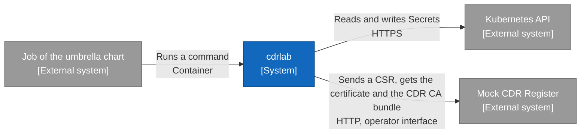

# cdrlab

`cdrlab` is the one CLI of the lab ([ADR 0035][adr-0035]). This specification gives the commands that the Jobs of a [cluster deployment](../../docs/spec/glossary.md#cluster-deployment) run: the set-up of the mock CDR CA, and the issue and renewal of a CDR certificate through the Register. It also gives the `cdrlab` image. In a cluster, each command writes Kubernetes Secrets in its own namespace.

## Context

## Library specifications

None.

## Goals

- The commands that make the mock CDR CA and the CDR certificates of a cluster deployment, with no host step.
- One image that the Jobs of the umbrella chart run.

## Non-goals

- The functions of the `pki` command, the output to files and the compose lab. A later change adds them to `cdrlab` ([ADR 0035][adr-0035]).
- The public TLS certificates of a cluster deployment. cert-manager or the lab user gives them ([umbrella chart: public TLS certificates](../../charts/cdr-lab/DESIGN.md#lab-0040)).
- The revocation of a replaced certificate. It expires ([Judgement: no revocation of a replaced certificate](#cli-0102)).

## Kubernetes access

- **CLI-0001** In a pod, the commands use the ServiceAccount of the pod and its namespace. ([Kubernetes: access the API from a pod][k8s-api-from-pod])
- **CLI-0002** The commands read and write Secrets only in the namespace of the pod. ([Judgement: CDR certificates from the Register (ADR 0032)][adr-0032])
- **CLI-0003** When a command fails, it exits with a status that is not 0, and it writes the cause to its error output. ([POSIX: exit status][posix-exit])

## CA set-up

- **CLI-0010** The CA set-up makes the mock CDR CA and writes two Secrets: the intermediate Secret and the CDR CA bundle Secret. The command takes the name of each Secret. ([Judgement: CDR certificates from the Register (ADR 0032)][adr-0032])
- **CLI-0011** The CA set-up makes the root and the intermediate with the profiles of the CA library. ([CA library: one root CA and one issuing intermediate CA](../../pkg/ca/DESIGN.md#ca-0001); [PKI: the CA keys](../../pki/DESIGN.md#pki-0003))
- **CLI-0012** The intermediate Secret has the type `kubernetes.io/tls`. `tls.crt` has the intermediate certificate, and `tls.key` has the intermediate key. ([Kubernetes: TLS Secrets][k8s-tls-secret])
- **CLI-0013** The CDR CA bundle Secret has the CDR CA bundle in the key `ca.crt`: the intermediate certificate and then the root certificate, in PEM. ([relying parties trust the CDR CA bundle](../../pki/DESIGN.md#pki-0013))
- **CLI-0014** When the two Secrets exist, the CA set-up changes nothing, and it exits with the status 0. ([Judgement: the CA set-up changes no CA that exists](#cli-0100))
- **CLI-0015** When only one of the two Secrets exists, the CA set-up changes nothing, and it fails. The error names the Secret that is absent. ([Judgement: the CA set-up changes no CA that exists](#cli-0100))
- **CLI-0016** Security: the CA set-up writes the root key to 0 Secrets and 0 files. ([Judgement: CDR certificates from the Register (ADR 0032)][adr-0032])
- **CLI-0017** When the CA set-up writes the first Secret and the write of the second Secret fails, it deletes the first Secret. Thus a failed run leaves no Secret of the two. ([Judgement: the CA set-up changes no CA that exists](#cli-0100))

## CDR certificate

- **CLI-0030** The certificate command gets a CDR certificate through the Register issue path, and writes it to a Secret. ([Judgement: CDR certificates from the Register (ADR 0032)][adr-0032])
  - a server certificate for a data holder brand, [through its issue path](../../services/register/design/certificate-management.md#reg-0634)
  - a client certificate for a software product, [through its issue path](../../services/register/design/certificate-management.md#reg-0632)
- **CLI-0031** The command takes these inputs. ([Register: certificate management](../../services/register/design/certificate-management.md#reg-0600))
  - the URL of the Register operator interface, and the operator token
  - the kind of the certificate, and the identifiers of the legal entity and of the brand or the software product
  - the CN and the O of the subject
  - for a server certificate, the DNS names
  - the name of the Secret
- **CLI-0032** The command makes a new RSA 2048 key and a CSR with [the CSR profile of the CA library](../../pkg/ca/DESIGN.md#ca-0010). ([CDS: Certificate Signing Request Profile][cds-csr-profile])
- **CLI-0033** Security: the command sends the CSR only, never the private key. ([Register: no private key](../../services/register/design/certificate-management.md#reg-0603))
- **CLI-0034** The Secret has the type `kubernetes.io/tls`. ([Kubernetes: TLS Secrets][k8s-tls-secret])
  - `tls.crt`: the certificate chain of the issue response
  - `tls.key`: the private key
  - `ca.crt`: the CDR CA bundle from the Register
- **CLI-0035** When the Secret has a certificate that meets each of these conditions, the command changes nothing, and it exits with the status 0. ([Judgement: a renewal window of 30 days](#cli-0101))
  - It expires more than the renewal window after the time of the run.
  - It chains to the CDR CA bundle of the Register.
  - It has the subject and the DNS names of the inputs.
  - Its key agrees with the key of the Secret.
- **CLI-0036** The renewal window is 30 days. An input can give a different window. ([Judgement: a renewal window of 30 days](#cli-0101))
- **CLI-0037** Integrity: when the issue fails, the command does not change the Secret, and it fails. For example, the Register is not ready, or it refuses the CSR. ([Judgement: a renewal window of 30 days](#cli-0101))
- **CLI-0038** When the Register refuses the CSR, the error gives the status and the `detail` of the response. ([RFC 9457][rfc9457])
- **CLI-0039** The command does not revoke the certificate that it replaces. ([Judgement: no revocation of a replaced certificate](#cli-0102))

## Image

- **CLI-0050** CI publishes the `cdrlab` image from `main` to `ghcr.io/lukemundy/cdr-lab/cdrlab`, with the rules of the image of a service. ([data holder: the publication of the image](../../services/dataholder/design/deployment.md#dh-1325); [Judgement: the image of the lab CLI (ADR 0035)][adr-0035])
  - The tags are the full and the short commit ID.
  - The image is an OCI image index for `linux/amd64` and `linux/arm64`.
  - CI publishes it only after its gate jobs pass, and for each commit that changes an input of the image.
- **CLI-0051** The inputs of the image are the Go code of `cli/cdrlab`, the Go code of `pkg/`, `go.mod`, `go.sum` and the `Dockerfile` of `cdrlab`. ([Judgement: the image job runs for each input of the image](../../services/dataholder/design/deployment.md#dh-1372))
- **CLI-0052** The image has a distroless base image, the `cdrlab` binary and the licence notices of its third-party code in `/licenses/`. ([Judgement: the image of the lab CLI (ADR 0035)][adr-0035])
- **CLI-0053** The image runs as a user that is not root. ([Judgement: the image of the lab CLI (ADR 0035)][adr-0035])

## Non-functional requirements

- **CLI-0060** Security: the commands write 0 private keys and 0 operator tokens to their output, their error output or their logs. ([Judgement: CDR certificates from the Register (ADR 0032)][adr-0032])
- **CLI-0061** Telemetry: the commands send no telemetry. ([Judgement: the commands send no telemetry](#cli-0103))
- **CLI-0062** Integrity: a run again of a command that completed, with the same inputs, changes nothing. ([Judgement: the CA set-up changes no CA that exists](#cli-0100); [Judgement: a renewal window of 30 days](#cli-0101))

## Judgements

### CLI-0100 The CA set-up changes no CA that exists

- Kind: choice
- Basis: Step 3.3. Each certificate that the Register issued chains to the intermediate, and the Register keeps the revocations of that intermediate ([PKI: the Register keeps the only list of revocations](../../pki/DESIGN.md#pki-0050)).
- Reason: A new CA under a running Register makes each issued certificate fail. One Secret with no other is a broken state, and a fresh deployment is the simplest correction.

### CLI-0101 A renewal window of 30 days

- Kind: choice
- Basis: Step 3.3. A CDR certificate is valid for 13 months ([CA library: the validity of a CDR certificate](../../pkg/ca/DESIGN.md#ca-0026)). The CDS gives no renewal time.
- Reason: A daily run then has 30 tries before a certificate expires, and the old certificate stays in use after a failed try. A renewal also occurs when the CA or the names change, so a change of the values takes effect at the next run.

### CLI-0102 No revocation of a replaced certificate

- Kind: choice
- Basis: Step 3.3. The CDS permits a renewal with the same subject ([CA library: no check of a unique subject DN](../../pkg/ca/DESIGN.md#ca-0037)). A replaced lab certificate has no compromise.
- Reason: Its key is only in the Secret, which the command writes again. A revocation adds a call that can fail after a successful renewal.

### CLI-0103 The commands send no telemetry

- Kind: choice
- Basis: Step 3.3. A Job shows its result as its status and its logs ([Kubernetes: Jobs][k8s-job]).
- Reason: A command runs for seconds. The Register records each server certificate issue, and the trace of the Register shows each request.

## Withdrawn

None.

[adr-0032]: ../../docs/adr/0032-issue-each-cdr-certificate-of-a-deployment-through-the-register-and-renew-it-with-no-manual-step.md
[adr-0035]: ../../docs/adr/0035-give-the-lab-one-cli-cdrlab-in-cli-with-an-image-that-follows-the-rules-of-a-service-image.md
[cds-csr-profile]: https://consumerdatastandardsaustralia.github.io/standards-archives/standards-1.36.0/#certificate-signing-request-profile
[k8s-api-from-pod]: https://kubernetes.io/docs/tasks/run-application/access-api-from-pod/
[k8s-job]: https://kubernetes.io/docs/concepts/workloads/controllers/job/
[k8s-tls-secret]: https://kubernetes.io/docs/concepts/configuration/secret/#tls-secrets
[posix-exit]: https://pubs.opengroup.org/onlinepubs/9799919799/utilities/V3_chap02.html#tag_19_08_02
[rfc9457]: https://www.rfc-editor.org/rfc/rfc9457
