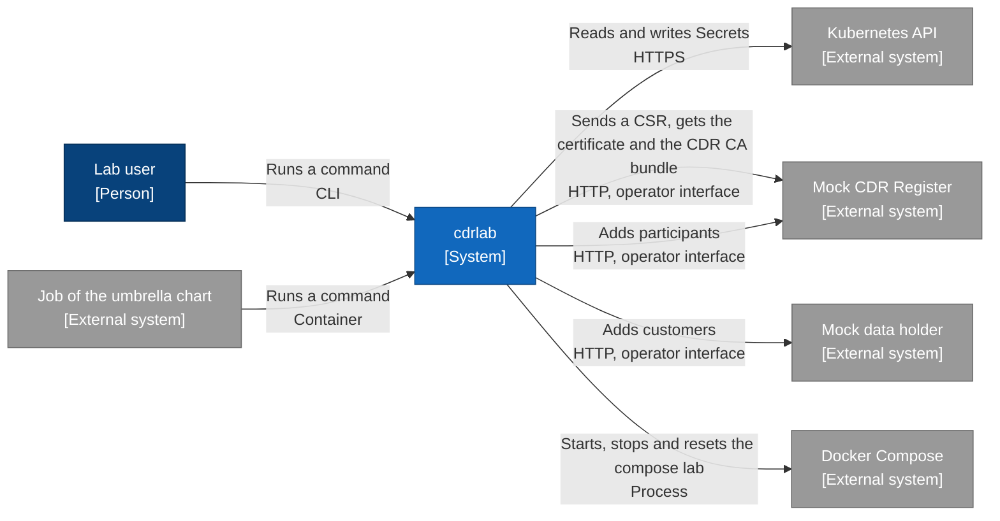

# cdrlab

`cdrlab` is the one CLI of the lab ([ADR 0035][adr-0035]). It makes the mock CDR CA and the mock public CA, gets CDR certificates through the Register, issues public TLS certificates, starts, stops and resets the compose lab, and adds participants and customers to a running lab. The Jobs of a [cluster deployment](../../../docs/spec/glossary.md#cluster-deployment) run its commands with Kubernetes Secrets as the output. A lab user on a host runs them with files as the output. This specification also gives the `cdrlab` image.

## Context

## Areas

| Area | File | Summary |
|---|---|---|
| Commands | [commands.md](commands.md) | The commands, the version, the Kubernetes access and the `cdrlab` image. |
| Certificates | [certificates.md](certificates.md) | The CA set-up, the CDR certificates through the Register and the public TLS certificates. |
| Compose lab | [compose-lab.md](compose-lab.md) | The start, the stop and the reset of the compose lab, in the source mode and in the release mode. |
| Onboarding | [onboarding.md](onboarding.md) | The add of participants to the Register and of customers to a data holder brand, through their operator interfaces. |
| Non-functional requirements | [non-functional-requirements.md](non-functional-requirements.md) | Security, telemetry, integrity and portability of all commands. |

## Library specifications

| Library | Specification |
|---|---|
| `pkg/ca` | [CA library](../../../pkg/ca/DESIGN.md) |
| `pkg/platform/buildinfo` | None. |

## Goals

- The commands that make the mock CDR CA and the CDR certificates of a cluster deployment, with no host step.
- The same commands with files as the output, for the compose lab.
- The start of the compose lab from a release, on a host that has only Docker with Compose ([ADR 0038][adr-0038]).
- One image that the Jobs of the umbrella chart run.
- The onboarding of a software product, a data holder brand and test customers into a compose lab or a cluster deployment, through the operator interfaces ([ADR 0040][adr-0040]).
- The same files for onboarding and for the seed data of the umbrella chart.

## Non-goals

- The public TLS certificates of a cluster deployment. cert-manager or the lab user gives them ([umbrella chart: public TLS certificates](../../../charts/cdr-lab/DESIGN.md#lab-0040)).
- The revocation of a replaced certificate. It expires ([Judgement: no revocation of a replaced certificate](certificates.md#cli-0102)).
- The conformance suite and the OpenID conformance suite from a release. They run the Go tests of a checkout ([ADR 0038][adr-0038]).
- Two labs on one Docker host. The compose project has one name and fixed host ports.
- A change or a removal of a participant or a customer. The operator console or a fresh deployment does it ([Judgement: add-only loads of the operator interfaces (ADR 0040)][adr-0040]).
- A host that runs Windows with no WSL 2 ([release: the platforms of the binaries](../../../tools/release/DESIGN.md#rls-0115)).

## Withdrawn

None.

[adr-0035]: ../../../docs/adr/0035-give-the-lab-one-cli-cdrlab-in-cli-with-an-image-that-follows-the-rules-of-a-service-image.md
[adr-0038]: ../../../docs/adr/0038-run-the-compose-lab-with-cdrlab-from-a-compose-project-in-the-binary-and-issue-its-cdr-certificates-from-the-host.md
[adr-0040]: ../../../docs/adr/0040-add-participants-and-customers-with-add-only-loads-of-the-operator-interfaces-from-cdrlab-and-from-the-umbrella-values.md
