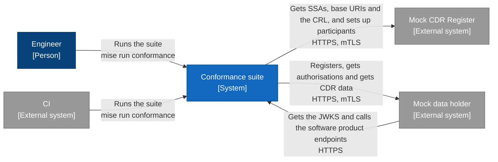

# Conformance suite

The conformance suite in `conformance/` checks that the deployed components of the lab obey the Consumer Data Right (CDR). It is a set of black-box tests of the deployed Register and data holder. When a test of the suite fails, a component does not conform. This specification gives the rules that each test of the suite obeys.

## Context

## Library specifications

| Library | Specification |
|---|---|
| `pkg/openapi` | None. |

## Goals

- The black-box tests of the deployed Register and data holder, in one Go package for each component. The Register serves the CRL of the mock CDR PKI ([ADR 0022][adr-0022]), so the Register package has the CRL tests.
- The pinned CDS OpenAPI specifications, in the `spec/` directory of each package.
- The test code that the two packages share.

## Non-goals

- The OpenID conformance run (build tag `openid`, `mise run openid-conformance`). It runs the test plan of the OpenID Foundation, and it does not run in CI ([README][readme]).
- The interfaces that the CDR does not define: the operator interfaces, the health probes and the operator consoles. The Go tests of each service test them, and the browser tests test the UIs ([ADR 0019][adr-0019]).

## Subject of a test

- **CONF-0001** A test checks only behaviour that the CDR defines: the CDS, the CDR Rules, and the security profile and PKI that the CDS gives. ([Judgement: the conformance suite tests only CDR conformance (ADR 0019)][adr-0019])
- **CONF-0002** A test can call an interface that the CDR does not define to set up a state. For example, a test changes a status on the Register or adds a customer to the data holder. ([Judgement: the conformance suite tests only CDR conformance (ADR 0019)][adr-0019])
- **CONF-0003** When a test calls an interface that the CDR does not define, the test does not check that interface. Its subject is a CDR behaviour. ([Judgement: the conformance suite tests only CDR conformance (ADR 0019)][adr-0019])
- **CONF-0004** A requirement of an interface that the CDR does not define gets a Go test in its service. `mise run test` runs that test with no part of the lab deployment other than PostgreSQL. ([Judgement: the conformance suite tests only CDR conformance (ADR 0019)][adr-0019])

## Black-box tests

- **CONF-0005** A test calls the deployed components only through their network interfaces, as a CDR participant or a consumer does. For example, a test does not read a database, and it does not import the code of a service. ([Judgement: tests call only the network interfaces of the deployment](#conf-0034))
- **CONF-0006** A test acts as the participant does, in these ways. ([the conformance suite acts as a participant](../services/dataholder/design/non-functional-requirements.md#dh-0015))
  - It finds the base URIs of a brand through the Register.
  - It gets each SSA from the Register.
  - It acts as the browser of the consumer in an authorisation flow.
- **CONF-0007** A test checks each response of a CDS API against the pinned CDS OpenAPI specification of the target CDS version, in addition to the checks of the test. ([Judgement: tests check each CDS response against the pinned specification](#conf-0035))
- **CONF-0008** Each pinned specification file is a copy of the CDS file, with no change. ([Judgement: pinned specifications with no change](#conf-0036))
- **CONF-0009** A `SOURCE.md` file next to the pinned specification files gives their source and checksum. ([Judgement: pinned specifications with no change](#conf-0036))

## Environment

- **CONF-0010** The suite runs in the `conformance` compose service on the lab network, with `mise run conformance`. ([Judgement: the suite runs on the lab network](#conf-0037))
- **CONF-0011** The suite serves the JWKS and the endpoints of the software products that it acts as. ([Judgement: the suite runs on the lab network](#conf-0037))
- **CONF-0012** A test gets each setting from an environment variable, which `compose.yaml` gives. ([Judgement: a missing setting fails the test](#conf-0038))
- **CONF-0013** When an environment variable is not set, the test fails. It does not skip. ([Judgement: a missing setting fails the test](#conf-0038))
- **CONF-0014** The test files have the build tag `conformance`, so `mise run test` does not run them. ([Judgement: a build tag for the conformance tests](#conf-0039))

## Runs and data

- **CONF-0015** The suite passes in one run after a new lab: `mise run reset && mise run up && mise run conformance`. ([Judgement: the suite passes in one run after a new lab](#conf-0040))
- **CONF-0016** A test can change the seed data in a way that cannot be reversed. Thus, a second run with no lab reset can fail. ([Judgement: the suite passes in one run after a new lab](#conf-0040))
- **CONF-0017** No test, requirement or acceptance criterion needs a second run of the suite. ([Judgement: no second run of the suite](#conf-0041))
- **CONF-0018** One test proves a full sequence. For example, one test registers, deletes and registers again. ([Judgement: one test for each sequence](#conf-0042))
- **CONF-0019** When a step of a sequence fails, the test stops, because the next steps depend on it. ([Judgement: one test for each sequence](#conf-0042))
- **CONF-0020** Each test package has its own participants in the seed files and its own listen ports. ([Judgement: the test packages run at the same time](#conf-0043))
- **CONF-0021** `go test` runs the test packages at the same time, not one after the other. ([Judgement: the test packages run at the same time](#conf-0043))
- **CONF-0022** A test that changes a state uses data that no other test uses. For example, the test has its own participant, customer or account number. ([Judgement: each test changes only its own data](#conf-0044))
- **CONF-0023** All customer, account and transaction data in the tests is invented. ([Judgement: invented data only](#conf-0045))
- **CONF-0024** Telemetry: the rule for CDR data and personal information in telemetry applies also to the mock data of the tests. ([no CDR data or personal information in telemetry](../pkg/platform/telemetry/DESIGN.md#tele-0004))

## Time

- **CONF-0025** Performance: a fixed wait in a test is 2 seconds or less. ([Judgement: no long waits in the suite](#conf-0046))
- **CONF-0026** A poll stops as soon as its condition is true. ([Judgement: no long waits in the suite](#conf-0046))
- **CONF-0027** The limit of a poll is the time that the requirement or the lab configuration gives. For example, the limit is the status interval of the data holder in `compose.yaml`. ([Judgement: no long waits in the suite](#conf-0046))
- **CONF-0028** The suite does not check a time rule with a longer period. A Go test that controls the time proves it in-process, in the service or in its library in `pkg/`. For example, the suite does not check the life of an authorisation code or the 10 minutes of an authorisation flow. ([Judgement: no long waits in the suite](#conf-0046))

## Exceptions

Each row is an exception to the subject of a test or to the check of each CDS response.

| ID | Test | Exception | Source |
|---|---|---|---|
| **CONF-0029** | The data holder tests of the end of eligibility, the removal of a software product and the notices | The test reads the arrangements of a customer from the operator interface. It uses them to see the end reason of an arrangement and the outcome of a notice. | [Judgement: the operator interface shows the end of an arrangement](#conf-0047) |
| **CONF-0030** | The data holder test of the logo | The test checks the `Content-Security-Policy` and `X-Content-Type-Options` headers of the logo, which the CDR does not define. | [Judgement: the logo test checks the headers that stop a script](#conf-0048) |
| **CONF-0031** | The data holder test of the stylesheets and the font of the authentication page | The test checks that the stylesheets of the page, and one font that they refer to, load from the origin of the page. The CDR does not define the styles of the page. | [Judgement: the test checks that the authentication page styles load from its origin](#conf-0049) |
| **CONF-0032** | The Register tests of Get SSA | The test does not check a response with the status 200 against the specification. | [Judgement: no schema check of the SSA body](#conf-0050) |
| **CONF-0033** | The Register test of an unknown path | The test does not check the response against the specification. | [Judgement: no schema check of an unknown path](#conf-0051) |

## Judgements

### CONF-0034 Tests call only the network interfaces of the deployment

- Kind: choice
- Basis: Step 3.2. A conformance test checks the deployed component from the outside, as a participant does ([ADR 0019][adr-0019]).
- Reason: The suite then tests the deployment, and it can run against a different implementation of a component. The Go `internal` rule makes an import of service code impossible.

### CONF-0035 Tests check each CDS response against the pinned specification

- Kind: choice
- Basis: Step 3.2. The CDS OpenAPI specification gives the fields, types and enumerations of each response ([ADR 0011][adr-0011]).
- Reason: A field, a type or an enumeration that does not agree with the CDS then fails in each test that gets it.

### CONF-0036 Pinned specifications with no change

- Kind: choice
- Basis: Step 1. The CDS text and specifications as written are the first source.
- Reason: An edit makes the check agree with the component, not with the CDS. The checksum shows that the file has no edit.

### CONF-0037 The suite runs on the lab network

- Kind: choice
- Basis: Step 3.3. The data holder calls the JWKS and the endpoints of each software product ([the conformance suite acts as a participant](../services/dataholder/design/non-functional-requirements.md#dh-0015)).
- Reason: The components then call the suite as they call a participant.

### CONF-0038 A missing setting fails the test

- Kind: choice
- Basis: Step 3.2. A check that does not run must not pass.
- Reason: A skip hides a test that did not run, so CI can pass with no check.

### CONF-0039 A build tag for the conformance tests

- Kind: choice
- Basis: Step 3.3. `mise run test` needs only PostgreSQL ([README: Development][readme-development]).
- Reason: The conformance tests need the full lab deployment. A build tag keeps them out of `mise run test` with no other configuration.

### CONF-0040 The suite passes in one run after a new lab

- Kind: choice
- Basis: Step 3.3. A new lab is quick to make, and its data has no value ([AGENTS.md][agents]).
- Reason: A test that cannot reverse its change then needs no clean-up code.

### CONF-0041 No second run of the suite

- Kind: choice
- Basis: Step 3.3. The suite is the slowest check in CI ([ADR 0019][adr-0019]).
- Reason: A second run doubles that time.

### CONF-0042 One test for each sequence

- Kind: choice
- Basis: Step 3.3. `go test` does not keep tests or runs in a sequence.
- Reason: The alternative is a sequence across tests or across runs, which can run out of order.

### CONF-0043 The test packages run at the same time

- Kind: choice
- Basis: Step 3.3. The test packages are independent.
- Reason: A run of the packages one after the other makes the suite slower.

### CONF-0044 Each test changes only its own data

- Kind: choice
- Basis: Step 3.3. `go test` gives no fixed sequence for the tests of a package.
- Reason: The tests of a package can then run in any sequence.

### CONF-0045 Invented data only

- Kind: choice
- Basis: Step 3.1. The CDR protects the data of real consumers ([README: Data][readme-data]).
- Reason: Invented data cannot disclose the data of a real person. The tests then need no controls for real data.

### CONF-0046 No long waits in the suite

- Kind: choice
- Basis: Step 3.3. A Go test that controls the time proves a time rule with no wait.
- Reason: A long wait makes each run of the suite slower.

### CONF-0047 The operator interface shows the end of an arrangement

- Kind: choice
- Basis: Step 3.1. The subject is a CDR behaviour, but no CDR API shows the end reason of an arrangement or the outcome of a notice to the test.
- Reason: In production, the consumer dashboard of the data holder shows these values. The operator interface gives the same values to the test.

### CONF-0048 The logo test checks the headers that stop a script

- Kind: choice
- Basis: Step 3.1. The CDS makes the `logoUri` of a brand mandatory ([CDS: Register API schemas][cds-register-schemas]), and a data recipient opens that URL.
- Reason: Only the URL that the Register gives proves that the deployed public listener serves the logo with the headers that stop a script in it ([data holder specification][dataholder-design]).

### CONF-0049 The test checks that the authentication page styles load from its origin

- Kind: choice
- Basis: Step 3.3. The data holder pages work with no styles ([data holder specification][dataholder-design]).
- Reason: Only a request to the deployed public listener shows that the image has the build of the styles and the fonts.

### CONF-0050 No schema check of the SSA body

- Kind: choice
- Basis: Step 3.3. The response body is a JWT with no JSON quotes ([the body of the SSA response](../services/register/design/software-statement-assertion.md#reg-0414)).
- Reason: The string schema of the specification cannot validate that body.

### CONF-0051 No schema check of an unknown path

- Kind: choice
- Basis: Step 3.3. The specification has no such path ([an unknown path gets 404](../services/register/design/register-apis.md#reg-0318)).
- Reason: The specification has no schema to validate the response against. The test checks the status and the error code only.

## Withdrawn

None.

[adr-0011]: ../docs/adr/0011-domain-data-as-typed-go.md
[adr-0019]: ../docs/adr/0019-limit-the-conformance-suite-to-cdr-conformance.md
[adr-0022]: ../docs/adr/0022-run-the-mock-cdr-intermediate-ca-in-the-register.md
[agents]: ../AGENTS.md
[cds-register-schemas]: https://consumerdatastandardsaustralia.github.io/standards-archives/standards-1.36.0/#cdr-register-api-schemas
[dataholder-design]: ../services/dataholder/design/README.md
[readme]: ../README.md
[readme-data]: ../README.md#data
[readme-development]: ../README.md#development
