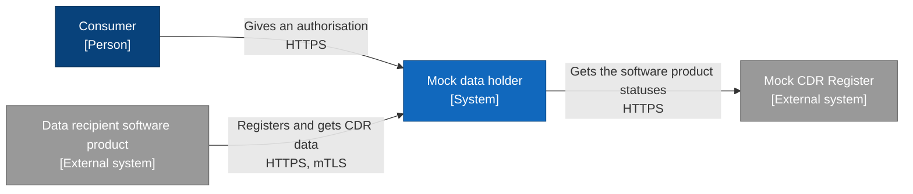

# Specification conventions

This file gives the detailed rules for how to write a specification. [ADR 0024][adr-0024] gives the structure and the reasons. This file does not repeat the ADR. It gives only the detail that the ADR leaves to it.

These rules can change without a new ADR, if they obey ADR 0024.

The [glossary](glossary.md) gives one term for each concept. Use only those terms.

## Writing style

Write all text in [ASD-STE100 Simplified Technical English][ste100]. These rules are the most important:

- Write one idea in each sentence.

  Not: "The data holder refuses the request and logs the error, unless the client is ACTIVE, in which case it continues."
  Use: "When the software product is not ACTIVE, the data holder refuses the request. The data holder logs the refusal."

- Start a sentence with a concrete subject and its verb.

  Not: "For each request, a check of the token is made."
  Use: "The data holder checks the token of each request."

- Use the active voice and the present tense.

  Not: "The token will be refused."
  Use: "The data holder refuses the token."

- Use one "of" in a phrase at most.

  Not: "the end of the validity of the certificate of the client"
  Use: "the expiry time of the client certificate"

- Use a list, not a sentence with many "or" alternatives.

  Not: "The reason is unspecified, keyCompromise, superseded or cessationOfOperation."
  Use: "The reason is one of these:", then a list.

- Give an example after each abstract rule. Start it with "For example".
- Keep a sentence short: 20 words or fewer for an instruction, 25 words or fewer for a description.
- Use inclusive language, for example allowlist and blocklist, primary and replica.

## Templates

Each template shows the headings in their sequence. A heading in angle brackets is a name that you choose. Each other heading is fixed, and the check finds it by its text.

The fixed `##` headings are:

- `Context`
- `Areas`
- `Library specifications`
- `Goals`
- `Non-goals`
- `Judgements`
- `Withdrawn`

Each other `##` heading in a specification is a group of requirements.

### One-file specification

The file is `DESIGN.md` in the directory of the component. It has the sections of the overview too, so that a split into a `design/` directory only moves text.

~~~markdown
# <Component name>

<Summary: what the component is and does, in one short paragraph.>

## Context

<The context diagram. See "Context diagram".>

## Library specifications

| Library | Specification |
|---|---|
| `pkg/<library>` | [<descriptive name>](<relative path>/DESIGN.md) |

## Goals

- <What the component does for its users.>

## Non-goals

- <What the component does not do, and where a reader finds it.>

## <Group of requirements>

<Optional: one paragraph that summarises the group. It has no rule.>

- <a id="xx-0001"></a>**XX-0001** <Requirement.> (<Source group>)

## Judgements

### <a id="xx-0002"></a>XX-0002 <Title>

- Kind: <choice | conflict | gap>
- Basis: <Step of the sources process, with links.>
- Reason: <Three sentences or fewer.>

## Withdrawn

- <a id="xx-0003"></a>**XX-0003** Removed.

<Link definitions>
~~~

When the component imports no `pkg/` library, the Library specifications section has the line `None.` in place of the table. When no identifier is withdrawn, the Withdrawn section has the line `None.`. When a library has no specification, its Specification cell is `None.`.

### Overview of a `design/` directory

The file is `design/README.md`. It has no requirements and no judgements.

~~~markdown
# <Component name>

<Summary: what the component is and does, in one short paragraph.>

## Context

<The context diagram.>

## Areas

| Area | File | Summary |
|---|---|---|
| <Area name> | [<file>.md](<file>.md) | <One sentence.> |

## Library specifications

<As in the one-file specification.>

## Goals

## Non-goals

## Withdrawn

<The withdrawn list of the full specification.>

<Link definitions>
~~~

The Areas table is the full list of the area files. Each `.md` file in the directory, except `README.md`, has one row.

### Area file

The file is `design/<area>.md`. The file name is the area name in lower-kebab-case, for example `authorisation.md`.

~~~markdown
# <Component name>: <Area name>

<Summary: what this area covers, in one short paragraph.>

## <Group of requirements>

- <a id="xx-0010"></a>**XX-0010** <Requirement.> (<Source group>)

## Judgements

<The judgements of the requirements in this file.>

<Link definitions>
~~~

An area file has no Withdrawn section. The withdrawn list is in `README.md`.

### Link definitions

A link to an external source is a reference link. Its definition is at the end of the file. The label names the source, in lower-kebab-case.

For example: `[CDS: Get Products][cds-get-products]`, with the definition `[cds-get-products]: https://consumerdatastandardsaustralia.github.io/standards-archives/standards-1.36.0/#cdr-banking-api_get-products`.

A link to a requirement, a judgement or a different file in the repository is an inline link with a relative path.

## Identifiers

### Format

An identifier is a component code, a hyphen and a number of 4 digits. For example: `DH-0042`.

- Pattern of the identifier: `^[A-Z]{2,5}-[0-9]{4}$`.
- The anchor of the identifier is the identifier in lower case. For example: `dh-0042`.

Reason for the lower case: GitHub changes each `id` attribute to lower case, and adds the prefix `user-content-`. A link with a lower-case fragment then always agrees with the anchor.

### Component codes

This table is the registry of the codes. A new specification adds its code to this table in the same change.

| Component | Code |
|---|---|
| `services/register` | `REG` |
| `services/dataholder` | `DH` |
| `pki` | `PKI` |
| `conformance` | `CONF` |
| `web/packages/ui` | `UI` |

A code has 2 to 5 capital letters. A code is not the name of a standard, and it is not an existing code with one letter changed. For example, `CDS` is the name of a standard, and `CON` is too near to `CONF`.

### Numbers

- Each component has its own numbers. They start at `0001`.
- Requirements and judgements of a component use the same numbers.
- The next number is the highest number that the component used, plus 1. The withdrawn list counts.
- A gap in the numbers has no meaning.

For example: the highest number in the Register specification and its withdrawn list is `REG-0120`. The next requirement is `REG-0121`.

Two pull requests can use the same number. The second pull request to merge rebases and gives its new identifiers the next free numbers.

### A rule that changes or moves

- A rule that changes its text, but not its intent, keeps its identifier.
- A rule that splits into two rules keeps its identifier for one of them. The other rule gets a new identifier.
- A rule that moves to a different area of the same component keeps its identifier ([ADR 0024: Identifiers][adr-0024-identifiers]).
- A rule that moves to a different component gets the next number of that component. The old identifier goes into the withdrawn list.

A change that moves or removes a rule also updates each link and each `// Verifies:` comment that uses the old identifier.

### Withdrawn list

Each entry is one list item in the Withdrawn section. It keeps the anchor of the identifier, so that an old link still goes to the entry.

An entry has one of these two forms:

```markdown
- <a id="reg-0031"></a>**REG-0031** Moved to [the revocation reasons of a CDR certificate](../../pki/DESIGN.md#pki-0044).
- <a id="reg-0032"></a>**REG-0032** Removed.
```

Pattern: `^- <a id="(?<anchor>[a-z]{2,5}-[0-9]{4})"></a>\*\*(?<id>[A-Z]{2,5}-[0-9]{4})\*\* (Moved to \[.+\]\(.+#[a-z]{2,5}-[0-9]{4}\)|Removed)\.$`

The entries are in the sequence of their numbers.

## Requirements

### List item

A requirement is one list item, on one line. Do not wrap the line.

The item has these parts, in this sequence:

1. The anchor: `<a id="dh-0042"></a>`
2. The identifier in bold: `**DH-0042**`
3. The rule: one or more sentences, with the condition first and the response last. It ends with a full stop.
4. The source group, in parentheses.

For example:

```markdown
- <a id="dh-0042"></a>**DH-0042** When a request has no `x-v` header, the data holder responds with 400 and the error code `urn:au-cds:error:cds-all:Header/Missing`. ([CDS: Versioning][cds-versioning])
```

Pattern: `^- <a id="(?<anchor>[a-z]{2,5}-[0-9]{4})"></a>\*\*(?<id>[A-Z]{2,5}-[0-9]{4})\*\* (?<rule>.+\.) \((?<sources>.+)\)$`

The anchor is the identifier in lower case.

A requirement can have a nested list, when the rule gives a set of values. The nested items are part of the rule, and they have no identifier. The source group then comes at the end of the first line.

For example:

```markdown
- <a id="pki-0021"></a>**PKI-0021** The lab operator can revoke a CDR certificate with one of these reasons. ([RFC 5280, section 5.3.1][rfc5280-reason])
  - `unspecified`
  - `keyCompromise`
  - `superseded`
```

### Table row

A table is good for a set of rules that have the same shape. Each row is one requirement.

- The first column is `ID`. Its cell has the anchor and the identifier in bold.
- The last column is `Source`. Its cell has the source group, with no parentheses.
- The other columns are yours to choose.

For example:

```markdown
| ID | Request | Software product INACTIVE | Source |
|---|---|---|---|
| <a id="dh-0210"></a>**DH-0210** | PAR endpoint | 400 `unauthorized_client` | [CDS: Data Holder Responsibilities][cds-dh-responsibilities] |
```

Each table in a group of requirements is a requirement table.

Pattern of the `ID` cell: `^<a id="(?<anchor>[a-z]{2,5}-[0-9]{4})"></a>\*\*(?<id>[A-Z]{2,5}-[0-9]{4})\*\*$`

### Source group

The source group gives one or more links, separated by `; `.

- A link to an external source names the source and its section. For example: `[CDS: Get Products][cds-get-products]`.
- A link to a judgement has text that starts with `Judgement:`, and then the title of the judgement. For example: `[Judgement: one base URI for the public endpoints](#dh-0050)`.
- A link to a requirement in a library specification can also be a source. For example: `[the CDS error response](../../pkg/<library>/DESIGN.md#xx-0007)`.
- When an ADR records the choice of a rule, the ADR is the judgement of the rule. The link to the ADR then has text that starts with `Judgement:`, and the rule needs no judgement in the specification. For example: `[Judgement: the Register is the CDR intermediate CA (ADR 0022)](../docs/adr/0022-run-the-mock-cdr-intermediate-ca-in-the-register.md)`. An ADR is never the judgement of a rule that the CDS or the ACCC gives. Link to that source.

For example: `([CDS: Participant Endpoints][cds-participant-endpoints]; [Judgement: one base URI for the public endpoints](#dh-0050))`.

An observation of a production system can be in the source group, after a link. For example: `([CP section 6.3.2][accc-cp]; observed on 2026-10-02: the intermediate is valid for 10 years)`. An observation is never the only source. When a rule has no source other than an observation, it links to a judgement. The judgement records the observation in its Basis.

### Non-functional requirements

A non-functional requirement has the same form as a different requirement. Its rule starts with its quality attribute and a colon. The rest of the rule gives a condition and a response that a test can measure, with a number and a unit.

For example:

```markdown
- <a id="dh-0300"></a>**DH-0300** Performance: on a development workstation at 50 requests each second, 95 % of API calls complete within 200 ms. ([Judgement: a response time target for the lab](#dh-0301))
```

The quality attributes are, for example: Performance, Restart, Telemetry, Secrets, Least privilege, Portability, Conformance, Local run and Health. Use the attribute that the existing requirements use, when one agrees.

- A non-functional requirement of one area is in that area.
- A non-functional requirement of all the component is in a one-file specification, in a group with the name `Non-functional requirements`. In a `design/` directory, it is in the area file `non-functional-requirements.md`.

## Judgements

Judgements are in the Judgements section of the file that has their requirements. Each judgement has an `###` heading and three list items, in this sequence:

- `Kind:` one of these words:
  - `choice`: a choice that the sources do not make
  - `conflict`: a conflict between two sources, and the source that we follow
  - `gap`: a source requirement that the component does not meet
- `Basis:` the step of the [sources process][readme-sources], and then the links to the sources that the judgement uses. The step is one of `Step 1`, `Step 2`, `Step 3.1`, `Step 3.2` and `Step 3.3`.
- `Reason:` three sentences or fewer.

For example:

```markdown
### <a id="dh-0050"></a>DH-0050 One base URI for the public endpoints

- Kind: choice
- Basis: Step 3.3. The CDS permits a product base URI that is the same as the public base URI ([CDS: Participant Endpoints][cds-participant-endpoints]).
- Reason: One base URI for all public endpoints is the least complex. A client then needs one setting.
```

Patterns:

- Heading: `^### <a id="(?<anchor>[a-z]{2,5}-[0-9]{4})"></a>(?<id>[A-Z]{2,5}-[0-9]{4}) (?<title>.+)$`
- Kind: `^- Kind: (choice|conflict|gap)$`
- Basis: `^- Basis: Step (1|2|3\.1|3\.2|3\.3)\. .+$`
- Reason: `^- Reason: .+$`

The title is a short noun phrase that names the choice, with no full stop. The link text to the judgement uses the same title.

A choice with no alternative is not a judgement. Do not write one for it.

## Links

A link to a requirement or a judgement has descriptive text and the lower-case anchor.

| Target | Form |
|---|---|
| The same file | `[<descriptive text>](#dh-0042)` |
| A different file of the same component | `[<descriptive text>](authorisation.md#dh-0042)` |
| A different component | `[<descriptive text>](../../pki/DESIGN.md#pki-0044)` |

The descriptive text tells the reader what the rule says. It is not the identifier.

For example:

- Use: "The consumer selects the accounts on the authorisation page ([only open accounts are offered](#dh-0120))."
- Not: "The consumer selects the accounts on the authorisation page ([DH-0120](#dh-0120))."
- Not: "The consumer selects the accounts on the authorisation page (see DH-0120)."

A link to a heading of a specification is permitted only for a link from outside the specifications, for example from a README. A heading anchor changes when the heading text changes.

A specification can link to a heading of a different specification until the target specification follows ADR 0024. Then the link goes to an identifier.

## Context diagram

The context diagram is a C4 level 1 diagram ([C4 model: System context diagram][c4-context]) in a Mermaid flowchart. GitHub renders it, and an agent reads it as text. The Mermaid C4 syntax is experimental, so do not use it.

- The diagram is `flowchart LR`.
- It has one node for the component, one node for each type of user, and one node for each external system.
- The label of a node is the name, a line break and the type in brackets. The type is one of these: `[Person]`, `[System]`, `[External system]`.
- The label of each arrow gives the purpose and the protocol.
- The diagram has no internal parts of the component, for example its database.
- Three class definitions give the C4 colours.

For example:

~~~markdown

~~~

## How to choose an area

[ADR 0024: Structure][adr-0024-structure] gives the rule for an area. These steps apply it:

1. Make a list of the interfaces of the component. For example: an API, a web UI, an operator interface.
2. Make a list of the capabilities that have their own section in the primary source. For example: authorisation, from the CDS Authorisation Standards.
3. Put each group of requirements into one item of the two lists.
4. Merge a small group into a related area. For example, Introspection goes into the area of the tokens.
5. When one area has more than 5,000 words, split it by interface, for example a web UI and its API. Do not split an area that is in the limit.
6. Give each area the name of its CDS section, when there is one.

Text that is not a requirement goes into the overview, or it goes away:

- The purpose, the scope and the actors go into the summary, the goals, the non-goals and the context diagram.
- A list of sources goes away. Each requirement links to its source.
- A Decisions table becomes judgements in the area of their rules. A row with no alternative, or with a reason that a requirement repeats, goes away.
- An open question becomes a judgement or a ticket.

### Worked example: the data holder

The table maps each `##` heading of `services/dataholder/DESIGN.md` on 2026-11-16 to its place. The words are the words of the heading today, with no Decisions rows. The judgements from the Decisions rows (20,664 words today) add to each area.

| Current heading | Words | Place |
|---|---|---|
| Purpose | 57 | Overview: summary |
| Sources | 72 | Goes away |
| Scope | 735 | Overview: goals and non-goals |
| Actors | 136 | Overview: context diagram |
| Brand | 1,453 | `brand.md` |
| Product reference data | 538 | `product-reference-data.md`, with Get Products, Get Product Detail, Get Status and Get Outages from APIs |
| Customers and accounts | 639 | `banking-apis.md`. The rules for user identifiers go to `consumer-authentication.md`. |
| APIs | 1,965 | Split: each row of the endpoint table goes to the area of its API. Versioning, headers, errors and CORS go to `api-standards.md`. |
| Authorisation server | 850 | `authorisation-server.md` |
| Client registration | 1,060 | `client-registration.md` |
| Registration management | 327 | `client-registration.md` |
| Authorisation request | 863 | `authorisation-server.md` |
| Consumer authentication | 1,252 | `consumer-authentication.md` |
| Consent | 1,509 | `authorisation.md` |
| Tokens of a consent | 604 | `tokens.md` |
| Introspection | 169 | `tokens.md` |
| Data of a consent | 1,478 | `banking-apis.md` |
| The end of a consent | 1,463 | `authorisation.md` |
| Register statuses | 558 | `client-registration.md`, because a status changes what a registration can do |
| Transport security | 277 | `api-standards.md` |
| Operator interface | 919 | `operator-interface.md` |
| Operator console | 3,583 | `operator-console.md` |
| Online bank site | 8,982 | Split by size: `online-bank-site.md` (the web UI) and `online-bank-site-api.md` (the site API, 1,651 words) |
| Lab-only features | 845 | No area. Each rule goes to the area that it changes. For example, the product load goes to `product-reference-data.md`, and the four preset brands go to `deployment.md`. |
| Deployment from published artifacts | 754 | `deployment.md` |
| Non-functional requirements | 650 | `non-functional-requirements.md` |
| Decisions | 20,664 | Judgements in the area of their rules |
| Open questions | 997 | Judgements or tickets |

The result is 15 area files. The web UI of the online bank site has approximately 7,300 words today, also its non-functional requirements. It can go below the limit when its copied text and repeated reasons go. If it does not, the consumer dashboard (894 words) becomes a separate area.

Some rules of `api-standards.md`, `authorisation-server.md` and `tokens.md` move to `pkg/` library specifications in milestone 2 of the project, because a `pkg/` library implements them ([ADR 0024: Shared rules][adr-0024-shared]).

## Verifies comments

A test refers to the requirements that it verifies with a `// Verifies:` comment. The comment is the same in Go and TypeScript.

- The comment is on its own line, directly above one of these:
  - a Go test function: `func TestX(t *testing.T)`
  - a `t.Run` call
  - a case of a table test
  - a TypeScript `it(` or `test(` call
- The comment gives one or more identifiers, separated by `, `. They are bare identifiers, not links.
- An identifier in the comment is a requirement, not a judgement or a withdrawn identifier.
- The comment can be in the tests of a different component. For example, a test of `pkg/ca` can verify a requirement of the PKI.

For example, in Go:

```go
// Verifies: DH-0042, DH-0043
func TestMissingVersionHeader(t *testing.T) {
```

For example, in TypeScript:

```ts
// Verifies: UI-0012
it("shows the masked account number", () => {
```

Pattern: `^\s*// Verifies: [A-Z]{2,5}-[0-9]{4}(, [A-Z]{2,5}-[0-9]{4})*$`

## The specification check

`mise run lint:spec` checks the rules of this file that a tool can check ([ADR 0024: Checks][adr-0024-checks]). `mise run lint` and CI run it. It gives each error and each warning with the file and the line.

Selection of the files:

- A specification file is `<component>/DESIGN.md`, or a `.md` file in `<component>/design/`.
- The check reads each file in a `design/` directory.
- The check reads a `DESIGN.md` only when it has the heading `## Withdrawn`. A `DESIGN.md` with an identifier anchor but no `## Withdrawn` heading is an error.
- The check does not read a file in a `testdata` directory.
- The component code comes from the table in [Component codes](#component-codes). Each row of the table has the form `` | `<component>` | `<CODE>` | ``.

In each specification file that the check reads, these are errors:

- An identifier, an anchor or a component code that does not agree with [Identifiers](#identifiers), or an identifier that the component uses two times. The withdrawn list counts.
- A top-level list item in a group of requirements that is not a requirement. Each top-level list item in a group is one requirement.
- A requirement with no source group, or a source group with no link. An observation alone is not a source.
- A reference link with a label that the file does not define.
- A judgement with items that do not agree with [Judgements](#judgements), or a withdrawn entry that does not agree with [Withdrawn list](#withdrawn-list).
- An identifier in text with no link, or a link whose text is only the identifier. The check finds only the codes of the registry, and it does not read code spans or fenced code blocks.
- More than 5,000 words. The count is the number of words that whitespace separates in the full file, as `wc -w` counts them.
- A Library specifications table that does not agree with the `pkg/` imports of the component. The check compares the Library column with the direct imports of the `.go` files in the component directory. Files with a build tag count. `_test.go` files do not count, because a test helper does not make the rules of its library apply. A library is `pkg/<name>` or `pkg/platform/<name>`. An import of a sub-package counts as its library, for example `pkg/cds/revocation` as `pkg/cds`. A web package has no Go imports, so its table is `None.`. The check does not read the Specification cell.

In all Markdown files of the repository, except this file, a link with a fragment in the form of an identifier anchor must go to an identifier that exists. This includes the links in ADRs and READMEs.

In each test file (`_test.go`, `.test.ts`, `.test.tsx`, `.spec.ts`, `.spec.tsx`), a line that starts with `// Verifies` must agree with [Verifies comments](#verifies-comments), and each identifier in it must be a requirement that exists.

A requirement that no `// Verifies:` comment refers to gives a warning, not an error.

## Words and patterns to avoid

| Avoid | Reason | Use |
|---|---|---|
| "(See Decisions)" or "see Decisions" | It has no link and does not name the judgement. | A link to the judgement in the source group. |
| An identifier in text with no link, for example "DH-0042 says" | A reader cannot understand an identifier. | A descriptive link. A bare identifier is only for a `// Verifies:` comment. |
| A link whose text is only the identifier, for example `[DH-0042](#dh-0042)` | The reader does not know what the rule says. | Descriptive link text. |
| "Open question", "TBD", "TODO", "to be decided", or a question in a requirement | A specification has no open questions. | A judgement, or a ticket. |
| "Decision" for a judgement | It is confused with an architecture decision. | "Judgement". |
| "Judgement:" and a reason in the text of a requirement | The reason has one place. | A judgement, and a link to it. |
| "will", "shall", "should", "may" in a requirement | A requirement is in the present tense. | "The data holder refuses …". In a library or a design system, "must" states what a user of it must do. |
| A word that describes a change in time, for example "currently", "now", "for now", "no longer", "previously", "the new behaviour" or "the old rule" | A specification has no history. "New" and "old" in a domain sense are permitted, for example "a new CRL". | The rule as it is. Git keeps the history. |
| "e.g.", "i.e.", "etc.", "and/or", "via" | These are not STE100. | "for example", "that is", the full list, a list, "through". |
| "fast", "large", "as appropriate", "if possible", "user-friendly" | A test cannot measure them. | A number and a unit, or a fixed condition. |
| Copied text of a source, or a quote longer than one phrase | A specification does not copy a source. | A link to the source, and only what the component selects, limits or adds. |
| A name of a package, a type, a function or a database table | A specification has no implementation detail. | The behaviour that a test or a reviewer can check. |
| An observation as the only source | An observation is not a source document. | A judgement that records the observation. |
| An ACCC mock implementation as a source or a reason | It is not a source. | The CDS, ACCC guidance or a judgement. |
| A test plan, for example "a test checks that …" | A specification has no test plans. | The rule only. The test refers to it with `// Verifies:`. |
| A requirement on more than one line | The check reads one line for each requirement. | One line. |

[adr-0024]: ../adr/0024-write-specifications-as-identified-single-requirements-split-by-area.md
[adr-0024-identifiers]: ../adr/0024-write-specifications-as-identified-single-requirements-split-by-area.md#identifiers
[adr-0024-structure]: ../adr/0024-write-specifications-as-identified-single-requirements-split-by-area.md#structure
[adr-0024-checks]: ../adr/0024-write-specifications-as-identified-single-requirements-split-by-area.md#checks
[adr-0024-shared]: ../adr/0024-write-specifications-as-identified-single-requirements-split-by-area.md#shared-rules
[readme-sources]: ../../README.md#sources-for-requirements
[ste100]: https://www.asd-ste100.org/
[c4-context]: https://c4model.com/diagrams/system-context
