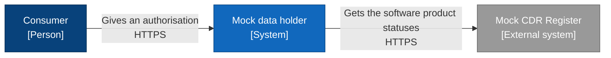

# Specification conventions

This file gives the detailed rules to write a specification. [ADR 0024][adr-0024] gives the structure and the reasons. These rules can change without a new ADR, if they obey ADR 0024.

Use only the terms of the [glossary](glossary.md).

## Writing style

Write all text in [ASD-STE100 Simplified Technical English][ste100]:

- One idea in each sentence. Not: "The data holder refuses the request and logs the error." Use: "The data holder refuses the request. It logs the refusal."
- A concrete subject and its verb, in the active voice and the present tense. Not: "The token will be refused." Use: "The data holder refuses the token."
- One "of" in a phrase at most: "the expiry time of the client certificate".
- A list, not a sentence with many "or" alternatives.
- An example after each abstract rule, which starts with "For example".
- 20 words or fewer for an instruction, 25 words or fewer for a description.
- Inclusive language, for example allowlist and blocklist, primary and replica.

## Templates

A heading in angle brackets is a name that you choose. The other headings are fixed, and the check finds them by their text: `Context`, `Areas`, `Library specifications`, `Goals`, `Non-goals`, `Judgements` and `Withdrawn`. Each other `##` heading is a group of requirements.

The only heading below `##` is a judgement heading (`###`) in the Judgements section. A group has no sub-groups. Split a group that is too large into two groups.

### One-file specification

The file is `DESIGN.md` in the directory of the component. It has the sections of an overview too, so that a split into a `design/` directory only moves text.

~~~markdown
# <Component name>

<Summary: what the component is and does, in one short paragraph.>

## Context

<The context diagram.>

## Library specifications

| Library | Specification |
|---|---|
| `pkg/<library>` | [<descriptive name>](<relative path>/DESIGN.md) |

## Goals

## Non-goals

- <What the component does not do, and where a reader finds it.>

## <Group of requirements>

<Optional: one paragraph that summarises the group. It has no rule.>

- <a id="xx-0001"></a>**XX-0001** <Requirement.> (<Source group>)

## Judgements

### <a id="xx-0002"></a>XX-0002 <Title>

- Kind: <choice | conflict | gap>
- Basis: <Step of the sources process, with links.>
- Reason: <Three sentences or fewer.>

## Withdrawn

- <a id="xx-0003"></a>**XX-0003** Removed.

<Link definitions>
~~~

A section with no content has the line `None.`: the Library specifications section of a component that imports no `pkg/` library, the Withdrawn section, and the Specification cell of a library with no specification.

### Overview of a `design/` directory

The file is `design/README.md`. It has the sections of the one-file specification from Context to Non-goals, and Withdrawn, but no requirements or judgements. After Context, an Areas table (`Area`, `File`, `Summary`) has one row for each other `.md` file.

### Area file

The file is `design/<area>.md`, with the area name in lower-kebab-case. It has a `# <Component name>: <Area name>` title, a one-paragraph summary, its groups of requirements and its Judgements section. It has no Withdrawn section: the withdrawn list is in `README.md`.

### Link definitions

A link to an external source is a reference link, with its definition at the end of the file. The label names the source in lower-kebab-case. For example: `[CDS: Get Products][cds-get-products]`.

A link to a requirement, a judgement or a different file in the repository is an inline link with a relative path.

## Identifiers

An identifier is a component code, a hyphen and 4 digits, for example `DH-0042` (pattern `^[A-Z]{2,5}-[0-9]{4}$`). Its anchor is the identifier in lower case, for example `dh-0042`, because GitHub changes each `id` attribute to lower case.

### Component codes

This table is the registry of the codes. A new specification adds its code in the same change.

| Component | Code |
|---|---|
| `services/register` | `REG` |
| `services/dataholder` | `DH` |
| `pki` | `PKI` |
| `conformance` | `CONF` |
| `web/packages/ui` | `UI` |
| `pkg/cds` | `CDSL` |
| `pkg/authserver` | `AUTH` |
| `pkg/ca` | `CA` |
| `pkg/platform/consolehttp` | `CNSL` |
| `pkg/platform/asset` | `ASSET` |
| `pkg/platform/telemetry` | `TELE` |
| `pkg/platform/httpserver` | `SRV` |
| `pkg/platform/database` | `DBASE` |
| `pkg/platform/operatorhttp` | `OPI` |
| `pkg/platform/hostallowlist` | `HOST` |
| `pkg/platform/problem` | `PROB` |
| `pkg/platform/jsonhttp` | `BODY` |

A code has 2 to 5 capital letters. It is not the name of a standard (`CDS`), and it is not near to an existing code (`CON` and `CONF`).

### Numbers

Each component has its own numbers from `0001`, for its requirements and its judgements. The next number is the highest used number plus 1, also in the withdrawn list. A gap has no meaning. When two pull requests use the same number, the second to merge takes the next free numbers.

### A rule that changes or moves

A rule keeps its identifier when its text changes but not its intent, and when it moves to a different area ([ADR 0024: Identifiers][adr-0024-identifiers]). When a rule splits, one part keeps the identifier. A rule that moves to a different component gets a number of that component, and its old identifier goes into the withdrawn list. The change also updates each link and `// Verifies:` comment to the old identifier.

### Withdrawn list

Each entry is one list item in the Withdrawn section, in the sequence of the numbers. It keeps the anchor, so that an old link still goes to the entry:

```markdown
- <a id="reg-0031"></a>**REG-0031** Moved to [the revocation reasons of a CDR certificate](../../pki/DESIGN.md#pki-0044).
- <a id="reg-0032"></a>**REG-0032** Removed.
```

Pattern: `^- <a id="(?<anchor>[a-z]{2,5}-[0-9]{4})"></a>\*\*(?<id>[A-Z]{2,5}-[0-9]{4})\*\* (Moved to \[.+\]\(.+#[a-z]{2,5}-[0-9]{4}\)|Removed)\.$`

## Requirements

### List item

A requirement is one list item on one line: the anchor, the identifier in bold, the rule (condition first, response last, full stop) and the source group in parentheses.

```markdown
- <a id="dh-0042"></a>**DH-0042** When a request has no `x-v` header, the data holder responds with 400 and the error code `urn:au-cds:error:cds-all:Header/Missing`. ([CDS: Versioning][cds-versioning])
```

Pattern: `^- <a id="(?<anchor>[a-z]{2,5}-[0-9]{4})"></a>\*\*(?<id>[A-Z]{2,5}-[0-9]{4})\*\* (?<rule>.+\.) \((?<sources>.+)\)$`

When the rule gives a set of values, it can have a nested list. The nested items have no identifier, and the source group is at the end of the first line.

### Table row

Each table in a group of requirements is a requirement table, for rules that have the same shape. Each row is one requirement. The first column is `ID`, with the anchor and the identifier in bold. The last column is `Source`, with the source group and no parentheses.

```markdown
| ID | Request | Software product INACTIVE | Source |
|---|---|---|---|
| <a id="dh-0210"></a>**DH-0210** | PAR endpoint | 400 `unauthorized_client` | [CDS: Data Holder Responsibilities][cds-dh-responsibilities] |
```

### Source group

The source group gives one or more links, separated by `; `. A link is one of these:

- An external source, with its name and section. For example: `[CDS: Get Products][cds-get-products]`.
- A judgement in the same file, with the text `Judgement:` and its title. For example: `[Judgement: one base URI for the public endpoints](#dh-0050)`.
- A requirement in a library specification.
- An ADR that records the choice of the rule. The text starts with `Judgement:`, and the rule then needs no judgement in the specification. An ADR is never the judgement of a rule that the CDS or the ACCC gives.

An observation of a production system can follow a link, for example `observed on 2026-10-02: the intermediate is valid for 10 years`. It is never the only source: a judgement then records it in its Basis.

### Non-functional requirements

A non-functional requirement starts its rule with a quality attribute and a colon, for example `Performance:`. Its response has a number and a unit that a test can measure. Use an existing attribute when one agrees.

A non-functional requirement of one area is in that area. One of all the component is in the group or the area file `Non-functional requirements`.

## Judgements

A judgement is in the Judgements section of the file that has its requirements. It has an `###` heading and three items, in this sequence:

- `Kind:` one of these words:
  - `choice`: a choice that the sources do not make
  - `conflict`: a conflict between two sources, and the source that we follow
  - `gap`: a source requirement that the component does not meet
- `Basis:` the step of the [sources process][readme-sources] (`Step 1`, `Step 2`, `Step 3.1`, `Step 3.2` or `Step 3.3`), and then the links to the sources that the judgement uses.
- `Reason:` three sentences or fewer.

```markdown
### <a id="dh-0050"></a>DH-0050 One base URI for the public endpoints

- Kind: choice
- Basis: Step 3.3. The CDS permits a product base URI that is the same as the public base URI ([CDS: Participant Endpoints][cds-participant-endpoints]).
- Reason: One base URI for all public endpoints is the least complex. A client then needs one setting.
```

Heading pattern: `^### <a id="(?<anchor>[a-z]{2,5}-[0-9]{4})"></a>(?<id>[A-Z]{2,5}-[0-9]{4}) (?<title>.+)$`

The title states the decision, as an ADR title does, so that a reader of the title alone knows what the component does. It is a short phrase with no full stop. For example: "One base URI for the public endpoints", not "The base URI". The link text is `Judgement:` and the title. Only the case of the first letter can differ. A choice with no alternative is not a judgement.

## Links

A link to a requirement or a judgement has text that tells the reader what the rule says, and the lower-case anchor. It is an inline link with a relative path: `(#dh-0042)`, `(authorisation.md#dh-0042)` or `(../../pki/DESIGN.md#pki-0044)`.

- Use: `The consumer selects the accounts ([only open accounts are offered](#dh-0120)).`
- Not: `([DH-0120](#dh-0120))` or `(see DH-0120)`.

A heading anchor changes with its heading text. Thus a specification links to a rule by its identifier, never by a heading. A link to the glossary, or to a fixed heading of an overview, for example `README.md#non-goals`, is permitted.

## Context diagram

The context diagram is a C4 level 1 diagram ([C4 model: System context diagram][c4-context]) in a Mermaid `flowchart LR`. Do not use the Mermaid C4 syntax: it is experimental.

- One node for the component, each type of user and each external system, with the label `<name><br>[<type>]`. The type is `Person`, `System` or `External system`.
- The label of each arrow gives the purpose and the protocol.
- No internal parts of the component, for example its database.
- Three class definitions give the C4 colours.

~~~markdown

~~~

## How to choose an area

These steps apply the rule of [ADR 0024: Structure][adr-0024-structure]:

1. Make a list of the interfaces of the component. For example: an API, a web UI, an operator interface.
2. Make a list of the capabilities that have their own section in the primary source. For example: authorisation, from the CDS Authorisation Standards.
3. Put each group of requirements into one item of the two lists.
4. Merge a small group into a related area. For example, introspection goes into the area of the tokens.
5. When an area has more than 5,000 words, split it by interface, for example a web UI and its API.
6. Give each area the name of its CDS section, when there is one.

For an example of the result, see the [data holder areas](../../services/dataholder/design/README.md#areas). `consumer-dashboard.md` is an area because it has its own CDS section (step 2). `operator-console.md` and `operator-console-api.md` are one capability split by interface (step 5).

## Verifies comments

A `// Verifies:` comment in a Go or TypeScript test gives the requirements that the test verifies, separated by `, `, with no links. It is on its own line, directly above a test function, a `t.Run` call, a table test case, or an `it(` or `test(` call. It can be in the tests of a different component.

```go
// Verifies: DH-0042, DH-0043
func TestMissingVersionHeader(t *testing.T) {
```

Pattern: `^\s*// Verifies: [A-Z]{2,5}-[0-9]{4}(, [A-Z]{2,5}-[0-9]{4})*$`

## The specification check

`mise run lint:spec` checks the rules of this file that a tool can check ([ADR 0024: Checks][adr-0024-checks]). CI runs it.

A specification file is `<component>/DESIGN.md`, or a `.md` file in `<component>/design/`, outside a `testdata` directory. The component code comes from the [Component codes](#component-codes) table, with rows in the form `` | `<component>` | `<CODE>` | ``.

In each specification file, these are errors:

- An identifier, a requirement, a judgement, a withdrawn entry or a heading that does not agree with its format in this file. An identifier that the component uses two times.
- A top-level list item in a group of requirements that is not a requirement.
- A requirement with no source link, or a reference link label with no definition.
- A bare identifier or a link whose text is only the identifier, outside code spans and fenced code blocks.
- More than 5,000 words, as `wc -w` counts them.
- An overview (`DESIGN.md` or `design/README.md`) with no Library specifications section or no Withdrawn section.
- A Library specifications table that does not agree with the direct `pkg/` imports of the component, without its tests. A sub-package counts as its library.

In all Markdown files except this file, a link with an identifier anchor as its fragment must go to an identifier that exists. A `Judgement:` link must go to a judgement, with its title as text.

In all Markdown files, also this file, a relative link with a fragment that is not an identifier anchor must go to a file that exists. When that file is a Markdown file, the fragment must be one of its anchors, as GitHub makes them: the anchor of each heading, with `-1`, `-2` for a duplicate heading, and each `<a id>` or `<a name>`. The fragment must agree exactly, also in case. A link with no fragment gets no check. The check does not see a link with a title, a link on more than one line or a link with brackets in its text. It gives no anchor for a setext heading, and it keeps the `_` of emphasis in the anchor of a heading.

In each test file (`_test.go`, `.test.ts`, `.test.tsx`, `.spec.ts`, `.spec.tsx`), a `// Verifies` line must agree with [Verifies comments](#verifies-comments), and each identifier must be a requirement that exists. A requirement that no `// Verifies:` comment refers to gives a warning.

## Words and patterns to avoid

| Avoid | Use |
|---|---|
| "(See Decisions)", "Decision" for a judgement, or a reason in the text of a requirement | A link to the judgement. |
| "Open question", "TBD", "TODO", or a question in a requirement | A judgement, or a ticket. |
| "will", "shall", "should", "may" in a requirement | The present tense. A library or a design system uses "must" for what its user must do. |
| A word of change in time: "currently", "now", "no longer", "the old rule" | The rule as it is. "A new CRL" in a domain sense is permitted. |
| "e.g.", "i.e.", "etc.", "and/or", "via" | "for example", "that is", the full list, a list, "through". |
| "fast", "large", "if possible" | A number and a unit, or a fixed condition. |
| Copied source text, or a quote longer than one phrase | A link, and only what the component selects, limits or adds. |
| A name of a package, a type, a function or a database table | The behaviour that a test or a reviewer can check. |
| An ACCC mock implementation as a source or a reason | The CDS, ACCC guidance or a judgement. |
| A test plan, for example "a test checks that …" | The rule only. The test refers to it with `// Verifies:`. |

[adr-0024]: ../adr/0024-write-specifications-as-identified-single-requirements-split-by-area.md
[adr-0024-identifiers]: ../adr/0024-write-specifications-as-identified-single-requirements-split-by-area.md#identifiers
[adr-0024-structure]: ../adr/0024-write-specifications-as-identified-single-requirements-split-by-area.md#structure
[adr-0024-checks]: ../adr/0024-write-specifications-as-identified-single-requirements-split-by-area.md#checks
[readme-sources]: ../../README.md#sources-for-requirements
[ste100]: https://www.asd-ste100.org/
[c4-context]: https://c4model.com/diagrams/system-context
