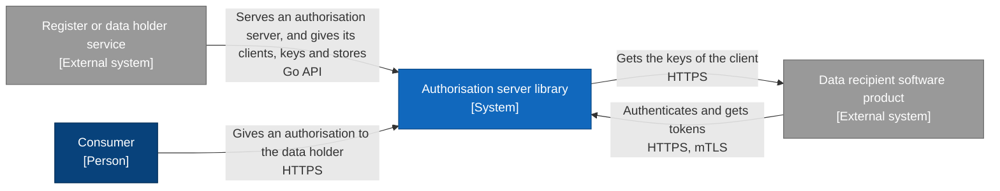

# Authorisation server library

The authorisation server library gives the two CDR authorisation servers of the lab: the Register authorisation server and the data holder authorisation server. It serves the OpenID Provider configuration, the JWKS, client authentication, the token endpoint, the authorisation flow and the endpoints of the tokens of an arrangement. A service gives the library its clients, keys, stores and consumer pages. The specification of the service gives these choices ([ADR 0001][adr-0001]).

## Context

## Areas

| Area | File | Summary |
|---|---|---|
| Configuration | [configuration.md](configuration.md) | The OpenID Provider configuration of each server, the JWKS and the signing keys. |
| Client authentication | [client-authentication.md](client-authentication.md) | The `private_key_jwt` client authentication at each endpoint that authenticates a client. |
| Token endpoint | [token-endpoint.md](token-endpoint.md) | The grants, the client credentials token, the token response and errors, and the verification of an access token. |
| Authorisation request | [authorisation-request.md](authorisation-request.md) | The pushed authorisation request, the request object, the authorisation endpoint, the authorisation response and the status checks of the software product. |
| Tokens of an arrangement | [tokens-of-an-arrangement.md](tokens-of-an-arrangement.md) | The authorisation code and refresh token grants, the ID token, introspection, token revocation and CDR arrangement revocation. |

## Library specifications

| Library | Specification |
|---|---|
| `pkg/cds` | [CDS HTTP library](../../cds/DESIGN.md) |
| `pkg/platform/jsonhttp` | None. |

## Goals

- One implementation of each authorisation server rule that the Register and the data holder share.
- A rule that the CDS leaves open has one judgement for the two servers.

## Non-goals

- The registration of a software product at a data holder, and registration management ([ADR 0009][adr-0009]). The data holder specification gives them.
- The clients, the client certificates and the statuses that the service gives. The specification of each service gives them.
- The storage of the signing keys, and the steps of a key change. The service gives the keys.
- The subject identifiers, the arrangements and the consumer pages of the data holder. The data holder gives them to the library.
- The resource APIs that accept an access token.

## Withdrawn

None.

[adr-0001]: ../../../docs/adr/0001-auth-server-library.md
[adr-0009]: ../../../docs/adr/0009-client-registration-outside-the-library.md
