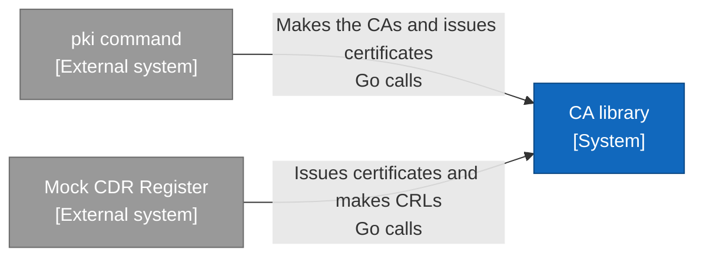

# CA library

The CA library makes the mock CDR CA and the mock public CA, checks CSRs, issues certificates and makes the CRL of a CA. It gives the certificate profiles and the CRL format of the mock CDR PKI. The `pki` command uses it at the set-up of the lab ([PKI specification](../../pki/DESIGN.md)). In a running lab, the Register uses it as the CDR intermediate CA ([ADR 0022][adr-0022]).

## Context

## Library specifications

None.

## Goals

- The CA certificates of the mock CDR CA and of the mock public CA.
- The check of a CSR against the CDS CSR profile.
- The issue of CDR certificates, and of public TLS server certificates for lab hosts.
- The revocation reasons, and a CRL in the format of production.

## Non-goals

- The CA keys, the lab directory and the permissions of the key files. The [PKI specification](../../pki/DESIGN.md) gives these.
- The check of the participant names in a CSR ([only the Register checks the participant names of a CSR](../../pki/DESIGN.md#pki-0081)).
- The list of revocations, the CRL numbers, the times of a new CRL and the CRL listener. The Register gives these ([the Register keeps the only list of revocations](../../pki/DESIGN.md#pki-0050)).

## CA structure

- **CA-0001** The CDR CA has one root CA and one issuing intermediate CA. ([ACCC: Certificate Management][accc-cert-mgmt])
- **CA-0002** Each CA signs with SHA-256 with RSA. ([CP section 6.1.5, Table 5][accc-cp])
- **CA-0003** The root certificate and the intermediate certificate are CA certificates with the key usages `keyCertSign` and `cRLSign`. ([Judgement: the certificates and the CRL copy the production profiles](#ca-0049))
- **CA-0004** The intermediate certificate has a path length of 0. ([Judgement: the certificates and the CRL copy the production profiles](#ca-0049))
- **CA-0005** The root certificate is valid for 20 years. ([CP section 6.3.2, Table 6][accc-cp])
- **CA-0006** The intermediate certificate is valid for 10 years. ([CP section 6.3.2, Table 6][accc-cp]; [Judgement: the certificates and the CRL copy the production profiles](#ca-0049))
- **CA-0007** The subject of the CDR root and of the CDR intermediate has the O `cdr-lab` and the OU `Consumer Data Right`. ([Judgement: mock CA names that are not from the ACCC](#ca-0048))
- **CA-0008** The CDR CA certificates have no ACCC name and no ACCC certificate policy OID. ([Judgement: mock CA names that are not from the ACCC](#ca-0048))
- **CA-0009** The public CA is separate from the CDR CA, and no certificate of one CA chains to the other. ([CDS: Participant Endpoints][cds-participant-endpoints]; observed on 2026-10-02: `api.cdr.gov.au` has a certificate from a public CA)

## CSR profile

The CSR profile is the [CDS: Certificate Signing Request Profile][cds-csr-profile]. These rules give what the CDR CA checks.

- **CA-0010** The CDR CA issues a certificate only from a CSR that obeys each rule of this group. ([CDS: Certificate Signing Request Profile][cds-csr-profile])
- **CA-0011** When a CSR breaks a rule, the CA refuses the CSR and names each rule that it breaks. ([CDS: Certificate Signing Request Profile][cds-csr-profile])
- **CA-0012** The key of the CSR is an RSA 2048 key. ([CDS: Certificate Signing Request Profile][cds-csr-profile])
- **CA-0013** The signature algorithm of the CSR is SHA-256 with RSA. ([CDS: Certificate Signing Request Profile][cds-csr-profile])
- **CA-0014** The CSR signature is valid with the key in the CSR (proof of possession). ([CPS section 3.2.1][accc-cps])
- **CA-0015** The subject of the CSR has these attributes. ([CDS: Certificate Signing Request Profile][cds-csr-profile])
  - CN
  - O
  - OU, with the value `Consumer Data Right`
  - C, with a two-letter country code
- **CA-0016** In a server CSR, the CN is the primary DNS name. ([CDS: Certificate Signing Request Profile][cds-csr-profile])
- **CA-0017** The subject alternative names of a server CSR are DNS names only. ([CDS: Certificate Signing Request Profile][cds-csr-profile])
- **CA-0018** The CN of a server CSR is a host name: only letters, digits, hyphens and dots, with no wildcard, and not an IP address. ([ACCC Participant Portal User Guide, section 10.6.2][accc-portal-guide]; [RFC 1123, section 2.1][rfc1123-names])
- **CA-0019** Each DNS name of a server CSR obeys the host name rules of the CN. ([Judgement: the CN host name rules for each name in a server CSR](#ca-0050))
- **CA-0020** Each label of a host name has 1 to 63 characters, and does not start or end with a hyphen. ([RFC 1123, section 2.1][rfc1123-names]; [RFC 1035, section 2.3.4][rfc1035-size])
- **CA-0021** A host name has 253 characters or fewer. ([RFC 1035, section 2.3.4][rfc1035-size])
- **CA-0022** The CN of a server CSR has 64 characters or fewer. ([RFC 5280, Appendix A][rfc5280-bounds])
- **CA-0023** A host name with no dot is valid, for example `wattle-bank`. ([Judgement: the CN host name rules for each name in a server CSR](#ca-0050))
- **CA-0024** A client CSR has no subject alternative names. ([CDS: Certificate Signing Request Profile][cds-csr-profile])

## Certificate profile

A CDR certificate copies the profile of the production server certificate of `secure.api.cdr.gov.au`, from "CDR Intermediate CA 2025".

- **CA-0025** The subject of a CDR certificate is the subject of its CSR. ([Judgement: the certificates and the CRL copy the production profiles](#ca-0049))
- **CA-0026** A CDR certificate is valid for 13 months from its issue. ([ACCC: Certificate FAQ][accc-cert-faq]; [Judgement: the certificates and the CRL copy the production profiles](#ca-0049))
- **CA-0027** A certificate is never valid after its issuer expires. ([CP section 6.3.2][accc-cp])
- **CA-0028** A CDR certificate has the key usage `digitalSignature` in a critical extension. ([Judgement: the certificates and the CRL copy the production profiles](#ca-0049))
- **CA-0029** The basic constraints of a CDR certificate say that it is not a CA. ([Judgement: the certificates and the CRL copy the production profiles](#ca-0049))
- **CA-0030** A server certificate has the extended key usage `serverAuth` only. ([CP section 6.1.7][accc-cp]; [Judgement: one extended key usage for each certificate type](#ca-0051))
- **CA-0031** A client certificate has the extended key usage `clientAuth` only. ([CP section 6.1.7][accc-cp]; [Judgement: one extended key usage for each certificate type](#ca-0051))
- **CA-0032** A CDR certificate never has the extended key usage `anyExtendedKeyUsage`. ([CP section 6.1.7][accc-cp])
- **CA-0033** A server certificate has a subject alternative name for its CN and for each DNS name in the CSR. ([CP section 10, Table 14][accc-cp]; observed on 2026-10-02: the SAN contains the CN)
- **CA-0034** A CDR certificate gives one CRL distribution point, which is the URL of the CRL of its issuer. ([RFC 5280, section 4.2.1.13][rfc5280-crldp]; observed on 2026-10-02: the production certificate gives the CRL URL of "CDR Intermediate CA 2025")
- **CA-0035** A CDR certificate gives no OCSP URL and no CA issuers URL. ([Judgement: a CRL and no OCSP](#ca-0053))
- **CA-0036** The serial number of a certificate is random, with more than 64 bits. ([CP section 10, Table 14][accc-cp]; [CA/Browser Forum Baseline Requirements, section 7.1][cabf-br])
- **CA-0056** A CDR certificate has a subject key identifier, which is the SHA-1 hash of its subject public key. ([CP section 10, Table 14][accc-cp]; [RFC 5280, section 4.2.1.2][rfc5280-ski])
- **CA-0037** The CA does not check that the subject DN of a certificate is unique. ([CPS section 3.1][accc-cps]; [Judgement: no check of unique subject names](#ca-0055))
- **CA-0038** A public TLS server certificate for a lab host has the validity, the key usage and the extended key usage of a CDR server certificate. ([CA/Browser Forum Baseline Requirements, section 6.3.2][cabf-br]; [Judgement: the CDR server profile for a public TLS server certificate](#ca-0052))
- **CA-0039** The subject of a public TLS server certificate has the CN only. ([Judgement: the CDR server profile for a public TLS server certificate](#ca-0052))
- **CA-0040** Each name of a public TLS server certificate obeys the host name rules of a server CSR. ([Judgement: the CDR server profile for a public TLS server certificate](#ca-0052))

## Revocation reasons and CRL format

- **CA-0041** The lab operator can revoke a CDR certificate with one of these reasons. ([RFC 5280, section 5.3.1][rfc5280-reason]; [CPS section 4.9][accc-cps]: the CA does not support suspension)
  - `unspecified`
  - `keyCompromise`
  - `affiliationChanged`
  - `superseded`
  - `cessationOfOperation`
  - `privilegeWithdrawn`
- **CA-0042** The revocation date of a CRL entry is the time of the revocation. ([RFC 5280, section 5.1.2.6][rfc5280-revoked])
- **CA-0043** A CRL entry with the reason `unspecified` has no reason code extension. ([RFC 5280, section 5.3.1][rfc5280-reason])
- **CA-0044** The CRL is a V2 CRL in DER. ([CP section 10, Table 17][accc-cp]; observed on 2026-10-02: the production CRL of "CDR Intermediate CA 2025")
- **CA-0045** The CDR intermediate signs the CRL with SHA-256 with RSA. ([CP section 10, Table 17][accc-cp])
- **CA-0046** The CRL has an authority key identifier and a CRL number. ([CP section 10, Table 17][accc-cp]; [RFC 5280, section 5.2.3][rfc5280-crl-number])
- **CA-0047** The next update of a CRL is 7 days after its issue. ([Judgement: a CRL validity of 7 days](#ca-0054))

## Judgements

### CA-0048 Mock CA names that are not from the ACCC

- Kind: choice
- Basis: Step 3.1. The ACCC issues the production CDR certificates under its certificate policy ([CP][accc-cp]).
- Reason: The mock certificates are not from the ACCC. They must not look as if they are.

### CA-0049 The certificates and the CRL copy the production profiles

- Kind: choice
- Basis: Step 3.2. On 2026-10-02, we observed "CDR Root CA", "CDR Intermediate CA 2025", the server certificate of `secure.api.cdr.gov.au` and the CRL of "CDR Intermediate CA 2025". The [CP section 6.3.2, Table 6][accc-cp] gives only maximums, for example 15 years for an intermediate.
- Reason: A mock component copies the behaviour of its production equivalent ([README: Component types][readme-component-types]). A relying party that works with the mock certificates then works with the production certificates.

### CA-0050 The CN host name rules for each name in a server CSR

- Kind: choice
- Basis: Step 3.2. The [ACCC Participant Portal User Guide, section 10.6.2][accc-portal-guide] gives the host name rules for the CN only. The [CDS: Certificate Signing Request Profile][cds-csr-profile] calls the subject alternative names secondary DNS names, and [RFC 1123, section 2.1][rfc1123-names] gives the syntax of a host name.
- Reason: Each name is a DNS name, so the same rules apply to each name. The rules require no dot, so a lab host name is valid.

### CA-0051 One extended key usage for each certificate type

- Kind: choice
- Basis: Step 3.2. The [CP section 6.1.7][accc-cp] requires an extended key usage on an end-entity certificate. On 2026-10-02, the production server certificate of `secure.api.cdr.gov.au` had one extended key usage.
- Reason: One usage for each certificate type is the narrowest profile that the CP permits. Production uses it.

### CA-0052 The CDR server profile for a public TLS server certificate

- Kind: choice
- Basis: Step 3.3. The [CA/Browser Forum Baseline Requirements, section 6.3.2][cabf-br] give a maximum validity of 398 days.
- Reason: One profile for each lab server certificate is the least complex. A validity of 13 months is less than 398 days.

### CA-0053 A CRL and no OCSP

- Kind: choice
- Basis: Step 3.3. The [CDS: Certificate Validation][cds-cert-validation] requires a relying party to check revocation through the CRL or OCSP that each certificate gives. Production certificates give both.
- Reason: A relying party that uses the CRL then works in production. A CRL is a signed file, but OCSP needs a responder service. Relying parties load the CA bundle, so a certificate needs no CA issuers URL.

### CA-0054 A CRL validity of 7 days

- Kind: choice
- Basis: Step 3.2. On 2026-10-02, the next update of the production CRL of "CDR Intermediate CA 2025" was 7 days after its issue.
- Reason: The CRL copies production. With [a new CRL at least once every 24 hours](../../pki/DESIGN.md#pki-0061), the current CRL is valid for 6 days or more while the Register runs.

### CA-0055 No check of unique subject names

- Kind: gap
- Basis: Step 2. The [CPS section 3.1][accc-cps] requires a unique subject DN.
- Reason: A renewal in production keeps the CN. A strict check stops a renewal in the lab.

## Withdrawn

None.

[readme-component-types]: ../../README.md#component-types
[adr-0022]: ../../docs/adr/0022-run-the-mock-cdr-intermediate-ca-in-the-register.md
[cds-csr-profile]: https://consumerdatastandardsaustralia.github.io/standards-archives/standards-1.36.0/#certificate-signing-request-profile
[cds-cert-validation]: https://consumerdatastandardsaustralia.github.io/standards-archives/standards-1.36.0/#certificate-validation
[cds-participant-endpoints]: https://consumerdatastandardsaustralia.github.io/standards-archives/standards-1.36.0/#participant-endpoints
[accc-cert-mgmt]: https://consumerdataright.atlassian.net/wiki/spaces/DP/pages/360415310/Certificate+Management
[accc-cert-faq]: https://consumerdataright.atlassian.net/wiki/spaces/DP/pages/374538246/Frequently+Asked+Questions+FAQ
[accc-cp]: https://www.cdr.gov.au/sites/default/files/2025-08/ACCC-Certificate-Policy-v1.04-published-27-August-2025.pdf
[accc-cps]: https://www.cdr.gov.au/sites/default/files/2025-08/ACCC-Certification-Practice-Statement-v2.0-published-27-August-2025.pdf
[accc-portal-guide]: https://www.cdr.gov.au/sites/default/files/2026-10/Participant%20Portal%20User%20Guide_-v23-20261014_091444.pdf
[rfc5280-crldp]: https://www.rfc-editor.org/rfc/rfc5280#section-4.2.1.13
[rfc5280-ski]: https://www.rfc-editor.org/rfc/rfc5280#section-4.2.1.2
[rfc5280-bounds]: https://www.rfc-editor.org/rfc/rfc5280#appendix-A
[rfc5280-reason]: https://www.rfc-editor.org/rfc/rfc5280#section-5.3.1
[rfc5280-revoked]: https://www.rfc-editor.org/rfc/rfc5280#section-5.1.2.6
[rfc5280-crl-number]: https://www.rfc-editor.org/rfc/rfc5280#section-5.2.3
[rfc1123-names]: https://www.rfc-editor.org/rfc/rfc1123#section-2.1
[rfc1035-size]: https://www.rfc-editor.org/rfc/rfc1035#section-2.3.4
[cabf-br]: https://cabforum.org/working-groups/server/baseline-requirements/requirements/
