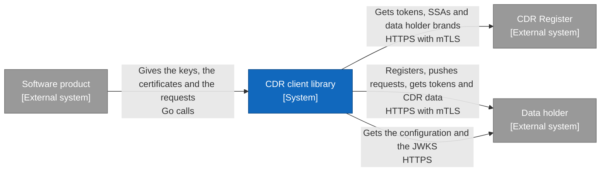

# CDR client library

The CDR client library gives the calls of a software product to the Register and to the data holders, as the CDS security profile specifies them. It gets an SSA and the data holder brands from the Register, registers with a data holder, starts an authorisation flow with PAR, validates the authorisation response and the ID token, gets and refreshes the tokens, and calls the resource APIs with the CDS headers. The mock data recipient uses it. The library gives the protocol. The service gives the keys, the certificates, the storage and the decisions.

## Context

## Library specifications

None.

## Goals

- One implementation of the data recipient side of the CDS security profile, for each lab component that acts as a software product.
- Each call has the transport, the client authentication and the headers that the CDS requires, with no extra code in the service.
- Each response that the library accepts is valid for the CDS. For example, the library refuses an authorisation response with a signature that is not valid.

## Non-goals

- The endpoints that a software product serves: the JWKS and the CDR Arrangement Revocation endpoint. The service serves them. The library gives only the JWKS document.
- The self-signed JWT client authentication of a data holder that calls a software product. The specification of the service that serves the CDR Arrangement Revocation endpoint gives it.
- The update and the deletion of a registration, token introspection and token revocation.
- The conformance suite. It keeps its own client code. A later change can move the suite to the library.
- The storage of the tokens, the registrations and the keys. The service keeps them.

## Transport

- **CDRC-0001** Each call to an mTLS endpoint of the Register or of a data holder uses the client certificate that the service gives, and trusts only the CDR CA bundle that the service gives. ([CDS: Use of MTLS][cds-use-of-mtls]; [CDS: Certificate Trust Model][cds-cert-trust-model])
- **CDRC-0002** Each call to an endpoint with TLS and no mTLS sends no client certificate, and trusts only the public CAs that the service gives. For example, the OpenID Provider configuration of a data holder is such an endpoint. ([CDS: Use of MTLS][cds-use-of-mtls]; [CDS: Participant Endpoints][cds-participant-endpoints])
- **CDRC-0003** Each call uses TLS 1.2 or TLS 1.3. With TLS 1.2, the library offers only the cipher suites that [the TLS profile of the CDS library](../cds/DESIGN.md#cdsl-0042) gives. ([CDS: Ciphers][cds-ciphers])
- **CDRC-0004** When the certificate file or the key file of the client certificate changes, the library uses the new certificate for each new connection within 1 minute, with no restart. ([Judgement: CDR certificates from the Register (ADR 0032)][adr-0032])
- **CDRC-0005** The library does not follow an HTTP redirect in a response of the Register or of a data holder. It gives the redirect to the service as an error. ([Judgement: no redirect from a CDR endpoint](#cdrc-0050))
- **CDRC-0006** Performance: each call stops after 30 seconds, when the service gives no shorter limit. ([Judgement: limits of 30 seconds and 10 MiB for each call](#cdrc-0051))
- **CDRC-0007** The library reads a response body of 10 MiB at most. It refuses a larger body. ([Judgement: limits of 30 seconds and 10 MiB for each call](#cdrc-0051))

## Keys and client authentication

- **CDRC-0010** The library signs each JWT with PS256 and the first signing key that the service gives. The header of the JWT has the `kid` of the key. ([FAPI 1.0 Advanced, section 8.6][fapi-algorithms]; [the first key of the list signs](../authserver/design/configuration.md#auth-0010))
- **CDRC-0011** The library refuses a signing key that is not an RSA key of 2048 bits or longer. ([FAPI 1.0 Advanced, section 8.6][fapi-algorithms])
- **CDRC-0012** The JWKS document of the library has the public key of each signing key that the service gives, and no private key. Each key has the JWK members `alg`, `e`, `key_ops`, `kid`, `kty` and `n`. ([CDS: JSON Web Key Set endpoint][cds-jwks-endpoint]; [CDS: JWK][cds-schema-jwk])
- **CDRC-0013** The library refuses two signing keys with the same `kid`. ([CDS: JSON Web Key Set endpoint][cds-jwks-endpoint])
- **CDRC-0014** The library authenticates to each token endpoint and to each PAR endpoint with `private_key_jwt`. The form has `client_assertion_type` `urn:ietf:params:oauth:client-assertion-type:jwt-bearer` and a new client assertion. ([CDS: Private Key JWT Client Authentication][cds-private-key-jwt])
- **CDRC-0015** The `iss` and the `sub` of the assertion are the client ID. At the Register, the client ID is the software product ID. At a data holder, it is the client ID of the registration. ([CDS: Data Recipients calling the CDR Register][cds-dr-calling-register]; [CDS: Data Recipients calling Data Holders][cds-dr-calling-dh])
- **CDRC-0016** The `aud` of the assertion is the issuer of the authorisation server. ([CDS: Private Key JWT Client Authentication][cds-private-key-jwt])
- **CDRC-0017** The assertion has a `jti` that is a new random UUID, an `iat`, and an `exp` 60 seconds after the `iat`. The library uses each assertion one time only. ([CDS: Private Key JWT Client Authentication][cds-private-key-jwt]; [Judgement: JWTs that expire after 60 seconds](#cdrc-0052))

## OpenID Provider configuration

- **CDRC-0020** The library gets the OpenID Provider configuration of an authorisation server from `<issuer>/.well-known/openid-configuration`. ([OpenID Connect Discovery, section 4][oidc-discovery])
- **CDRC-0021** The library refuses a configuration whose `issuer` is not equal to the issuer that the service gives. ([OpenID Connect Discovery, section 4.3][oidc-discovery-validation])
- **CDRC-0022** The library gets each endpoint from the configuration, and not from a path that it knows. For example, it gets the PAR endpoint from `pushed_authorization_request_endpoint`. ([CDS: OpenID Provider Configuration endpoint][cds-oidc-config])
- **CDRC-0023** The library gets the configuration and the JWKS of an authorisation server again when they are more than 5 minutes old, and when a signature has a `kid` that the JWKS it has does not have. It gets them again one time each 10 seconds at most. ([CDS: Metadata Cache Management][cds-metadata-cache]; [Judgement: a copy of the configuration for 5 minutes](#cdrc-0053))

## Register

- **CDRC-0030** The library gets a Register access token with the `client_credentials` grant and the scope `cdr-register:read`. ([CDS: Data Recipients calling the CDR Register][cds-dr-calling-register])
- **CDRC-0031** The library uses a Register access token until 30 seconds before its `expires_in` ends. It then gets a new token. ([CDS: Token Expiry][cds-token-expiry]; [Judgement: JWTs that expire after 60 seconds](#cdrc-0052))
- **CDRC-0032** The library gets the SSA of a software product with Get Software Statement Assertion, version 4, with the industry `all`. ([CDS: Get Software Statement Assertion][cds-get-ssa]; [CDS: Endpoint Version Schedule][cds-version-schedule])
- **CDRC-0033** The library gets the data holder brands with Get Data Holder Brands, version 3, with the industry `all`. It gets each page, with the page size 1000, until the response has no `next` link. ([CDS: Get Data Holder Brands][cds-get-dh-brands]; [CDS: Pagination][cds-pagination])
- **CDRC-0034** The library gets the data recipients with Get Data Recipients, version 4, with no authentication. ([CDS: Get Data Recipients][cds-get-drs])

## Registration

- **CDRC-0040** The library registers a software product with `POST` to the `registration_endpoint` of the data holder. The body is a JWT that the library signs, with the content type `application/jwt`. ([CDS: Registration Request using JWT][cds-registration-request])
- **CDRC-0041** The registration JWT has these claims. ([CDS: Registration Request using JWT][cds-registration-request]; [Judgement: JWTs that expire after 60 seconds](#cdrc-0052))
  - `iss`: the software product ID
  - `aud`: the issuer of the data holder
  - `iat`, `exp` 60 seconds after `iat`, and a new random `jti`
  - `token_endpoint_auth_method`: `private_key_jwt`
  - `token_endpoint_auth_signing_alg`, `request_object_signing_alg`, `id_token_signed_response_alg` and `authorization_signed_response_alg`: `PS256`
  - `grant_types`: `client_credentials`, `authorization_code` and `refresh_token`
  - `response_types`: `code`
  - `application_type`: `web`
  - `redirect_uris`: the redirect URIs that the service gives
  - `software_statement`: an SSA that the library got from the Register for this request
- **CDRC-0042** The registration JWT has no `id_token_encrypted_response_alg`, no `id_token_encrypted_response_enc` and no claim for the encryption of the authorisation response. ([CDS: Registration Request using JWT][cds-registration-request])
- **CDRC-0043** The library gives the `client_id` of a successful registration response to the service. It refuses a response with no `client_id`. ([CDS: Registration Response][cds-registration-response])
- **CDRC-0044** When the registration fails, the library gives the `error` of the response to the service. ([CDS: Registration Errors][cds-registration-errors])

## Pushed authorisation request

- **CDRC-0060** The library starts an authorisation flow with `POST` to the PAR endpoint. The form has the client assertion and a `request` parameter with the request object, and no other authorisation parameter. ([CDS: Pushed Authorisation endpoint][cds-par-endpoint]; [FAPI 1.0 Advanced, section 5.2.3][fapi-advanced-client], item 8)
- **CDRC-0061** The request object has these claims. ([CDS: Request Object, Data Recipient Software Products][cds-request-object-dr]; [FAPI 1.0 Advanced, section 5.2.3][fapi-advanced-client], items 8 and 10; [JARM, section 2.3][jarm-response-mode])
  - `iss` and `client_id`: the client ID of the registration
  - `aud`: the issuer of the data holder
  - `nbf` and `iat`: the time of the request, and `exp`: 10 minutes after `nbf`
  - `jti`: a new random UUID
  - `response_type`: `code`, and `response_mode`: `jwt`
  - `redirect_uri`, `scope` and `claims.sharing_duration`: the values that the service gives
  - `state` and `nonce`: values of 128 bits or more from a cryptographic random source
  - `code_challenge`: the S256 challenge of a new code verifier, and `code_challenge_method`: `S256`
  - `claims.id_token.acr`: essential, with the value `urn:cds.au:cdr:2`
- **CDRC-0062** The request object has no `cdr_arrangement_id`. ([Judgement: no amendment of an arrangement](../authserver/design/authorisation-request.md#auth-0120))
- **CDRC-0063** The code verifier has 43 to 128 characters from a cryptographic random source. ([RFC 7636, section 4.1][rfc7636-verifier])
- **CDRC-0064** The library gives the service the URL of the authorisation endpoint with the `client_id` and the `request_uri` of the response, and no other parameter. The service keeps the `state`, the `nonce` and the code verifier with the flow. ([RFC 9126, section 4][rfc9126-authorise])

## Authorisation response

- **CDRC-0070** The library validates the `response` parameter of the redirect as JARM gives. When one of these checks fails, it refuses the response. ([JARM, section 4.4][jarm-validation]; [FAPI 1.0 Advanced, section 5.2.3.2][fapi-advanced-client-jarm])
  - the signature, with a key of the JWKS of the data holder and the `authorization_signed_response_alg` of the registration
  - the `iss` is the issuer of the data holder that the flow started at
  - the `aud` is the client ID of the registration
  - the `exp` is after the time of the check
- **CDRC-0071** The library refuses a response whose `state` is not equal to the `state` of the flow. ([JARM, section 4.4][jarm-validation]; [RFC 9700, section 4.7.1][rfc9700-csrf])
- **CDRC-0072** When a valid response has `error`, the library gives the `error` and the `error_description` to the service. ([JARM, section 2.1][jarm-response])
- **CDRC-0073** The library refuses an unsigned response and a response with the algorithm `none`. ([JARM, section 4.4][jarm-validation])

## Tokens

- **CDRC-0080** The library exchanges a code with the `authorization_code` grant, the `redirect_uri` of the flow and the code verifier of the flow. It uses each code one time only. ([CDS: Authentication Flows][cds-authentication-flows]; [RFC 7636, section 4.5][rfc7636-token])
- **CDRC-0081** The library refuses a response to the `authorization_code` grant with no `access_token`, no `id_token` or no `expires_in`. For a sharing duration of more than 0, it also refuses a response with no `refresh_token`. ([CDS: Tokens][cds-tokens]; [CDS: Requesting Sharing Duration][cds-sharing-duration])
- **CDRC-0082** The library gives the `cdr_arrangement_id` of the token response to the service. ([CDS: CDR Arrangement ID][cds-arrangement-id])
- **CDRC-0083** The library validates the ID token of a response to the `authorization_code` grant. When one of these checks fails, it refuses the token response. ([OpenID Connect Core, section 3.1.3.7][oidc-id-token-validation]; [CDS: ID Token][cds-id-token])
  - the signature, with a key of the JWKS of the data holder and the `id_token_signed_response_alg` of the registration
  - the `iss` is the issuer of the data holder
  - the `aud` is the client ID, or a list that contains the client ID
  - the `exp` is after the time of the check
  - the `nonce` is the `nonce` of the flow
  - the `acr` is `urn:cds.au:cdr:2` or `urn:cds.au:cdr:3`
- **CDRC-0084** The library refuses an encrypted ID token. ([CDS: ID Token][cds-id-token])
- **CDRC-0085** The library refreshes an access token with the `refresh_token` grant. When the response has a new refresh token, the library gives it to the service. ([CDS: Refresh Token][cds-refresh-token])
- **CDRC-0087** When a response to the `refresh_token` grant has an ID token, the library validates it with [the checks of the ID token](#cdrc-0083), except the `nonce`. A response with no ID token is valid. ([OpenID Connect Core, section 12.2][oidc-refresh-response])
- **CDRC-0086** When the token endpoint gives `invalid_grant`, the library gives the service an error that says that the grant ended. ([RFC 6749, section 5.2][rfc6749-token-errors])

## Arrangement revocation

- **CDRC-0088** The library revokes an arrangement with `POST` to the `cdr_arrangement_revocation_endpoint` of the data holder, with the client assertion and the `cdr_arrangement_id` in the form. ([CDS: CDR Arrangement Revocation endpoint][cds-arrangement-revocation])
- **CDRC-0089** The library gives a response of 204 to the service as a success, and a response of 422 as an arrangement that is not valid. It gives each other response as an error. ([CDS: CDR Arrangement Revocation endpoint][cds-arrangement-revocation])

## Resource calls

- **CDRC-0090** Each call to a resource API has the access token as a bearer token, the `x-v` that the service gives and no `x-min-v`. ([CDS: HTTP Headers][cds-http-headers]; [Judgement: one version for each endpoint](#cdrc-0054))
- **CDRC-0091** Each call to a resource API has an `x-fapi-interaction-id` that is a new random RFC 4122 UUID. ([CDS: HTTP Headers][cds-http-headers]; [Judgement: a new interaction ID for each call](#cdrc-0055))
- **CDRC-0092** Each call to a resource API has `x-fapi-auth-date` with the time that the service gives, in the format of RFC 7231 in UTC. For example, `Thu, 16 Jan 2020 16:50:15 GMT`. ([CDS: HTTP Headers][cds-http-headers])
- **CDRC-0093** A call that the service marks as customer present has `x-fapi-customer-ip-address` and `x-cds-client-headers` with the values that the service gives. Each other call has neither header. The `x-cds-client-headers` has only the `User-Agent`, `Accept` and `Accept-Language` headers that the service gives, encoded in Base64. It never has a `Cookie`, an `Authorization` or a header against cross-site request forgery. ([CDS: HTTP Headers][cds-http-headers]; [CDS: NFRs, Definitions][cds-definitions])
- **CDRC-0094** The library gets each page of a paginated resource API, with the page size that the service gives, until the response has no `next` link. It follows the `next` link only when the link is on the base URI of the first request. ([CDS: Pagination][cds-pagination]; [Judgement: no redirect from a CDR endpoint](#cdrc-0050))
- **CDRC-0095** When the response has a different `x-v` from the request, the library refuses the response. ([CDS: HTTP Headers][cds-http-headers]; [Judgement: one version for each endpoint](#cdrc-0054))
- **CDRC-0096** When a resource API gives an error response, the library gives the status and the `code` of each error to the service. For example, a 403 with `urn:au-cds:error:cds-all:Authorisation/RevokedConsent`. ([CDS: Error Codes][cds-error-codes])

## Telemetry

- **CDRC-0100** Telemetry: each call has an HTTP client span with the method, the host, the port, the route pattern of the path and the status. For example, a call to `/cds-au/v1/banking/accounts/1234/transactions` has the route pattern `/cds-au/v1/banking/accounts/{accountId}/transactions`. ([OpenTelemetry: HTTP client spans][otel-http-client]; [no CDR data in telemetry](../platform/telemetry/DESIGN.md#tele-0004))
- **CDRC-0101** Telemetry: the span of a resource call has the attributes `http.request.header.x-v` and `http.request.header.x-fapi-interaction-id`, with the values of the request. ([OpenTelemetry: HTTP request headers][otel-http-headers]; [Judgement: a new interaction ID for each call](#cdrc-0055))
- **CDRC-0102** Telemetry: a span, a metric or a log of the library has none of these values. ([no CDR data in telemetry](../platform/telemetry/DESIGN.md#tele-0004); [OWASP: Logging Cheat Sheet, data to exclude][owasp-logging-exclude])
  - a query string, a request body or a response body
  - a token, a code, a client assertion, a request object, an SSA, a code verifier, a `state` or a `nonce`
  - the `request_uri`, the `cdr_arrangement_id`, the `sub` or an account ID
  - the `x-fapi-customer-ip-address` or the `x-cds-client-headers`

## Judgements

### CDRC-0050 No redirect from a CDR endpoint

- Kind: choice
- Basis: Step 3.2. A client that follows a redirect sends the next request to a host that the configuration did not give ([RFC 9700, section 4.11][rfc9700-open-redirect]). The CDS gives no redirect for these endpoints.
- Reason: A redirect or a `next` link to a different host can take an access token or a client assertion to that host. The refusal costs nothing, because no CDS endpoint redirects a software product.

### CDRC-0051 Limits of 30 seconds and 10 MiB for each call

- Kind: choice
- Basis: Step 3.3. The CDS gives response times for data holders, and the slowest is a few seconds ([CDS: Performance Requirements][cds-performance]). It gives no limit for the client.
- Reason: 30 seconds is much longer than each CDS response time, so a slow data holder still answers. A limit and a body size limit stop a data holder that does not answer from holding a worker. 10 MiB is more than a page of 1000 transactions.

### CDRC-0052 JWTs that expire after 60 seconds

- Kind: choice
- Basis: Step 3.2. The CDS requires an `exp` and gives no lifetime for a client assertion or a registration JWT ([CDS: Private Key JWT Client Authentication][cds-private-key-jwt]). A data holder of the lab accepts an `exp` up to 10 minutes after the request ([the `exp` of a registration JWT](../../services/dataholder/design/registration.md#dh-0607)).
- Reason: The library sends each JWT at once, so a short life is enough and limits a replay. 60 seconds and a margin of 30 seconds on a token cover the difference between two clocks.

### CDRC-0053 A copy of the configuration for 5 minutes

- Kind: choice
- Basis: Step 3.3. The CDS gives no cache period for the configuration and the JWKS of a data holder ([CDS: Metadata Cache Management][cds-metadata-cache]).
- Reason: A copy for 5 minutes removes 2 calls from each flow. A new `kid` gets the JWKS again at once, so a key change does not stop a flow.

### CDRC-0054 One version for each endpoint

- Kind: choice
- Basis: Step 3.3. `x-min-v` is optional ([CDS: HTTP Headers][cds-http-headers]). The Endpoint Version Schedule gives the version of each endpoint for the target CDS version ([CDS: Endpoint Version Schedule][cds-version-schedule]).
- Reason: The service parses one version of each response schema. A data holder that does not support it gives 406, and the service shows the error, so an engineer sees the version difference.

### CDRC-0055 A new interaction ID for each call

- Kind: choice
- Basis: Step 3.3. The `x-fapi-interaction-id` is optional on a request, and the data holder plays it back ([CDS: HTTP Headers][cds-http-headers]).
- Reason: An ID from the client is in the span of the client and in the telemetry of the data holder, so an engineer finds one call on both sides. A random UUID is not CDR data and not personal information.

## Withdrawn

None.

[adr-0032]: ../../docs/adr/0032-issue-each-cdr-certificate-of-a-deployment-through-the-register-and-renew-it-with-no-manual-step.md
[cds-arrangement-revocation]: https://consumerdatastandardsaustralia.github.io/standards-archives/standards-1.36.0/#cdr-arrangement-revocation-endpoint
[cds-arrangement-id]: https://consumerdatastandardsaustralia.github.io/standards-archives/standards-1.36.0/#cdr-arrangement-id
[cds-authentication-flows]: https://consumerdatastandardsaustralia.github.io/standards-archives/standards-1.36.0/#authentication-flows
[cds-cert-trust-model]: https://consumerdatastandardsaustralia.github.io/standards-archives/standards-1.36.0/#certificate-trust-model
[cds-ciphers]: https://consumerdatastandardsaustralia.github.io/standards-archives/standards-1.36.0/#ciphers
[cds-definitions]: https://consumerdatastandardsaustralia.github.io/standards-archives/standards-1.36.0/#definitions
[cds-dr-calling-dh]: https://consumerdatastandardsaustralia.github.io/standards-archives/standards-1.36.0/#data-recipients-calling-data-holders
[cds-dr-calling-register]: https://consumerdatastandardsaustralia.github.io/standards-archives/standards-1.36.0/#data-recipients-calling-the-cdr-register
[cds-error-codes]: https://consumerdatastandardsaustralia.github.io/standards-archives/standards-1.36.0/#error-codes
[cds-get-dh-brands]: https://consumerdatastandardsaustralia.github.io/standards-archives/standards-1.36.0/#cdr-register-api_get-data-holder-brands
[cds-get-drs]: https://consumerdatastandardsaustralia.github.io/standards-archives/standards-1.36.0/#cdr-register-api_get-data-recipients
[cds-get-ssa]: https://consumerdatastandardsaustralia.github.io/standards-archives/standards-1.36.0/#cdr-register-api_get-software-statement-assertion-ssa
[cds-http-headers]: https://consumerdatastandardsaustralia.github.io/standards-archives/standards-1.36.0/#http-headers
[cds-id-token]: https://consumerdatastandardsaustralia.github.io/standards-archives/standards-1.36.0/#id-token
[cds-jwks-endpoint]: https://consumerdatastandardsaustralia.github.io/standards-archives/standards-1.36.0/#json-web-key-set-endpoint
[cds-metadata-cache]: https://consumerdatastandardsaustralia.github.io/standards-archives/standards-1.36.0/#metadata-cache-management
[cds-oidc-config]: https://consumerdatastandardsaustralia.github.io/standards-archives/standards-1.36.0/#openid-provider-configuration-endpoint
[cds-pagination]: https://consumerdatastandardsaustralia.github.io/standards-archives/standards-1.36.0/#pagination
[cds-par-endpoint]: https://consumerdatastandardsaustralia.github.io/standards-archives/standards-1.36.0/#pushed-authorisation-endpoint
[cds-participant-endpoints]: https://consumerdatastandardsaustralia.github.io/standards-archives/standards-1.36.0/#participant-endpoints
[cds-performance]: https://consumerdatastandardsaustralia.github.io/standards-archives/standards-1.36.0/#performance-requirements
[cds-private-key-jwt]: https://consumerdatastandardsaustralia.github.io/standards-archives/standards-1.36.0/#private-key-jwt-client-authentication
[cds-refresh-token]: https://consumerdatastandardsaustralia.github.io/standards-archives/standards-1.36.0/#refresh-token
[cds-registration-errors]: https://consumerdatastandardsaustralia.github.io/standards-archives/standards-1.36.0/#registration-errors
[cds-registration-request]: https://consumerdatastandardsaustralia.github.io/standards-archives/standards-1.36.0/#registration-request-using-jwt
[cds-registration-response]: https://consumerdatastandardsaustralia.github.io/standards-archives/standards-1.36.0/#registration-response
[cds-request-object-dr]: https://consumerdatastandardsaustralia.github.io/standards-archives/standards-1.36.0/#security-profile_request-object_data-recipient-software-products
[cds-schema-jwk]: https://consumerdatastandardsaustralia.github.io/standards-archives/standards-1.36.0/#cdr-register-api_schemas_tocSjwk
[cds-sharing-duration]: https://consumerdatastandardsaustralia.github.io/standards-archives/standards-1.36.0/#requesting-sharing-duration
[cds-token-expiry]: https://consumerdatastandardsaustralia.github.io/standards-archives/standards-1.36.0/#token-expiry
[cds-tokens]: https://consumerdatastandardsaustralia.github.io/standards-archives/standards-1.36.0/#tokens
[cds-use-of-mtls]: https://consumerdatastandardsaustralia.github.io/standards-archives/standards-1.36.0/#use-of-mtls
[cds-version-schedule]: https://consumerdatastandardsaustralia.github.io/standards-archives/standards-1.36.0/#endpoint-version-schedule
[fapi-advanced-client]: https://openid.net/specs/openid-financial-api-part-2-1_0.html#confidential-client
[fapi-advanced-client-jarm]: https://openid.net/specs/openid-financial-api-part-2-1_0.html#jarm-response-mode
[fapi-algorithms]: https://openid.net/specs/openid-financial-api-part-2-1_0.html#algorithm-considerations
[jarm-response]: https://openid.net/specs/oauth-v2-jarm.html#name-the-jwt-response-document
[jarm-response-mode]: https://openid.net/specs/oauth-v2-jarm.html#name-response-mode-jwt
[jarm-validation]: https://openid.net/specs/oauth-v2-jarm.html#name-processing-rules
[oidc-discovery]: https://openid.net/specs/openid-connect-discovery-1_0.html#ProviderConfig
[oidc-discovery-validation]: https://openid.net/specs/openid-connect-discovery-1_0.html#ProviderConfigurationValidation
[oidc-refresh-response]: https://openid.net/specs/openid-connect-core-1_0.html#RefreshTokenResponse
[oidc-id-token-validation]: https://openid.net/specs/openid-connect-core-1_0.html#IDTokenValidation
[otel-http-client]: https://opentelemetry.io/docs/specs/semconv/http/http-spans/#http-client-span
[otel-http-headers]: https://opentelemetry.io/docs/specs/semconv/registry/attributes/http/
[owasp-logging-exclude]: https://cheatsheetseries.owasp.org/cheatsheets/Logging_Cheat_Sheet.html#data-to-exclude
[rfc6749-token-errors]: https://www.rfc-editor.org/rfc/rfc6749#section-5.2
[rfc7636-token]: https://www.rfc-editor.org/rfc/rfc7636#section-4.5
[rfc7636-verifier]: https://www.rfc-editor.org/rfc/rfc7636#section-4.1
[rfc9126-authorise]: https://www.rfc-editor.org/rfc/rfc9126#section-4
[rfc9700-csrf]: https://www.rfc-editor.org/rfc/rfc9700#section-4.7.1
[rfc9700-open-redirect]: https://www.rfc-editor.org/rfc/rfc9700#section-4.11
