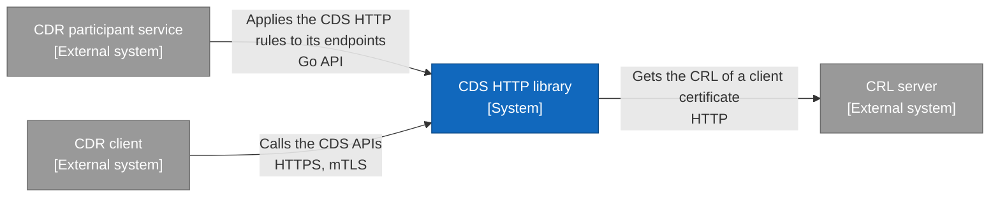

# CDS HTTP library

The CDS HTTP library gives the HTTP rules of the Consumer Data Standards that the CDR APIs of each lab service share. These rules are the version negotiation, the interaction ID, the CDS error format, pagination, the response envelope, CORS, the TLS and mTLS profile, and a revocation check of client certificates with the CRL. A service chooses the endpoints that each rule applies to. The specification of the service gives that choice.

## Context

## Library specifications

| Library | Specification |
|---|---|
| `pkg/platform/httproute` | None. |
| `pkg/platform/jsonhttp` | [JSON body library](../platform/jsonhttp/DESIGN.md) |

## Goals

- One implementation of each CDS HTTP rule that two or more services share.
- A rule that the CDS leaves open has one judgement for all services.

## Non-goals

- The choice of the endpoints that each rule applies to, the supported versions and the CORS headers that a service exposes. The specification of each service gives them.
- The server certificates of a service. The service gives them.
- The revocation check of the Register. The Register checks client certificates with its own CRL ([the Register checks with its newest CRL](../../services/register/design/certificate-revocation.md#reg-0726)).
- The errors of the security endpoints and of the lab-only interfaces. They have their own formats.

## Versioning

- **CDSL-0001** A service must give each versioned endpoint its lowest and its highest supported version. ([CDS: HTTP Headers][cds-http-headers])
- **CDSL-0002** When a request to a versioned endpoint has no `x-v` header, the response is 400 with `urn:au-cds:error:cds-all:Header/Missing`. ([CDS: Missing Required Header][cds-error-400-header-missing])
- **CDSL-0003** When `x-v` or `x-min-v` is not a positive integer, the response is 400 with `urn:au-cds:error:cds-all:Header/InvalidVersion`. ([CDS: Invalid Version][cds-error-400-invalid-version]; [Judgement: 400 for a version value that is not valid, as the CDS says](#cdsl-0059))
- **CDSL-0004** A positive integer in a version header has only decimal digits and a value of 1 or more. For example, `003` is valid, and `+3` is not valid. ([CDS: Invalid Version][cds-error-400-invalid-version]; [Judgement: only decimal digits in a version header, with leading zeros](#cdsl-0060))
- **CDSL-0005** A version value that is too large for an integer is higher than each supported version. ([Judgement: only decimal digits in a version header, with leading zeros](#cdsl-0060))
- **CDSL-0006** The endpoint serves the highest supported version between `x-min-v` and `x-v`. ([CDS: HTTP Headers][cds-http-headers])
- **CDSL-0007** When `x-min-v` is equal to or higher than `x-v`, the endpoint ignores `x-min-v`. ([CDS: HTTP Headers][cds-http-headers])
- **CDSL-0008** When the endpoint supports no requested version, the response is 406 with `urn:au-cds:error:cds-all:Header/UnsupportedVersion`. ([CDS: Unsupported Version][cds-error-406-unsupported-version])
- **CDSL-0009** After a successful version negotiation, each response of the endpoint has an `x-v` header with the version served, also an error response. ([CDS: HTTP Headers][cds-http-headers])

## Interaction ID

- **CDSL-0010** Each response has an `x-fapi-interaction-id` header. Its value is the `x-fapi-interaction-id` of the request, or a new [RFC 4122][rfc4122] UUID when the request has none. ([CDS: HTTP Headers][cds-http-headers])
- **CDSL-0011** A service must apply the interaction ID to each CDS API, also to an API with no authentication. ([CDS: HTTP Headers][cds-http-headers]; [Judgement: the interaction ID on each CDS API](#cdsl-0061))

## Error format

- **CDSL-0012** An error response has the CDS error format: a JSON object with an `errors` list, and each error has a `code`, a `title` and a `detail`. ([CDS: Error Codes][cds-error-codes])
- **CDSL-0013** The `title` of an error is the title that the CDS error list gives for its code. ([CDS: Error Codes][cds-error-codes])
- **CDSL-0014** An error has no `meta` object. ([CDS: Error Codes][cds-error-codes]; [Judgement: no meta object in an error](#cdsl-0062))
- **CDSL-0015** When an unexpected server error occurs, the response is 500 with `urn:au-cds:error:cds-all:GeneralError/Unexpected`. ([CDS: Unexpected Error][cds-error-5xx-unexpected])
- **CDSL-0016** The `detail` of an unexpected error does not show its cause. ([CDS: Unexpected Error][cds-error-5xx-unexpected])

## Pagination

- **CDSL-0017** When a request to a paginated endpoint has no `page`, the response gives page 1. ([CDS: Pagination][cds-pagination])
- **CDSL-0018** When a request to a paginated endpoint has no `page-size`, the page size is 25. ([CDS: Pagination][cds-pagination])
- **CDSL-0019** The maximum page size is 1000. ([CDS: Pagination][cds-pagination])
- **CDSL-0020** When `page` is not a positive integer, the response is 400 with `urn:au-cds:error:cds-all:Field/Invalid`, and the `detail` is `page`. ([CDS: Invalid Field][cds-error-400-field-invalid])
- **CDSL-0021** When `page-size` is not a positive integer or is more than 1000, the response is 400 with `urn:au-cds:error:cds-all:Field/InvalidPageSize`. ([CDS: Invalid Page Size][cds-error-400-invalid-page-size]; [CDS: Pagination][cds-pagination])
- **CDSL-0022** A `page` or a `page-size` with an empty value is the same as an absent parameter. ([Judgement: an empty page parameter is absent](#cdsl-0063))
- **CDSL-0023** When the requested page is after the last page, the response is 422 with `urn:au-cds:error:cds-all:Field/InvalidPage`, and the `detail` is the number of pages. ([CDS: Invalid Page][cds-error-422-invalid-page]; [Judgement: 422 for a page out of range, as the CDS says](#cdsl-0064))
- **CDSL-0024** Page 1 of an empty list is in range. ([CDS: Pagination][cds-pagination])
- **CDSL-0025** The `links` object of a page has `self`, which is the link of the requested page. ([CDS: Pagination][cds-pagination])
- **CDSL-0026** When the list has records, `links` has `first` and `last`. ([CDS: Pagination][cds-pagination])
- **CDSL-0027** After the first page, `links` has `prev`. ([CDS: Pagination][cds-pagination])
- **CDSL-0028** Before the last page, `links` has `next`. ([CDS: Pagination][cds-pagination])
- **CDSL-0029** Each link is the base URI that the service gives and the path of the request, with `page`, `page-size` and the filters that the service gives. ([CDS: Pagination][cds-pagination])
- **CDSL-0030** A service must give each filter of the request that the endpoint supports, so that each link keeps the filters. ([CDS: Pagination][cds-pagination])
- **CDSL-0031** The `meta` object of a page has `totalRecords` and `totalPages`. When the list has no records, `totalPages` is 0. ([CDS: Pagination][cds-pagination])
- **CDSL-0032** A page of transactions has `meta.isQueryParamUnsupported` with the value `false`. ([CDS: Get Transactions For Account][cds-get-transactions])
- **CDSL-0033** A service must support each query parameter of an endpoint that gives a page of transactions. ([CDS: Get Transactions For Account][cds-get-transactions])

## Response envelope

- **CDSL-0034** A response that is not paginated has `data`, `links.self` and an empty `meta` object. ([CDS: Payload Conventions][cds-payload-conventions])
- **CDSL-0035** The `links.self` of a response is the base URI that the service gives and the path of the request. ([CDS: Payload Conventions][cds-payload-conventions])

## CORS

- **CDSL-0036** A service must apply the CORS rules only to APIs with no authentication. ([CDS: CORS][cds-cors])
- **CDSL-0037** Each response of an endpoint with the CORS rules has `Access-Control-Allow-Origin: *`, also an error response. ([CDS: CORS][cds-cors])
- **CDSL-0038** Each response that is not a preflight response has `Access-Control-Expose-Headers` with the list of headers that the service gives. ([Fetch: CORS protocol][fetch-cors])
- **CDSL-0039** When a request is `OPTIONS` with an `Access-Control-Request-Method` header, the response is a preflight response: 204 with `Access-Control-Allow-Origin: *` and `Access-Control-Allow-Methods: GET`. ([Fetch: CORS protocol][fetch-cors])
- **CDSL-0040** When a preflight request has `Access-Control-Request-Headers`, the response has an `Access-Control-Allow-Headers` that contains the requested headers. ([Fetch: CORS protocol][fetch-cors]; [Judgement: the CORS preflight permits each requested header](#cdsl-0065))

## TLS and mTLS

- **CDSL-0041** Each listener with the TLS profile accepts only TLS 1.2 and TLS 1.3. ([CDS: Transaction Security][cds-transaction-security]; [CDS: Ciphers][cds-ciphers])
- **CDSL-0042** With TLS 1.2, the only cipher suites are `TLS_ECDHE_RSA_WITH_AES_128_GCM_SHA256` and `TLS_ECDHE_RSA_WITH_AES_256_GCM_SHA384`. ([CDS: Ciphers][cds-ciphers]; [Judgement: two TLS 1.2 cipher suites](#cdsl-0066))
- **CDSL-0043** A listener with the TLS profile and no mTLS does not request a client certificate. ([CDS: Transaction Security][cds-transaction-security])
- **CDSL-0044** An mTLS listener accepts only a client certificate that chains to the CA bundle that the service gives. ([CDS: Certificate Trust Model][cds-cert-trust-model]; [CDS: Transaction Security][cds-transaction-security])
- **CDSL-0045** For an mTLS listener, a service must give the CDR CA bundle, with the intermediate and the root. ([relying parties trust the CDR CA bundle](../../pki/DESIGN.md#pki-0013))
- **CDSL-0046** For an mTLS listener, a service must give a revocation check of client certificates. ([CDS: Certificate Validation][cds-cert-validation])
- **CDSL-0047** When the revocation check of the service fails, the mTLS listener refuses the client certificate. ([CDS: Certificate Validation][cds-cert-validation])

## CRL check

These rules apply to a service that uses the CRL check of the library as its revocation check.

- **CDSL-0048** The CRL check uses the CRL at each HTTP or HTTPS CRL distribution point of the certificate. ([CDS: Certificate Validation][cds-cert-validation]; [RFC 5280, section 4.2.1.13][rfc5280-crldp])
- **CDSL-0049** When the certificate is on the CRL, the CRL check fails. ([CDS: Certificate Validation][cds-cert-validation])
- **CDSL-0050** The CRL check uses only a CRL that a certificate of the CA bundle signed, and only before the next update of the CRL. ([CDS: Certificate Validation][cds-cert-validation]; [RFC 5280, section 5.1.2.5][rfc5280-next-update])
- **CDSL-0051** When the CRL check has no CRL that it can use, the CRL check fails. ([Judgement: refuse a certificate with a revocation status that is not known](#cdsl-0067))
- **CDSL-0052** When the last CRL that the CRL check loaded is older than the maximum age, the CRL check loads the CRL again. ([Judgement: a maximum CRL age of 1 minute](#cdsl-0068))
- **CDSL-0053** The default maximum age is 1 minute. ([Judgement: a maximum CRL age of 1 minute](#cdsl-0068))
- **CDSL-0054** With a maximum age of 0, the CRL check loads the CRL at each check. ([Judgement: a maximum CRL age of 1 minute](#cdsl-0068))
- **CDSL-0055** When a load fails and the last CRL is before its next update, the CRL check uses the last CRL. ([RFC 5280, section 5.1.2.5][rfc5280-next-update]; [Judgement: the last CRL stays in use after a failed load](#cdsl-0069))
- **CDSL-0056** When the CRL check uses the last CRL after a failed load, it loads the CRL again after the longer of the maximum age and 1 minute. ([Judgement: the last CRL stays in use after a failed load](#cdsl-0069))
- **CDSL-0057** Telemetry: when the CRL check uses the last CRL after a failed load, it logs a warning. ([Judgement: the last CRL stays in use after a failed load](#cdsl-0069))
- **CDSL-0058** While the CRL server can be reached, a revocation takes effect within the maximum age. ([Judgement: a maximum CRL age of 1 minute](#cdsl-0068))

## Judgements

### CDSL-0059 400 for a version value that is not valid, as the CDS says

- Kind: conflict
- Basis: Step 1. The CDS gives 400 ([CDS: Invalid Version][cds-error-400-invalid-version]). A DSB guide says that 406 is also suitable ([CDR Support: Error scenarios and responses][support-error-scenarios]).
- Reason: The CDS is the first source.

### CDSL-0060 Only decimal digits in a version header, with leading zeros

- Kind: choice
- Basis: Step 2. The CDS requires a positive integer ([CDS: Invalid Version][cds-error-400-invalid-version]). Leading zeros are valid ([CDR Support: Allowed values for x-v and x-min-v][support-version-values]).
- Reason: A sign or a space is not a usual integer format. A very large version is still a positive integer.

### CDSL-0061 The interaction ID on each CDS API

- Kind: choice
- Basis: Step 3.3. The CDS requires the header on authenticated APIs only ([CDS: HTTP Headers][cds-http-headers]).
- Reason: One behaviour for all APIs is simpler. It also helps tracing across participants.

### CDSL-0062 No meta object in an error

- Kind: choice
- Basis: Step 3.3. The `meta` object of an error is optional ([CDS: Error Codes][cds-error-codes]).
- Reason: The services use only standard CDS error codes, so the object has no content.

### CDSL-0063 An empty page parameter is absent

- Kind: choice
- Basis: Step 3.3. The CDS does not say what an empty parameter value means ([CDS: Pagination][cds-pagination]).
- Reason: The two parameters are optional. A client that makes a query from a form can send a name with no value.

### CDSL-0064 422 for a page out of range, as the CDS says

- Kind: conflict
- Basis: Step 1. The CDS says that the code must be supported ([CDS: Invalid Page][cds-error-422-invalid-page]). A DSB guide also permits 200 and 400 ([CDR Support: Error scenarios and responses][support-error-scenarios]). The Register OpenAPI specification lists no 422 for Get Data Holder Brands, but it gives no other code.
- Reason: The CDS is the first source.

### CDSL-0065 The CORS preflight permits each requested header

- Kind: choice
- Basis: Step 3.1. The CDS requires that CORS protections are disabled on unauthenticated APIs ([CDS: CORS][cds-cors]). The DSB guidance gives a minimum list of headers ([CDR Support: CORS support][support-cors]). The production Register also permits the requested headers.
- Reason: The requested headers always include the headers of the minimum list that the client sends. An allowlist blocks a page that sends a harmless header, and it protects nothing.

### CDSL-0066 Two TLS 1.2 cipher suites

- Kind: choice
- Basis: Step 1. The CDS permits only the suites that [FAPI 1.0 Advanced, section 8.5][fapi-tls] permits and that [BCP 195][bcp195] recommends ([CDS: Ciphers][cds-ciphers]). Observed on 2026-10-03: the production public API of the Register also accepts `ECDHE-RSA-AES128-SHA256`, which the CDS does not permit.
- Reason: With an RSA key, only these two suites are in both lists. A client that works with the lab then also works with production.

### CDSL-0067 Refuse a certificate with a revocation status that is not known

- Kind: choice
- Basis: Step 3.1. The CDS requires the check ([CDS: Certificate Validation][cds-cert-validation]), and does not say what to do when the check cannot be done.
- Reason: To accept the certificate lets a revoked client connect when the CRL server is down. The status is not known only when no CRL can be used ([the last CRL after a failed load](#cdsl-0055)).

### CDSL-0068 A maximum CRL age of 1 minute

- Kind: choice
- Basis: Step 3.3. The CDS gives no time ([CDS: Certificate Validation][cds-cert-validation]).
- Reason: A revocation must take effect quickly. A burst of connections must cause one load.

### CDSL-0069 The last CRL stays in use after a failed load

- Kind: choice
- Basis: Step 3.2. A CRL is valid until its next update ([RFC 5280, section 5.1.2.5][rfc5280-next-update]).
- Reason: When the Register serves the CRL ([ADR 0022][adr-0022]), a short outage of the Register otherwise stops all mTLS clients. A request to a CRL server that does not reply can take 5 seconds, so a load at each connection delays each handshake. The warning shows the outage, because the clients do not see it.

## Withdrawn

None.

[adr-0022]: ../../docs/adr/0022-run-the-mock-cdr-intermediate-ca-in-the-register.md
[cds-http-headers]: https://consumerdatastandardsaustralia.github.io/standards-archives/standards-1.36.0/#http-headers
[cds-error-codes]: https://consumerdatastandardsaustralia.github.io/standards-archives/standards-1.36.0/#error-codes
[cds-error-400-header-missing]: https://consumerdatastandardsaustralia.github.io/standards-archives/standards-1.36.0/#error-400-header-missing
[cds-error-400-invalid-version]: https://consumerdatastandardsaustralia.github.io/standards-archives/standards-1.36.0/#error-400-header-invalid-version
[cds-error-406-unsupported-version]: https://consumerdatastandardsaustralia.github.io/standards-archives/standards-1.36.0/#error-406-header-unsupported-version
[cds-error-400-field-invalid]: https://consumerdatastandardsaustralia.github.io/standards-archives/standards-1.36.0/#error-400-field-invalid
[cds-error-400-invalid-page-size]: https://consumerdatastandardsaustralia.github.io/standards-archives/standards-1.36.0/#error-400-field-invalid-page-size
[cds-error-422-invalid-page]: https://consumerdatastandardsaustralia.github.io/standards-archives/standards-1.36.0/#error-422-field-invalid-page
[cds-error-5xx-unexpected]: https://consumerdatastandardsaustralia.github.io/standards-archives/standards-1.36.0/#error-5xx-unexpected-error
[cds-pagination]: https://consumerdatastandardsaustralia.github.io/standards-archives/standards-1.36.0/#pagination
[cds-payload-conventions]: https://consumerdatastandardsaustralia.github.io/standards-archives/standards-1.36.0/#payload-conventions
[cds-get-transactions]: https://consumerdatastandardsaustralia.github.io/standards-archives/standards-1.36.0/#cdr-banking-api_get-transactions-for-account
[cds-cors]: https://consumerdatastandardsaustralia.github.io/standards-archives/standards-1.36.0/#cors
[cds-transaction-security]: https://consumerdatastandardsaustralia.github.io/standards-archives/standards-1.36.0/#transaction-security
[cds-ciphers]: https://consumerdatastandardsaustralia.github.io/standards-archives/standards-1.36.0/#ciphers
[cds-cert-trust-model]: https://consumerdatastandardsaustralia.github.io/standards-archives/standards-1.36.0/#certificate-trust-model
[cds-cert-validation]: https://consumerdatastandardsaustralia.github.io/standards-archives/standards-1.36.0/#certificate-validation
[support-error-scenarios]: https://cdr-support.zendesk.com/hc/en-us/articles/5729181240591
[support-version-values]: https://cdr-support.zendesk.com/hc/en-us/articles/900004807083
[support-cors]: https://cdr-support.zendesk.com/hc/en-us/articles/900003054706
[fetch-cors]: https://fetch.spec.whatwg.org/#http-cors-protocol
[fapi-tls]: https://openid.net/specs/openid-financial-api-part-2-1_0.html#tls-considerations
[bcp195]: https://www.rfc-editor.org/rfc/rfc9325#section-4.2
[rfc4122]: https://www.rfc-editor.org/rfc/rfc4122
[rfc5280-crldp]: https://www.rfc-editor.org/rfc/rfc5280#section-4.2.1.13
[rfc5280-next-update]: https://www.rfc-editor.org/rfc/rfc5280#section-5.1.2.5
