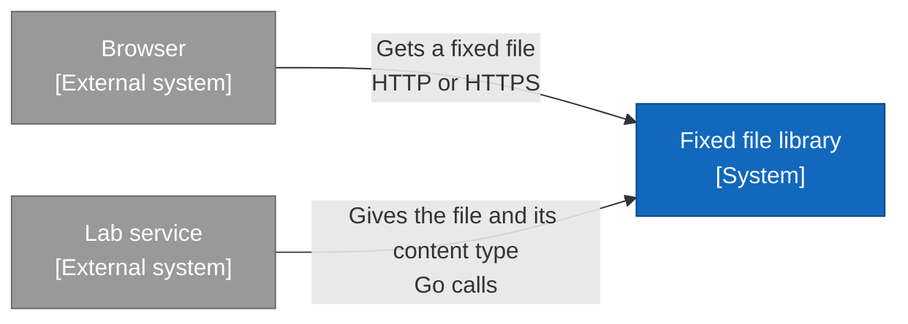

# Fixed file library

The fixed file library serves a file that does not change while the process runs, for example a stylesheet, a font or a logo. The data holder uses it for the brand files and for the styles and the fonts of the consumer pages. The service gives the file, its content type and the paths.

## Context

## Library specifications

None.

## Goals

- A browser gets a new version of a fixed file after a restart of the service, with no change of its path.
- A browser that has the current version gets a small response.

## Non-goals

- The paths of the files, the listener of each file and the authentication. The specification of the service gives them.
- The checks of a file, for example the size of a logo. The specification of the service gives them.

## Caching

- **ASSET-0001** Each response has `Cache-Control: no-cache` and an `ETag` that the content of the file gives. A request with an `If-None-Match` that agrees with the `ETag` gets 304. ([RFC 9111, section 5.2.2.4][rfc9111-no-cache]; [RFC 9110, section 13.1.2][rfc9110-if-none-match]; [Judgement: the browser asks again each time](#asset-0002))

## Judgements

### ASSET-0002 The browser asks again each time

- Kind: choice
- Basis: Step 3.2. `no-cache` makes a cache validate the stored response before each use ([RFC 9111, section 5.2.2.4][rfc9111-no-cache]).
- Reason: The file names have no content hash, so a browser must not keep a file after a new version starts. The `ETag` makes the answer small when the file did not change.

## Withdrawn

None.

[rfc9110-if-none-match]: https://www.rfc-editor.org/rfc/rfc9110#section-13.1.2
[rfc9111-no-cache]: https://www.rfc-editor.org/rfc/rfc9111#section-5.2.2.4
