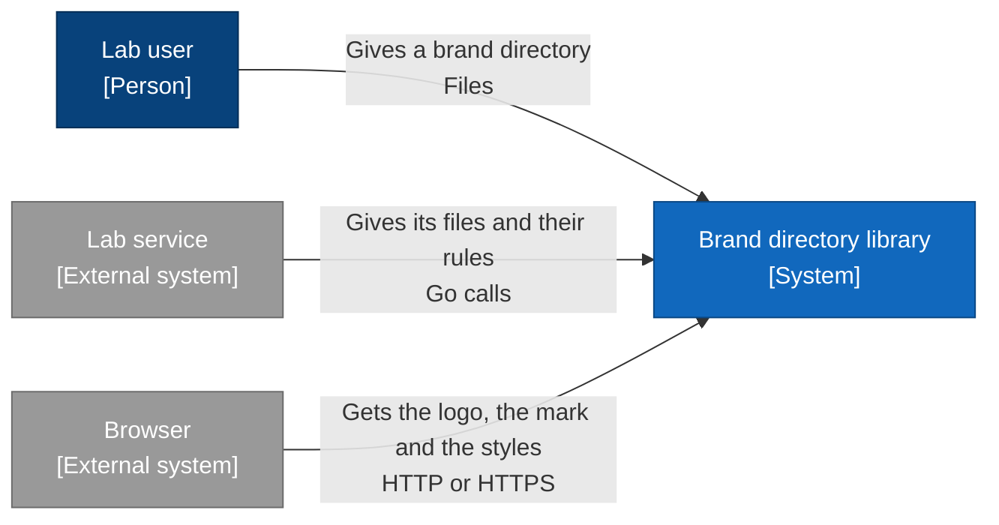

# Brand directory library

The brand directory library reads and validates the brand directory of a lab service, and serves the logo, the mark and the styles of the brand. It gives the files and the rules that each brand directory has. The data holder and the data recipient use it. Each service gives its own files, the fields of its brand file and their rules.

## Context

## Library specifications

| Library | Specification |
|---|---|
| `pkg/platform/asset` | [Fixed file library](../asset/DESIGN.md) |

## Goals

- One format of brand directory for each lab service that shows a brand.
- A brand directory that is not valid stops the service at start-up, with an error that names each file and rule.

## Non-goals

- The files of a service, the fields of its brand file and their rules, for example the product catalogue of the data holder. The specification of the service gives them.
- The paths and the listeners of the brand files. The specification of the service gives them.
- The contrast of the colours of a brand. The [design system](../../../web/packages/ui/design/tokens-and-brands.md#ui-0013) gives the rule, and the tests of the web workspace check each preset brand.
- The selection of the brand directory and the preset brands of a service.

## Files of a brand directory

- **BRAND-0001** `tokens.json` is required. It has the values of the brand for the semantic colour roles, the body font, the heading font and the radius of the design system. They are in the token format of the design system, with literal values only. ([what a brand can change](../../../web/packages/ui/design/tokens-and-brands.md#ui-0031); [Judgement: the brand directory of a data holder (ADR 0023)][adr-0023])
- **BRAND-0002** `logo.svg` is required. It is the logo, legible on the brand colour of the header of the pages and on white. ([the logo on the brand colour and on white](../../../web/packages/ui/design/consumer-pages.md#ui-0363))
- **BRAND-0003** `logo.png` is required. It is the logo of `logo.svg` as a PNG image for an email, legible on the brand colour of the header of the email. ([Judgement: the brand directory of a data holder (ADR 0023)][adr-0023])
- **BRAND-0004** `mark.svg` is required. It is a square symbol of the brand, for small sizes. ([a brand can change the logo](../../../web/packages/ui/design/tokens-and-brands.md#ui-0031))
- **BRAND-0005** `ATTRIBUTION.md` is optional. It gives the source, the author and the licence of each photo, and it is 16 KiB or less. The service does not read or serve it. ([Judgement: the brand directory of a data holder (ADR 0023)][adr-0023])
- **BRAND-0025** A service adds its own required and optional files to the brand directory. It gives the size limit of each file. For example, the data holder adds `products.json`. ([Judgement: one brand directory format for each lab service](#brand-0033))
- **BRAND-0026** The brand file `brand.json` is required. It has the field `brandName` and the fields that the service adds. ([CDS: Register API schemas][cds-register-schemas]; [Judgement: one brand directory format for each lab service](#brand-0033))
- **BRAND-0006** The `brandName` has 1 to 200 characters, and it is not only white space. ([CDS: Register API schemas][cds-register-schemas])
- **BRAND-0007** The `brandName` has no control character. For example, the library refuses a brand name with a line break. ([Judgement: the brand directory of a data holder (ADR 0023)][adr-0023])
- **BRAND-0008** `tokens.json` has each token of a brand of the design system. A missing token is an error. ([Judgement: the brand directory of a data holder (ADR 0023)][adr-0023])

## Validation of the brand directory

- **BRAND-0009** A JSON file of the brand directory has only the fields of the contract. The library refuses an unknown field, and a file that the contract does not name. ([Judgement: the brand directory of a data holder (ADR 0023)][adr-0023])
- **BRAND-0010** The contract of the brand directory has no format version. ([Judgement: the brand directory of a data holder (ADR 0023)][adr-0023])
- **BRAND-0011** The library ignores each entry of the directory whose name starts with `..`. For example, it ignores the `..data` entry of a ConfigMap volume. ([Kubernetes: atomic_writer.go][k8s-atomic-writer]; [Judgement: the brand directory of a data holder (ADR 0023)][adr-0023])
- **BRAND-0012** The body font and the heading font of a brand are each one of the fixed set of fonts of the design system. A brand with a different font is a change to the design system. ([Judgement: the brand directory of a data holder (ADR 0023)][adr-0023])
- **BRAND-0013** Each colour of `tokens.json` is in the sRGB gamut. ([colour values in OKLCH](../../../web/packages/ui/design/tokens-and-brands.md#ui-0012))
- **BRAND-0014** Each SVG file is well-formed XML with an `svg` root element in the SVG namespace and a `viewBox`. It is 100 KiB or less. ([Judgement: the brand directory of a data holder (ADR 0023)][adr-0023]; [Judgement: SVG files in the SVG namespace, and a square mark](#brand-0030))
- **BRAND-0015** The `viewBox` of `mark.svg` is square. ([Judgement: SVG files in the SVG namespace, and a square mark](#brand-0030))
- **BRAND-0016** `logo.png` is a valid PNG image of 100 KiB or less. It is exactly 96 pixels high and 768 pixels wide or less. ([Judgement: a `logo.png` 96 pixels high and at most 768 pixels wide](#brand-0031))
- **BRAND-0017** The aspect ratio of `logo.png` is the aspect ratio of the `viewBox` of `logo.svg`, with a tolerance of 2 %. The aspect ratio is the width divided by the height. ([Judgement: a `logo.png` 96 pixels high and at most 768 pixels wide](#brand-0031))
- **BRAND-0018** Each JSON file is 1 MiB or less. ([Kubernetes: ConfigMaps][k8s-configmap]; [Judgement: the brand directory of a data holder (ADR 0023)][adr-0023])
- **BRAND-0019** Each photo is a WebP image that is not animated. The service gives the size limit, the width and the aspect ratio of each photo. ([RFC 9649][rfc9649]; [Judgement: the brand directory of a data holder (ADR 0023)][adr-0023])
- **BRAND-0020** The library reads the size of each image, and the animation flag of each photo, in the header of the file before it decodes the image. ([RFC 9649][rfc9649]; [Judgement: the brand directory of a data holder (ADR 0023)][adr-0023])
- **BRAND-0021** The brand directory is 1 MiB or less in all, with the files of the service. ([Kubernetes: ConfigMaps][k8s-configmap]; [Judgement: the brand directory of a data holder (ADR 0023)][adr-0023])
- **BRAND-0022** When a rule of the brand directory fails, the library gives one error. The error names each file and rule that fails, also the rules of the service. ([Judgement: the brand directory of a data holder (ADR 0023)][adr-0023])

## Brand files

- **BRAND-0023** The stylesheet of the brand sets the custom properties of the design system under the selector `:root:root`. Thus the sequence of the stylesheets on a page has no effect. A service can serve a stylesheet with only some of the properties. ([a brand is a set of values for the brand modifier](../../../web/packages/ui/design/tokens-and-brands.md#ui-0030))
- **BRAND-0024** A response with an SVG file of the brand does not permit scripts, also when a browser opens its URL directly. ([MDN: CSP sandbox][mdn-csp-sandbox]; [Judgement: no script in an SVG file of the brand](#brand-0032))

## Judgements

### BRAND-0030 SVG files in the SVG namespace, and a square mark

- Kind: choice
- Basis: Step 3.3. [ADR 0023][adr-0023] gives the SVG structure, and the design system shows the mark in a row of the hero ([the row of the hero](../../../web/packages/ui/design/consumer-pages.md#ui-0365)).
- Reason: A browser does not show an SVG file with no SVG namespace as an image. A `viewBox` that is not square cannot give a square mark.

### BRAND-0031 A `logo.png` 96 pixels high and at most 768 pixels wide

- Kind: choice
- Basis: Step 3.3. [ADR 0023][adr-0023] requires a fixed height, a maximum width and the aspect ratio of `logo.svg`, and does not give the numbers.
- Reason: An email shows the logo 48 CSS px high, and 96 pixels gives a sharp image on a screen with a pixel ratio of 2. A width of 768 pixels (an aspect ratio of 8) is more than each preset logo needs, and the size limit is the limit of the SVG files. The tolerance permits the rounding of the width to a whole pixel.

### BRAND-0032 No script in an SVG file of the brand

- Kind: choice
- Basis: Step 3.2. A browser runs a script in an SVG file that it opens directly ([MDN: CSP sandbox][mdn-csp-sandbox]).
- Reason: A user brand directory can contain an SVG file with a script. The sandbox stops the script also outside the pages.

### BRAND-0033 One brand directory format for each lab service

- Kind: choice
- Basis: Step 3.3. The CDS gives the brand name and the logo of each brand on the Register ([CDS: Register API schemas][cds-register-schemas]), and says nothing about how the software gets them. The data holder gets its brand from a strict brand directory ([ADR 0023][adr-0023]).
- Reason: One format with the same rules is the least complex for a lab user who makes brands for more than one kind of service. Each service adds only the files that its brand needs.

## Withdrawn

None.

[adr-0023]: ../../../docs/adr/0023-give-the-brand-of-a-data-holder-as-a-strict-brand-directory.md
[cds-register-schemas]: https://consumerdatastandardsaustralia.github.io/standards-archives/standards-1.36.0/#cdr-register-api-schemas
[k8s-atomic-writer]: https://github.com/kubernetes/kubernetes/blob/master/pkg/volume/util/atomic_writer.go
[k8s-configmap]: https://kubernetes.io/docs/concepts/configuration/configmap/
[mdn-csp-sandbox]: https://developer.mozilla.org/en-US/docs/Web/HTTP/Reference/Headers/Content-Security-Policy/sandbox
[rfc9649]: https://www.rfc-editor.org/rfc/rfc9649
