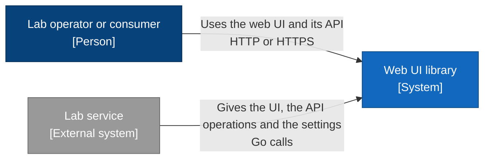

# Web UI library

The web UI library serves a [web UI](../../../docs/spec/glossary.md#web-ui) and its API on one listener. The lab services use it for the operator consoles of the Register and the data holder, and for the online bank site of the data holder. It gives the browser security of the listener, the cache headers, the routes of the UI and its API, and the list parameters of the API. Each service gives the UI, the operations of the API and the names of the settings.

## Context

## Library specifications

| Library | Specification |
|---|---|
| `pkg/platform/hostallowlist` | [Host allowlist library](../hostallowlist/DESIGN.md) |
| `pkg/platform/httproute` | None. |
| `pkg/platform/problem` | [Problem details library](../problem/DESIGN.md) |

## Goals

- One set of browser security rules for each lab web UI.
- One set of cache rules and routes for each lab web UI.
- One format of the page parameters for each list of a web UI API.

## Non-goals

- TLS, a login and cookies. The specification of each service gives them. For example, the operator consoles use plain HTTP, and the online bank site uses TLS and a session cookie.
- The format of the values of the `Host` allowlist, and their comparison. The [Host allowlist library](../hostallowlist/DESIGN.md) gives them.
- The format of a problem details body. The [problem details library](../problem/DESIGN.md) gives it.
- The operations of each API, the total of a list and the other query parameters. The specification of each service gives them.
- The brand files that a service serves on the listener.

## Listener

- **CNSL-0001** The web UI and its API are on one listener, so they have one origin. ([ADR 0014][adr-0014])
- **CNSL-0002** The listener is off when its setting has no value or is false. A true value of the setting turns the listener on. For example, the Register console is on when `CONSOLE_ENABLED` is `true`. ([Judgement: the web UI is off by default](#cnsl-0018))
- **CNSL-0003** When the listener is on, the setting of the `Host` allowlist is required, and it has no default. ([Judgement: a Host allowlist with no default](#cnsl-0019))
- **CNSL-0004** The listener refuses each request, with each method, whose `Host` header is not in the allowlist. The response is 403 with a problem details body. ([Vite advisory GHSA-vg6x-rcgg-rjx6][vite-dns-rebinding]; [Judgement: a Host allowlist with no default](#cnsl-0019))

## Browser security

- **CNSL-0005** When the browser says that a request is cross-origin, the listener refuses each method other than GET, HEAD and OPTIONS. The browser says this with a `Sec-Fetch-Site` other than `same-origin` or `none`, or with an `Origin` that is not the host. The response is 403 with a problem details body. ([Go: CrossOriginProtection][go-cop]; [OWASP: CSRF Prevention][owasp-csrf])
- **CNSL-0006** The responses have no CORS headers, so a browser permits no cross-origin request. ([OWASP ASVS 5.0, V3.4.2][asvs-v3])
- **CNSL-0007** Each response has these headers. ([OWASP ASVS 5.0, V3.4][asvs-v3]; [RFC 9700, section 4.16][rfc9700-clickjacking]; [Judgement: a strict CSP with Trusted Types](#cnsl-0020))
  - `Content-Security-Policy: default-src 'self'; script-src 'self'; style-src 'self'; img-src 'self' data:; font-src 'self'; connect-src 'self'; object-src 'none'; base-uri 'none'; form-action 'self'; frame-ancestors 'none'; require-trusted-types-for 'script'`
  - `X-Content-Type-Options: nosniff`
  - `Referrer-Policy: no-referrer`
  - `Cross-Origin-Opener-Policy: same-origin`

## Caching

- **CNSL-0008** Each response of the API has `Cache-Control: no-store`. ([RFC 9111][rfc9111]; [Judgement: the cache rules of the web UI](#cnsl-0021))
- **CNSL-0009** The HTML page, and each file of the web UI that is not under the path `/assets/`, has `Cache-Control: no-cache`. For example, `/favicon.svg` has `no-cache`. ([RFC 9111][rfc9111]; [Judgement: the cache rules of the web UI](#cnsl-0021))
- **CNSL-0010** Each file under the path `/assets/` has `Cache-Control: public, max-age=31536000, immutable`. A web UI must put under this path only the files whose name contains a hash of their content. ([RFC 9111][rfc9111]; [Judgement: the cache rules of the web UI](#cnsl-0021))

## Routes

- **CNSL-0011** The API is under the path `/api/`. ([Judgement: one prefix for the API](#cnsl-0022))
- **CNSL-0012** A request under `/api/` whose path and method are not an operation of the API gives 404 with a problem details body. For example, `GET /api/unknown` gives 404. ([RFC 9110, section 15.5.5][rfc9110-404])
- **CNSL-0013** A GET for a path that is not under `/api/` and is not a file of the web UI gives the HTML page. The web UI then shows its own route or its "not found" page. ([Judgement: the web UI routes in the browser](#cnsl-0023))

## Lists

- **CNSL-0014** A list of the API gets the page in the query parameter `page` and the page size in the query parameter `pageSize`. ([Judgement: page parameters, not the CDS pagination](#cnsl-0024))
- **CNSL-0015** The page size is 25 by default, and 100 at most. ([Judgement: the page size of a list](#cnsl-0025))
- **CNSL-0016** When `page` or `pageSize` is not an integer of 1 or more, the response is 400. A `pageSize` above 100 also gives 400. For example, `page=0` gives 400. ([Judgement: page parameters, not the CDS pagination](#cnsl-0024))
- **CNSL-0017** An empty value of `page`, `pageSize`, `sort`, `order` or a filter is the same as an absent parameter. For example, `sort=` gives the default sort. ([Judgement: an empty value is absent](#cnsl-0026))

## Judgements

### CNSL-0018 The web UI is off by default

- Kind: choice
- Basis: Step 3.3. The CDS and the ACCC give no rule for a lab web UI. [ADR 0014][adr-0014] gives a listener for each web UI.
- Reason: A production service has no such UI. A deployment must not get one without an explicit setting.

### CNSL-0019 A Host allowlist with no default

- Kind: choice
- Basis: Step 3.2. A plain HTTP server with no check of the `Host` header is open to DNS rebinding ([Vite advisory GHSA-vg6x-rcgg-rjx6][vite-dns-rebinding]). The `Host` header gives the host and the port of the request ([RFC 9110, section 7.2][rfc9110-host]).
- Reason: With DNS rebinding, a web page can send a same-origin request that the cross-origin check does not refuse, because the `Origin` and the `Host` agree. A default is a value of one deployment, so the setting is required. 403 is the same status as the refusal of a cross-origin change.

### CNSL-0020 A strict CSP with Trusted Types

- Kind: choice
- Basis: Step 3.2. A nonce or a hash in a policy is for pages that have inline scripts ([web.dev: Strict CSP][strict-csp]). Trusted Types are in all three browser engines ([MDN compatibility data][bcd-trusted-types]).
- Reason: The UI build has no inline script, so `script-src 'self'` needs no nonce and no hash. Trusted Types stop a script that assigns an HTML string.

### CNSL-0021 The cache rules of the web UI

- Kind: choice
- Basis: Step 3.2. [RFC 9111][rfc9111] gives `no-store`, `no-cache` and `immutable`.
- Reason: The user always sees current data. A new build of the UI loads at once, and a file with a hash in its name never changes.

### CNSL-0022 One prefix for the API

- Kind: choice
- Basis: Step 3.3. The CDS and the ACCC give no rule for a lab web UI.
- Reason: One prefix separates the API from the paths of the UI. The UI can then use each other path for its own routes.

### CNSL-0023 The web UI routes in the browser

- Kind: choice
- Basis: Step 3.3. The CDS and the ACCC give no rule for a lab web UI. [ADR 0014][adr-0014] gives a single-page application.
- Reason: The UI finds its route from the path. A link to a page of the UI then works when the browser loads it directly.

### CNSL-0024 Page parameters, not the CDS pagination

- Kind: choice
- Basis: Step 3.3. The [CDS pagination][cds-pagination] is for the CDR APIs.
- Reason: The API of a web UI is not a CDR API. A page and a page size in the request are simpler for the UI.

### CNSL-0025 The page size of a list

- Kind: choice
- Basis: Step 3.3. The CDS default page size is also 25 ([CDS: Pagination][cds-pagination]).
- Reason: 25 rows fit a desktop screen in the compact density. A maximum keeps each response small.

### CNSL-0026 An empty value is absent

- Kind: choice
- Basis: Step 3.2. A form sends a field with no value as a parameter with an empty value ([HTML: Constructing the entry list][html-form-entry-list]).
- Reason: This is the usual HTTP behaviour. A link from a form with an empty field then still works.

## Withdrawn

None.

[adr-0014]: ../../../docs/adr/0014-web-uis-as-embedded-react-single-page-applications.md
[asvs-v3]: https://github.com/OWASP/ASVS/blob/v5.0.0_release/5.0/en/0x12-V3-Web-Frontend-Security.md
[bcd-trusted-types]: https://github.com/mdn/browser-compat-data/blob/main/api/TrustedTypePolicyFactory.json
[cds-pagination]: https://consumerdatastandardsaustralia.github.io/standards-archives/standards-1.36.0/#pagination
[go-cop]: https://pkg.go.dev/net/http#CrossOriginProtection
[html-form-entry-list]: https://html.spec.whatwg.org/multipage/form-control-infrastructure.html#constructing-the-form-data-set
[owasp-csrf]: https://cheatsheetseries.owasp.org/cheatsheets/Cross-Site_Request_Forgery_Prevention_Cheat_Sheet.html
[rfc9110-404]: https://www.rfc-editor.org/rfc/rfc9110#section-15.5.5
[rfc9110-host]: https://www.rfc-editor.org/rfc/rfc9110#section-7.2
[rfc9111]: https://www.rfc-editor.org/rfc/rfc9111
[rfc9700-clickjacking]: https://www.rfc-editor.org/rfc/rfc9700.html#section-4.16
[strict-csp]: https://web.dev/articles/strict-csp
[vite-dns-rebinding]: https://github.com/vitejs/vite/security/advisories/GHSA-vg6x-rcgg-rjx6
