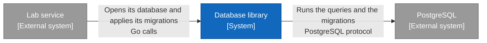

# Database library

The database library connects a lab service to its PostgreSQL database, and it applies the migrations of the service. It traces the database calls with no query arguments and no error messages, because they can contain CDR data and personal information.

## Context

## Library specifications

None.

## Goals

- One way for each lab service to connect to its database and to apply its migrations.
- No CDR data and no personal information in the database spans.

## Non-goals

- The migrations, the roles and the tables of a service. The service gives them ([ADR 0020][adr-0020]).
- The databases and the users of a deployment. The operator of the deployment gives them ([ADR 0020][adr-0020]).

## Connection

- **DBASE-0001** A service gets its database connection from the libpq environment variables. For example, `PGHOST` gives the server, and `PGDATABASE` gives the database. ([Judgement: one PostgreSQL database for each service (ADR 0002)](../../../docs/adr/0002-data-store.md))

## Migrations

- **DBASE-0002** A service applies its migrations at its start only when `DATABASE_MIGRATE_ON_START` is `true`. When the variable is not set, or is `false`, the service does not migrate. ([Judgement: one PostgreSQL database for each service (ADR 0002)](../../../docs/adr/0002-data-store.md); [Judgement: the migrations of a service create its roles (ADR 0020)](../../../docs/adr/0020-service-migrations-create-roles-and-the-operator-creates-users.md))
- **DBASE-0003** The migrations hold a PostgreSQL advisory lock while they run. For example, when two processes migrate the same database at the same time, the second process waits, and each migration applies one time. ([Judgement: one PostgreSQL database for each service (ADR 0002)](../../../docs/adr/0002-data-store.md))

## Telemetry

- **DBASE-0004** A database span has the SQL text with its placeholders, and no query arguments. ([Judgement: one PostgreSQL database for each service (ADR 0002)](../../../docs/adr/0002-data-store.md); [Judgement: OpenTelemetry for traces, metrics and logs (ADR 0006)](../../../docs/adr/0006-telemetry.md))
- **DBASE-0005** The span of a query that fails has the SQLSTATE of the error, and not its message. For example, a value that is not a UUID gives `22P02` in the span, with no value. ([Judgement: one PostgreSQL database for each service (ADR 0002)](../../../docs/adr/0002-data-store.md); [Judgement: OpenTelemetry for traces, metrics and logs (ADR 0006)](../../../docs/adr/0006-telemetry.md))

## Judgements

None.

## Withdrawn

None.

[adr-0020]: ../../../docs/adr/0020-service-migrations-create-roles-and-the-operator-creates-users.md
