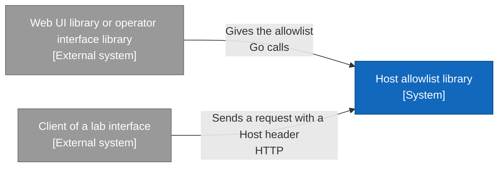

# Host allowlist library

The `Host` allowlist library refuses a request whose `Host` header is not in an allowlist, so that DNS rebinding fails. The [web UI library](../consolehttp/DESIGN.md) and the [operator interface library](../operatorhttp/DESIGN.md) use it. This specification gives the format of the values of an allowlist and their comparison. The library that uses it gives the setting and the refusal.

## Context

## Library specifications

| Library | Specification |
|---|---|
| `pkg/platform/httproute` | None. |
| `pkg/platform/problem` | [Problem details library](../problem/DESIGN.md) |

## Goals

- One format of the values of each `Host` allowlist of the lab.
- One comparison of the `Host` header with an allowlist.

## Non-goals

- The name of each setting, and the default. The [web UI library](../consolehttp/DESIGN.md) and the [operator interface library](../operatorhttp/DESIGN.md) give them.
- The response to a request that the allowlist refuses. The library that uses the allowlist gives it.

## Values

- **HOST-0001** Each value of an allowlist is a value of the `Host` header, in one of these forms. ([RFC 9110, section 7.2][rfc9110-host])
  - a host and a port, for example `127.0.0.1:8080`
  - a host with no port, for a client that uses the default port of its scheme, for example through a TLS proxy
- **HOST-0002** The comparison of the `Host` header with a value has no difference for upper and lower case. For example, `LOCALHOST:8080` agrees with `localhost:8080`. ([RFC 3986, section 3.2.2][rfc3986-host])

## Judgements

None.

## Withdrawn

None.

[rfc3986-host]: https://www.rfc-editor.org/rfc/rfc3986#section-3.2.2
[rfc9110-host]: https://www.rfc-editor.org/rfc/rfc9110#section-7.2
