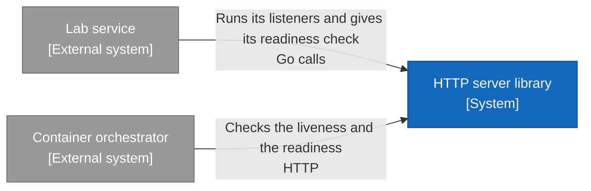

# HTTP server library

The HTTP server library runs the HTTP listeners of a lab service, and it serves the health probes. A service gives the readiness check, and it puts the probes on a listener that it chooses. The specification of each service gives its readiness conditions and its listeners.

## Context

## Library specifications

None.

## Goals

- The same health probes on each lab service.

## Non-goals

- The readiness conditions of a service, for example a current CRL. The specification of each service gives them.
- The listener of the health probes, and its port. The specification of each service gives them.

## Health probes

- **SRV-0001** `GET /livez` responds with 200 while the process runs. The response does not depend on the readiness check. ([Kubernetes: API health endpoints][k8s-health]; [Judgement: the probe paths of the Kubernetes API server](#srv-0003))
- **SRV-0002** `GET /readyz` responds with 200 when the readiness check of the service passes, and with 503 when it fails. For example, a service that cannot connect to its database responds with 503. ([Kubernetes: API health endpoints][k8s-health]; [Judgement: the probe paths of the Kubernetes API server](#srv-0003))

## Judgements

### SRV-0003 The probe paths of the Kubernetes API server

- Kind: choice
- Basis: Step 3.2. The CDS and the ACCC say nothing about health probes. The Kubernetes API server uses `/livez` and `/readyz`, and `/healthz` is deprecated there ([Kubernetes: API health endpoints][k8s-health]).
- Reason: The paths are an industry norm. All lab services then have the same probes.

## Withdrawn

None.

[k8s-health]: https://kubernetes.io/docs/reference/using-api/health-checks/
