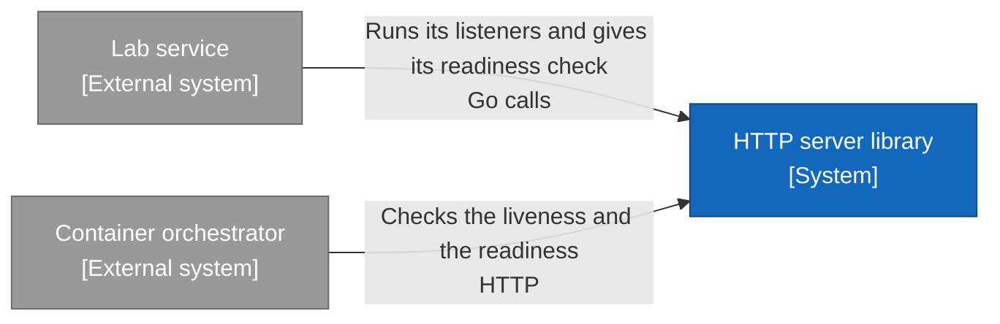

# HTTP server library

The HTTP server library runs the HTTP listeners of a lab service, and it serves the health probes. A listener can serve more than one group of routes, each with its own security policy. A service gives the readiness check, and it puts the probes on a listener that it chooses. The specification of each service gives its readiness conditions, its listeners and their groups of routes.

## Context

## Library specifications

None.

## Goals

- The same health probes on each lab service.
- The same limits on slow and idle connections on each lab service.
- One security policy for each group of routes, also when groups share a listener.

## Non-goals

- The readiness conditions of a service, for example a current CRL. The specification of each service gives them.
- The listener of the health probes, and its port. The specification of each service gives them.
- The security policy of each group of routes other than the health probes. The library or the service that gives the group gives its policy.

## Health probes

- **SRV-0001** `GET /livez` responds with 200 while the process runs. The response does not depend on the readiness check. ([Kubernetes: API health endpoints][k8s-health]; [Judgement: the probe paths of the Kubernetes API server](#srv-0003))
- **SRV-0002** `GET /readyz` responds with 200 when the readiness check of the service passes, and with 503 when it fails. For example, a service that cannot connect to its database responds with 503. ([Kubernetes: API health endpoints][k8s-health]; [Judgement: the probe paths of the Kubernetes API server](#srv-0003))

- **SRV-0011** The health probes do not check the `Host` header. For example, a probe with the IP address of the pod as its `Host` gets the probe response. ([Kubernetes: HTTP probes][k8s-http-probes]; [Judgement: health probes with no `Host` check and no authentication](#srv-0013))
- **SRV-0012** The health probes need no authentication. ([Kubernetes: HTTP probes][k8s-http-probes]; [Judgement: health probes with no `Host` check and no authentication](#srv-0013))

## Groups of routes

- **SRV-0009** The security policy of a group of routes applies only to the requests for the paths of that group. For example, the `Host` allowlist of the operator interface does not apply to `GET /readyz` on the same listener. ([Judgement: listeners by TLS mode and audience (ADR 0025)][adr-0025])
- **SRV-0010** A request for a path that no group of routes of the listener serves gets 404. ([RFC 9110, section 15.5.5][rfc9110-404]; [Judgement: listeners by TLS mode and audience (ADR 0025)][adr-0025])

## Connections

- **SRV-0004** A server stops a request when the client does not send all the headers in 5 seconds. ([Judgement: limits that stop slow and idle connections](#srv-0008))
- **SRV-0005** A server stops a request when the client does not send all of the request, with its body, in 30 seconds. ([Judgement: limits that stop slow and idle connections](#srv-0008))
- **SRV-0006** A server stops a response that it does not write in 60 seconds from the end of the request headers. ([Judgement: limits that stop slow and idle connections](#srv-0008))
- **SRV-0007** A server closes a keep-alive connection that has no request for 120 seconds. ([Judgement: limits that stop slow and idle connections](#srv-0008))

## Judgements

### SRV-0003 The probe paths of the Kubernetes API server

- Kind: choice
- Basis: Step 3.2. The CDS and the ACCC say nothing about health probes. The Kubernetes API server uses `/livez` and `/readyz`, and `/healthz` is deprecated there ([Kubernetes: API health endpoints][k8s-health]).
- Reason: The paths are an industry norm. All lab services then have the same probes.

### SRV-0008 Limits that stop slow and idle connections

- Kind: choice
- Basis: Step 3.2. The CDS and the ACCC give no connection limits. Go `net/http` has no read, write or idle limit by default, so a slow client can keep a connection open with no end ([Go: net/http Server][go-http-server]).
- Reason: Real components use this library. The limits stop a slow request body and an idle connection from holding resources. They are much longer than each request of the lab, and no response of the lab is a stream.

### SRV-0013 Health probes with no `Host` check and no authentication

- Kind: choice
- Basis: Step 3.2. The kubelet sends an HTTP probe to the IP address of the pod, unless the probe gives a host ([Kubernetes: HTTP probes][k8s-http-probes]). The kubelet sends no credential that the service can check.
- Reason: A `Host` check then refuses the probes of a usual Kubernetes deployment. The probes give only the state of the process, so a DNS rebinding attack gets no data of value.

## Withdrawn

None.

[adr-0025]: ../../../docs/adr/0025-group-the-listeners-of-a-service-by-tls-mode-and-audience.md
[k8s-health]: https://kubernetes.io/docs/reference/using-api/health-checks/
[go-http-server]: https://pkg.go.dev/net/http#Server
[k8s-http-probes]: https://kubernetes.io/docs/tasks/configure-pod-container/configure-liveness-readiness-startup-probes/#http-probes
[rfc9110-404]: https://www.rfc-editor.org/rfc/rfc9110#section-15.5.5
