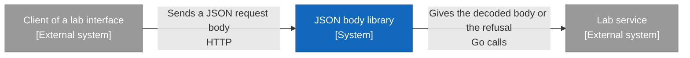

# JSON body library

The JSON body library reads JSON request bodies and writes JSON response bodies. The operator interfaces, the console APIs and the site API read their request bodies with it. The CDR APIs and the authorisation servers write some response bodies with it. This specification gives the request bodies that the library refuses. Each service gives the response to a refusal.

## Context

## Library specifications

None.

## Goals

- One rule for an unknown field in a JSON request body of a lab interface.
- One rule for a JSON request body with more than one value.

## Non-goals

- The status code and the problem details of a refusal. The specification of each service gives them.
- The size limit of a request body. The specification of each service gives it.
- The request bodies of the CDR APIs of the data holder. The data holder specification gives them.

## Request bodies

- **BODY-0001** A JSON request body with a field that the operation does not accept is not valid. For example, a body with a `pasword` field, when the operation accepts a `password` field, is not valid. ([Judgement: an unknown field is not valid](#body-0003))
- **BODY-0002** A request body with a JSON value after its first JSON value is not valid. For example, the body `{} {}` is not valid. ([RFC 8259, section 2][rfc8259-2])

## Judgements

### BODY-0003 An unknown field is not valid

- Kind: choice
- Basis: Step 3.3. The CDS and the ACCC give no rule for a lab interface. A JSON object can have any member name ([RFC 8259, section 4][rfc8259-4]).
- Reason: A client that sends a wrong field name gets an error, and the service does not ignore the value. The OpenAPI documents of the console APIs also forbid properties that they do not name.

## Withdrawn

None.

[rfc8259-2]: https://www.rfc-editor.org/rfc/rfc8259#section-2
[rfc8259-4]: https://www.rfc-editor.org/rfc/rfc8259#section-4
