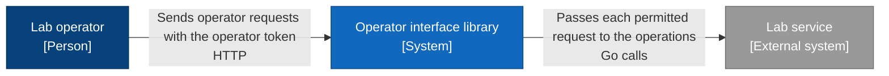

# Operator interface library

The operator interface library gives the HTTP rules that the [operator interfaces](../../../docs/spec/glossary.md#operator-interface) of the Register and the data holder share: the [operator token](../../../docs/spec/glossary.md#operator-token), the `Host` allowlist and the browser access. Each service gives its listener, the path prefix of its operator interface, its operations and their errors.

## Context

## Library specifications

| Library | Specification |
|---|---|
| `pkg/platform/hostallowlist` | [Host allowlist library](../hostallowlist/DESIGN.md) |
| `pkg/platform/httproute` | None. |
| `pkg/platform/problem` | [Problem details library](../problem/DESIGN.md) |

## Goals

- One authentication of the lab operator for each operator interface.
- One protection against DNS rebinding and cross-origin requests for each operator interface.

## Non-goals

- The listener, the path prefix, TLS and the operations of each operator interface. The specification of each service gives them.
- The other groups of routes on the listener. The specification of each service gives them.
- An identity for each operator. [Production gaps](../../../docs/production-gaps.md) gives this gap.

## Operator token

- **OPI-0001** Each request for a path under the prefix of the operator interface must have the operator token as a bearer token. This includes a request for an unknown path under the prefix. For example, `GET /v1/unknown` with no token gets 401. ([RFC 6750][rfc6750]; [Judgement: one bearer token from the configuration](#opi-0008))
- **OPI-0002** A request with no bearer token gets 401 with `WWW-Authenticate: Bearer`. ([RFC 6750, section 3.1][rfc6750-errors])
- **OPI-0003** A request with a different bearer token gets 401 with `WWW-Authenticate: Bearer error="invalid_token"`. ([RFC 6750, section 3.1][rfc6750-errors])
- **OPI-0004** The service gets the operator token from its configuration. For example, the setting `OPERATOR_TOKEN` gives the token. ([Judgement: one bearer token from the configuration](#opi-0008))

## Host allowlist

- **OPI-0005** The operator interface refuses each request, with each method and each path under its prefix, whose `Host` header is not in the allowlist. The response is 403 with a problem details body, and the interface does not examine the token. ([Vite advisory GHSA-vg6x-rcgg-rjx6][vite-dns-rebinding]; [Judgement: a Host allowlist with no default](#opi-0009))
- **OPI-0006** The allowlist is a setting with [the values of the `Host` header](../hostallowlist/DESIGN.md#host-0001), for example `INTERNAL_ALLOWED_HOSTS`. The setting is required, and has no default. ([Judgement: a Host allowlist with no default](#opi-0009))

## Browser access

- **OPI-0007** The responses of the operator interface have no CORS headers, so a browser permits no cross-origin request. ([OWASP ASVS 5.0, V3.4.2][asvs-v3])

## Judgements

### OPI-0008 One bearer token from the configuration

- Kind: choice
- Basis: Step 3.3. The interface of the production Register is not public, and the CDS gives no operator interface ([CDS: Participant Statuses][cds-participant-statuses]).
- Reason: The interfaces are not public. A bearer token is the simplest authentication that keeps them closed. mTLS needs the mock PKI.

### OPI-0009 A Host allowlist with no default

- Kind: choice
- Basis: Step 3.2. A plain HTTP server with no check of the `Host` header is open to DNS rebinding ([Vite advisory GHSA-vg6x-rcgg-rjx6][vite-dns-rebinding]).
- Reason: The lab operator token is public, and a port binding to `127.0.0.1` does not stop DNS rebinding. With DNS rebinding, a web page that the operator opens can send a same-origin request with the token. The check is the same as for a [web UI](../consolehttp/DESIGN.md#cnsl-0019), and a default is a value of one deployment, so the setting is required.

## Withdrawn

None.

[asvs-v3]: https://github.com/OWASP/ASVS/blob/v5.0.0_release/5.0/en/0x12-V3-Web-Frontend-Security.md
[cds-participant-statuses]: https://consumerdatastandardsaustralia.github.io/standards-archives/standards-1.36.0/#participant-statuses
[rfc6750]: https://www.rfc-editor.org/rfc/rfc6750
[rfc6750-errors]: https://www.rfc-editor.org/rfc/rfc6750#section-3.1
[vite-dns-rebinding]: https://github.com/vitejs/vite/security/advisories/GHSA-vg6x-rcgg-rjx6
