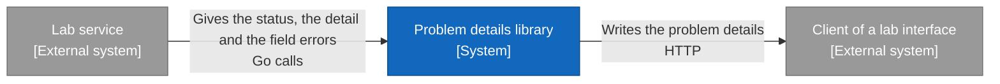

# Problem details library

The problem details library writes the [RFC 9457][rfc9457] problem details of the lab HTTP interfaces that the CDR does not define. The lab services use it for the operator interfaces, the operator console APIs and the site API of the online bank site. It gives the type of a problem, the format of the field errors and the type of a session that ended. Each service gives the status code and the `detail` of each problem.

## Context

## Library specifications

None.

## Goals

- One type for a problem with no type of its own.
- One problem type and one format for field errors, for each lab interface.
- One problem type for a session that ended, for each lab interface with a session.

## Non-goals

- The errors of the CDR APIs. The [CDS HTTP library](../../cds/DESIGN.md) gives them.
- The status code of each problem, and the text of each `detail`. The specification of each service gives them.
- The session of a lab interface. The specification of the service gives when a session ends.

## Problem details

- **PROB-0001** A problem with no type of its own has the type `about:blank`. For example, a 404 for a record that does not exist has the type `about:blank`. ([RFC 9457, section 4.2.1][rfc9457-about-blank])

## Field errors

- **PROB-0002** A problem with field errors has the type `https://github.com/lukemundy/cdr-lab/blob/main/pkg/platform/problem/DESIGN.md#prob-0002` and the title "Values in the request are not valid". ([RFC 9457, section 3.2][rfc9457-3-2]; [Judgement: one type for field errors](#prob-0008))
- **PROB-0003** A problem with field errors gives each field error in the extension member `errors`. Each field error has a `pointer` and a `detail`. ([RFC 9457, section 3][rfc9457-3]; [Judgement: each field error shows at its field](#prob-0009))
- **PROB-0004** The `pointer` of a field error is a JSON Pointer to the field in the request body, in the URI fragment form. For example, `#/endpointDetail/publicBaseUri`. ([RFC 6901, section 6][rfc6901-6])
- **PROB-0005** The `detail` of a field error says what is wrong with the value, in one sentence. A service must give a sentence that a UI can show at the field. ([Judgement: each field error shows at its field](#prob-0009))
- **PROB-0006** When the service gives no `detail` for a problem with field errors, the `detail` says that one or more values in the request are not valid. ([RFC 9457, section 3.1.4][rfc9457-detail])
- **PROB-0007** A refusal with no field error has the type `about:blank` and no `errors` member. For example, a refusal of a stale version names no field. ([RFC 9457, section 4.2.1][rfc9457-about-blank])

## Session ended

- **PROB-0010** A problem for a request with a session cookie whose session ended has the type `https://github.com/lukemundy/cdr-lab/blob/main/pkg/platform/problem/DESIGN.md#prob-0010` and the title "The session ended". For example, the online bank site of the data holder gives it after a restart. ([RFC 9457, section 3.2][rfc9457-3-2]; [Judgement: one type for a session that ended](#prob-0011))

## Judgements

### PROB-0008 One type for field errors

- Kind: choice
- Basis: Step 3.2. A problem type defines its extension members, and `about:blank` has no meaning other than the status code ([RFC 9457, section 3.2][rfc9457-3-2]). A type URI is an identifier, and a type URI that resolves to documentation is encouraged ([RFC 9457, section 3.1.1][rfc9457-type]).
- Reason: The type lets a client find the field errors without a check of each member. This library writes the field errors of each lab interface, so one type in its specification is the least complex. The URI goes to the identifier of this rule, which does not change when a specification moves ([ADR 0024][adr-0024-identifiers]).

### PROB-0009 Each field error shows at its field

- Kind: choice
- Basis: Step 3.2. A UI shows an input error at its field ([WCAG 2.2, SC 3.3.1][wcag-3-3-1]). RFC 9457 gives an example of field errors in an extension member, with a JSON Pointer ([RFC 9457, section 3][rfc9457-3]).
- Reason: A UI has no copy of the rules of a service, so only the service can name the field. The format of the RFC example is the least complex.

### PROB-0011 One type for a session that ended

- Kind: choice
- Basis: Step 3.2. A problem type lets a client tell a problem apart from other problems with the same status code, and `about:blank` has no meaning other than the status code ([RFC 9457, section 3.2][rfc9457-3-2]).
- Reason: Only the server knows that a session cookie names a session that ended, so a type tells the UI that the session ended, also after a reload or a restart. One type in this library, for each lab interface, is the least complex. The URI goes to the identifier of this rule, which does not change when a specification moves ([ADR 0024][adr-0024-identifiers]).

## Withdrawn

None.

[adr-0024-identifiers]: ../../../docs/adr/0024-write-specifications-as-identified-single-requirements-split-by-area.md#identifiers
[rfc6901-6]: https://www.rfc-editor.org/rfc/rfc6901#section-6
[rfc9457]: https://www.rfc-editor.org/rfc/rfc9457
[rfc9457-3]: https://www.rfc-editor.org/rfc/rfc9457#section-3
[rfc9457-3-2]: https://www.rfc-editor.org/rfc/rfc9457#section-3.2
[rfc9457-about-blank]: https://www.rfc-editor.org/rfc/rfc9457#section-4.2.1
[rfc9457-detail]: https://www.rfc-editor.org/rfc/rfc9457#section-3.1.4
[rfc9457-type]: https://www.rfc-editor.org/rfc/rfc9457#section-3.1.1
[wcag-3-3-1]: https://www.w3.org/TR/WCAG22/#error-identification
