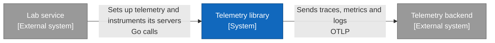

# Telemetry library

The telemetry library sets up OpenTelemetry traces, metrics and logs for each lab service. It instruments the HTTP servers and the one-shot subcommands of a service. It removes the URL paths and the query strings from the spans, because they can contain CDR data and personal information. The specification of each service gives the data of that service that its telemetry does not contain.

## Context

## Library specifications

| Library | Specification |
|---|---|
| `pkg/platform/buildinfo` | None. |

## Goals

- The same signals from each lab service, with one set-up.
- No CDR data and no personal information in the URL of a span.
- Telemetry that identifies the build of the service.

## Non-goals

- The data of a service that its telemetry does not contain, for example the tokens of the data holder. The specification of each service gives it.
- The database spans. The [database library](../database/DESIGN.md) gives them.
- The telemetry backend of the lab. `compose.yaml` gives it.

## Signals

- **TELE-0001** A service sends traces, metrics and logs with OpenTelemetry. ([Judgement: OpenTelemetry for traces, metrics and logs (ADR 0006)](../../../docs/adr/0006-telemetry.md))
- **TELE-0002** When no exporter and no OTLP endpoint is set for a signal, the service drops that signal with no error. At the start, it writes one log line that names the signals that it drops. For example, with no `OTEL_*` variables, the service logs that traces, metrics and logs are off. ([Judgement: OpenTelemetry for traces, metrics and logs (ADR 0006)](../../../docs/adr/0006-telemetry.md))
- **TELE-0003** The resource attribute `service.version` is the short commit ID of the build. For example, a build of commit `73f4c82` has the `service.version` `73f4c82`. ([Judgement: OpenTelemetry for traces, metrics and logs (ADR 0006)](../../../docs/adr/0006-telemetry.md))

## Sensitive data

- **TELE-0004** A service must not put CDR data or personal information in a span, a metric or a log, also when the data is mocked. ([Judgement: OpenTelemetry for traces, metrics and logs (ADR 0006)](../../../docs/adr/0006-telemetry.md))
- **TELE-0005** The URL path of each HTTP server span is the route pattern of the request. For example, a request to `/api/customers/1234` has the path `/api/customers/{customerNumber}`. ([Judgement: OpenTelemetry for traces, metrics and logs (ADR 0006)](../../../docs/adr/0006-telemetry.md))
- **TELE-0006** When no route matches the request, the URL path of the span is `REDACTED`. ([Judgement: OpenTelemetry for traces, metrics and logs (ADR 0006)](../../../docs/adr/0006-telemetry.md))
- **TELE-0007** An HTTP server span has no query string, or `REDACTED` when an instrumentation records the query string. For example, a search with `?q=jane@example.com` gives no `jane@example.com` in the span. ([Judgement: OpenTelemetry for traces, metrics and logs (ADR 0006)](../../../docs/adr/0006-telemetry.md))

## Judgements

None.

## Withdrawn

None.
