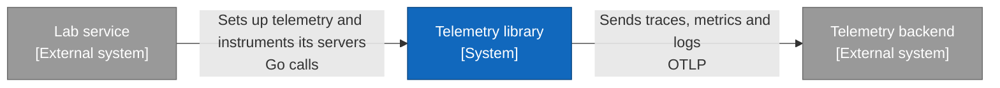

# Telemetry library

The telemetry library sets up OpenTelemetry traces, metrics and logs for each lab service. It instruments the HTTP servers and the one-shot subcommands of a service. It removes the URL paths and the query strings from the spans, because they can contain CDR data and personal information. The specification of each service gives the data of that service that its telemetry does not contain.

## Context

## Library specifications

| Library | Specification |
|---|---|
| `pkg/platform/buildinfo` | None. |

## Goals

- The same signals from each lab service, with one set-up.
- No CDR data and no personal information in the URL of a span.
- Telemetry that identifies the build of the service.
- A small, fixed number of metric series, which traffic, routes and new features do not change.

## Non-goals

- The data of a service that its telemetry does not contain, for example the tokens of the data holder. The specification of each service gives it.
- The database spans. The [database library](../database/DESIGN.md) gives them.
- The telemetry backend of the lab. `compose.yaml` gives it.

## Signals

- **TELE-0001** A service sends traces, metrics and logs with OpenTelemetry. ([Judgement: OpenTelemetry for traces, metrics and logs (ADR 0006)](../../../docs/adr/0006-telemetry.md))
- **TELE-0002** When no exporter and no OTLP endpoint is set for a signal, the service drops that signal with no error. At the start, it writes one log line that names the signals that it drops. For example, with no `OTEL_*` variables, the service logs that traces, metrics and logs are off. ([Judgement: OpenTelemetry for traces, metrics and logs (ADR 0006)](../../../docs/adr/0006-telemetry.md))
- **TELE-0003** The resource attribute `service.version` is the short commit ID of the build. For example, a build of commit `73f4c82` has the `service.version` `73f4c82`. ([Judgement: OpenTelemetry for traces, metrics and logs (ADR 0006)](../../../docs/adr/0006-telemetry.md))

## Sensitive data

- **TELE-0004** A service must not put CDR data or personal information in a span, a metric or a log, also when the data is mocked. The IP address of the client is the only exception. For example, an HTTP server span has `client.address`, but no email address. ([Judgement: OpenTelemetry for traces, metrics and logs (ADR 0006)](../../../docs/adr/0006-telemetry.md))
- **TELE-0005** The URL path of each HTTP server span is the route pattern of the request. For example, a request to `/api/customers/1234` has the path `/api/customers/{customerNumber}`. ([Judgement: OpenTelemetry for traces, metrics and logs (ADR 0006)](../../../docs/adr/0006-telemetry.md))
- **TELE-0006** When no route matches the request, the URL path of the span is `REDACTED`. ([Judgement: OpenTelemetry for traces, metrics and logs (ADR 0006)](../../../docs/adr/0006-telemetry.md))
- **TELE-0007** An HTTP server span has no query string, or `REDACTED` when an instrumentation records the query string. For example, a search with `?q=jane@example.com` gives no `jane@example.com` in the span. ([Judgement: OpenTelemetry for traces, metrics and logs (ADR 0006)](../../../docs/adr/0006-telemetry.md))

## Metrics

- **TELE-0010** A long-running process sends only the metrics of its state, with no attributes other than the ones given here: the Go runtime metrics `go.config.gogc`, `go.goroutine.count`, `go.memory.allocated`, `go.memory.allocations`, `go.memory.gc.goal`, `go.processor.limit` and `go.memory.used` (with `go.memory.type` `stack` or `other`), `http.server.active_requests` (the HTTP server requests that the process has not completed, with no attributes), and the [statistics of the connection pool](../database/DESIGN.md#dbase-0006). Thus each long-running process has 23 series. The duration and the status of a request, a query or a job are in its span, not in a metric. ([Judgement: metrics only for the state of the process](#tele-0013))
- **TELE-0011** A one-shot subcommand, for example `migrate`, sends no metrics. ([Judgement: metrics only for the state of the process](#tele-0013))
- **TELE-0012** The resource attribute `service.instance.id` is the host name of the process. When the host name is not available, it is a random UUID. For example, in Kubernetes it is the pod name. ([Judgement: the host name as the instance ID](#tele-0014))

## Judgements

### TELE-0013 Metrics only for the state of the process

- Kind: choice
- Basis: Step 3.2. "Every unique combination of key-value label pairs represents a new time series" ([Prometheus: labels][prometheus-labels]). The traces give the route, the status and the duration of each request, and a backend can calculate rates and percentiles from them. The OpenTelemetry convention for `http.server.active_requests` requires `http.request.method` and `url.scheme` ([OpenTelemetry: HTTP metrics][otel-http-active-requests]). This library does not give them, so that the metric has one series.
- Reason: The lab can share a metrics backend that has a limit on the series, and the number of series must not change with traffic, routes or features ([ADR 0026](../../../docs/adr/0026-send-metrics-only-for-the-state-of-a-process.md)). The runtime, the pool and the active requests are state that a trace cannot give. A one-shot subcommand stops after some seconds, so its series show nothing about capacity.

### TELE-0014 The host name as the instance ID

- Kind: choice
- Basis: Step 3.2. `service.instance.id` "MUST be unique for each instance of the same `service.namespace,service.name` pair" ([OpenTelemetry: service attributes][otel-service-instance]). A pod name in Kubernetes and a container ID in Docker are unique for each running container.
- Reason: A random UUID at each start gives a new set of series at each restart of a container, and the old set stays active in the backend until it is stale. The host name stays the same when the container restarts.

## Withdrawn

- **TELE-0008** Removed.
- **TELE-0009** Removed.

[otel-http-active-requests]: https://opentelemetry.io/docs/specs/semconv/http/http-metrics/#metric-httpserveractive_requests
[otel-service-instance]: https://opentelemetry.io/docs/specs/semconv/registry/attributes/service/
[prometheus-labels]: https://prometheus.io/docs/practices/naming/#labels
