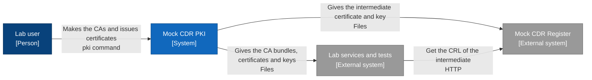

# Mock CDR PKI

The mock CDR PKI gives the lab a CDR CA and a separate public CA. They have the structure and the certificate profiles of production. In production, the ACCC operates the CDR CA, and TLS endpoints use certificates from public CAs. A real component that trusts the mock CAs then needs only a change of its CA bundles and certificates to work with production. The `pki` command makes the CAs and issues the certificates of the lab at set-up. In a running lab, the Register is the CDR intermediate CA ([ADR 0022][adr-0022]).

## Context

## Library specifications

| Library | Specification |
|---|---|
| `pkg/ca` | [CA library](../pkg/ca/DESIGN.md) |

## Goals

- A mock CDR CA: a root CA and one issuing intermediate CA.
- A mock public CA for TLS endpoints.
- The issue of CDR certificates from CSRs, and of public TLS server certificates for lab hosts. The `pki` command issues at the set-up of the lab. In a running lab, the Register issues CDR client and server certificates as the intermediate CA ([ADR 0022][adr-0022]).
- The revocation of CDR certificates, and a CRL of the CDR intermediate. In a running lab, the Register revokes CDR certificates, and signs and serves the CRL ([ADR 0022][adr-0022]). The `pki` command does neither.

## Non-goals

- OCSP ([a CRL and no OCSP](../pkg/ca/DESIGN.md#ca-0053)).
- The revocation of CA certificates and of public TLS server certificates.
- A second intermediate or a second trust chain. The dual trust chain period of production ends when the certificates of the earlier chain expire, by 1 November 2026 ([ACCC: Certificate FAQ][accc-cert-faq]).
- The trust chain of the ACCC Conformance Test Suite (CTS).
- The workflow of the Participant Portal: approval, renewal reminders and agreements.

## CA structure

- **PKI-0002** The intermediate issues each CDR certificate. ([ACCC: Certificate Management][accc-cert-mgmt])
- **PKI-0003** The root key and the intermediate key are RSA 4096 keys. ([CP section 6.1.5, Table 5][accc-cp]; observed on 2026-10-02: the key of "CDR Intermediate CA 2025" is RSA 4096)
- **PKI-0012** A TLS endpoint uses a certificate from the public CA, not a CDR certificate. ([CDS: Participant Endpoints][cds-participant-endpoints])
- **PKI-0013** Relying parties trust the CDR CA bundle, which has the intermediate and the root. ([ACCC: Certificate Management][accc-cert-mgmt]; observed on 2026-10-02: `secure.api.cdr.gov.au` sends only its leaf certificate, so a client that trusts only the root cannot verify it)

## CSR profile

The [CA library](../pkg/ca/DESIGN.md) gives the CSR profile that the CDR CA checks.

- **PKI-0028** The `pki` command does not check the O of a server CSR. ([Judgement: only the Register checks the participant names of a CSR](#pki-0081))
- **PKI-0030** The `pki` command does not check the CN and the O of a client CSR. ([Judgement: only the Register checks the participant names of a CSR](#pki-0081))

## Certificate profile

The [CA library](../pkg/ca/DESIGN.md) gives the profiles of a CDR certificate and of a public TLS server certificate.

- **PKI-0041** In the lab, the CRL URL is on the CRL listener of the Register in the lab network: `http://register`, the port of the CRL listener in `compose.yaml`, and the path `/crl/cdr-intermediate.crl`. ([Judgement: the Register service name in the CRL URL](#pki-0091))

## Revocation

The [Register DESIGN.md][register-design-crl] gives the revocation request, the CRL listener and the other times of a new CRL. The [CA library](../pkg/ca/DESIGN.md) gives the revocation reasons and the CRL format. The rules of this group apply to each revocation and each CRL.

- **PKI-0048** The Register is the only component that revokes a CDR certificate. ([Judgement: the Register is the CDR intermediate CA (ADR 0022)](../docs/adr/0022-run-the-mock-cdr-intermediate-ca-in-the-register.md))
- **PKI-0049** The Register is the only component that signs a CRL of the intermediate. ([Judgement: the Register is the CDR intermediate CA (ADR 0022)](../docs/adr/0022-run-the-mock-cdr-intermediate-ca-in-the-register.md))
- **PKI-0050** The Register keeps the only list of revocations. ([Judgement: the Register is the CDR intermediate CA (ADR 0022)](../docs/adr/0022-run-the-mock-cdr-intermediate-ca-in-the-register.md))
- **PKI-0052** When the lab operator revokes a certificate that is revoked, the CA refuses the revocation. ([Judgement: one revocation for each certificate](#pki-0085))
- **PKI-0053** When a revocation completes, the CRL lists the certificate with its reason. ([Judgement: a new CRL at each revocation](#pki-0086))
- **PKI-0059** Each new CRL has a higher CRL number than each CRL before it, also after a restart of the Register. ([RFC 5280, section 5.2.3][rfc5280-crl-number])
- **PKI-0061** The Register issues a new CRL at least once every 24 hours, also when no revocation occurs. ([CP section 4.9.7, Table 1][accc-cp]; [CPS section 2.3][accc-cps])
- **PKI-0062** The Register issues a new CRL at each revocation. ([Judgement: a new CRL at each revocation](#pki-0086))
- **PKI-0063** A revoked certificate stays on the CRL, also after the certificate expires. ([Judgement: revoked certificates stay on the CRL](#pki-0088))
- **PKI-0064** The Register serves the CRL over HTTP, with the content type `application/pkix-crl`, at the URL in each CDR certificate. ([RFC 2585, section 4.2][rfc2585-mime])
- **PKI-0065** A lab reset deletes the CAs and the Register database, and thus each revocation and each CRL. ([Judgement: a lab reset makes a new CRL issuer](#pki-0089))
- **PKI-0066** After a lab reset, the new intermediate has no revocations, and its CRL numbers start again. ([Judgement: a lab reset makes a new CRL issuer](#pki-0089))
- **PKI-0067** The `pki` command does not revoke certificates, sign CRLs or keep a list of revocations, and it has no `revoke` command and no `crl` command. ([Judgement: the Register is the CDR intermediate CA (ADR 0022)](../docs/adr/0022-run-the-mock-cdr-intermediate-ca-in-the-register.md))
- **PKI-0068** The set-up issues the fixture `conformance/revoked.crt` before the lab starts, as each other fixture, and does not revoke it. ([Judgement: each conformance test revokes the fixture](#pki-0090))
- **PKI-0069** When a conformance test needs a revoked certificate, the test revokes the fixture through the Register operator interface with the reason `keyCompromise`. ([Judgement: each conformance test revokes the fixture](#pki-0090))
- **PKI-0070** When the fixture is already revoked (409), the conformance test accepts the response. ([Judgement: each conformance test revokes the fixture](#pki-0090))

## Keys

- **PKI-0071** Secrets: the repository contains no private keys. ([Judgement: no private key in the repository](#pki-0093))
- **PKI-0072** The lab creates the CA keys when it is set up. ([Judgement: no private key in the repository](#pki-0093))
- **PKI-0073** Only the owner can read the key file of a root CA. ([Judgement: only the owner reads a root key](#pki-0094))
- **PKI-0074** The deployment sets who can read the intermediate key file, and in the lab any user can read it. ([Judgement: lab keys that any user can read](#pki-0095))
- **PKI-0075** When the Register starts, it reads the intermediate key file, so that it can issue certificates, revoke certificates and sign CRLs. ([Judgement: the Register is the CDR intermediate CA (ADR 0022)](../docs/adr/0022-run-the-mock-cdr-intermediate-ca-in-the-register.md))
- **PKI-0076** The Register never reads a root key. ([Judgement: the Register is the CDR intermediate CA (ADR 0022)](../docs/adr/0022-run-the-mock-cdr-intermediate-ca-in-the-register.md))
- **PKI-0077** Any user can read the private key of a certificate that the lab issues for its own services and tests. ([Judgement: lab keys that any user can read](#pki-0095))

## Judgements

### PKI-0081 Only the Register checks the participant names of a CSR

- Kind: choice
- Basis: Step 3.3. The [CDS: Certificate Signing Request Profile][cds-csr-profile] gives the CN and the O of a client certificate, and the O of a server certificate, from the names of the participant.
- Reason: Only the Register knows the software products, the brands and the legal entities. The Register checks the names when it issues a certificate ([Register DESIGN.md: Operator interface][register-design]).

### PKI-0085 One revocation for each certificate

- Kind: choice
- Basis: Step 3.3. The [CPS section 4.9.12][accc-cps] lets the ACCC change a reason to `keyCompromise` when it finds a key compromise.
- Reason: The lab has no process that finds a key compromise. One revocation for each certificate is the least complex rule.

### PKI-0086 A new CRL at each revocation

- Kind: choice
- Basis: Step 3.3. Production can take up to 24 hours to publish a revocation ([CPS section 4.9][accc-cps]).
- Reason: A lab test must see a revocation at once. The [Register DESIGN.md][register-design-crl] gives the other times of a new CRL.

### PKI-0088 Revoked certificates stay on the CRL

- Kind: gap
- Basis: Step 2. Production removes an entry from the CRL after the certificate expires ([CPS section 4.10.1][accc-cps]).
- Reason: A lab certificate is valid for 13 months. A lab reset deletes the CA and its CRL.

### PKI-0089 A lab reset makes a new CRL issuer

- Kind: choice
- Basis: Step 3.2. A CRL number is unique for one CRL scope and one CRL issuer ([RFC 5280, section 5.2.3][rfc5280-crl-number]).
- Reason: A new intermediate has a new key and a new authority key identifier, so it is a new CRL issuer. Its CRL numbers can start again. The certificates of the earlier lab do not chain to the new CA bundle, so they need no revocation.

### PKI-0090 Each conformance test revokes the fixture

- Kind: choice
- Basis: Step 3.3. The CDS defines no interface to revoke a certificate, and the Register keeps the only list of revocations ([ADR 0022][adr-0022]). A test can use an interface that the CDR does not define to set up a state ([conformance DESIGN.md: Subject of a test][conformance-design-subject]).
- Reason: In the lab, the data holder loads the CRL at each check ([data holder DESIGN.md: Transport security][dataholder-design-transport]), so it sees the revocation at once. The lab start then has no step after the Register starts.

### PKI-0091 The Register service name in the CRL URL

- Kind: choice
- Basis: Step 3.3. A certificate can give only one useful CRL URL, and production gives one ([RFC 5280, section 4.2.1.13][rfc5280-crldp]).
- Reason: All lab participants, also the conformance tests, run in the lab network. The Register serves the CRL ([ADR 0022][adr-0022]).

### PKI-0093 No private key in the repository

- Kind: choice
- Basis: Step 3.2. [CWE-321][cwe-321] lists a hard-coded cryptographic key as a weakness.
- Reason: The repository is public, so a key in it protects nothing. The lab creates each key at set-up.

### PKI-0094 Only the owner reads a root key

- Kind: choice
- Basis: Step 3.2. [CWE-732][cwe-732] lists a permission that is too wide on a critical resource as a weakness.
- Reason: The root keys sign the CA certificates that all lab participants trust. No lab component reads them.

### PKI-0095 Lab keys that any user can read

- Kind: choice
- Basis: Step 3.3. Lab containers read the keys as a different user ([production gaps][production-gaps]).
- Reason: The intermediate key signs only lab certificates. The key of a lab certificate protects only a throwaway lab identity. The lab data has no value.

## Withdrawn

- **PKI-0001** Moved to [one root CA and one issuing intermediate CA](../pkg/ca/DESIGN.md#ca-0001).
- **PKI-0004** Moved to [the signature algorithm of each CA](../pkg/ca/DESIGN.md#ca-0002).
- **PKI-0005** Moved to [the key usages of the CA certificates](../pkg/ca/DESIGN.md#ca-0003).
- **PKI-0006** Moved to [the path length of the intermediate](../pkg/ca/DESIGN.md#ca-0004).
- **PKI-0007** Moved to [the validity of the root certificate](../pkg/ca/DESIGN.md#ca-0005).
- **PKI-0008** Moved to [the validity of the intermediate certificate](../pkg/ca/DESIGN.md#ca-0006).
- **PKI-0009** Moved to [the subject of the CDR CA certificates](../pkg/ca/DESIGN.md#ca-0007).
- **PKI-0010** Moved to [no ACCC name in the CDR CA certificates](../pkg/ca/DESIGN.md#ca-0008).
- **PKI-0011** Moved to [a public CA that is separate from the CDR CA](../pkg/ca/DESIGN.md#ca-0009).
- **PKI-0014** Moved to [an issue only from a CSR that obeys the CSR profile](../pkg/ca/DESIGN.md#ca-0010).
- **PKI-0015** Moved to [the refusal of a CSR that breaks a rule](../pkg/ca/DESIGN.md#ca-0011).
- **PKI-0016** Moved to [the key of a CSR](../pkg/ca/DESIGN.md#ca-0012).
- **PKI-0017** Moved to [the signature algorithm of a CSR](../pkg/ca/DESIGN.md#ca-0013).
- **PKI-0018** Moved to [the proof of possession of a CSR](../pkg/ca/DESIGN.md#ca-0014).
- **PKI-0019** Moved to [the subject attributes of a CSR](../pkg/ca/DESIGN.md#ca-0015).
- **PKI-0020** Moved to [the CN of a server CSR as the primary DNS name](../pkg/ca/DESIGN.md#ca-0016).
- **PKI-0021** Moved to [DNS names only in a server CSR](../pkg/ca/DESIGN.md#ca-0017).
- **PKI-0022** Moved to [the host name rules of the CN of a server CSR](../pkg/ca/DESIGN.md#ca-0018).
- **PKI-0023** Moved to [the host name rules of each DNS name of a server CSR](../pkg/ca/DESIGN.md#ca-0019).
- **PKI-0024** Moved to [the length of a label of a host name](../pkg/ca/DESIGN.md#ca-0020).
- **PKI-0025** Moved to [the length of a host name](../pkg/ca/DESIGN.md#ca-0021).
- **PKI-0026** Moved to [the length of the CN of a server CSR](../pkg/ca/DESIGN.md#ca-0022).
- **PKI-0027** Moved to [a valid host name with no dot](../pkg/ca/DESIGN.md#ca-0023).
- **PKI-0029** Moved to [no subject alternative names in a client CSR](../pkg/ca/DESIGN.md#ca-0024).
- **PKI-0031** Moved to [the subject of a CDR certificate](../pkg/ca/DESIGN.md#ca-0025).
- **PKI-0032** Moved to [the validity of a CDR certificate](../pkg/ca/DESIGN.md#ca-0026).
- **PKI-0033** Moved to [no validity after the issuer expires](../pkg/ca/DESIGN.md#ca-0027).
- **PKI-0034** Moved to [the key usage of a CDR certificate](../pkg/ca/DESIGN.md#ca-0028).
- **PKI-0035** Moved to [the basic constraints of a CDR certificate](../pkg/ca/DESIGN.md#ca-0029).
- **PKI-0036** Moved to [the extended key usage of a server certificate](../pkg/ca/DESIGN.md#ca-0030).
- **PKI-0037** Moved to [the extended key usage of a client certificate](../pkg/ca/DESIGN.md#ca-0031).
- **PKI-0038** Moved to [no anyExtendedKeyUsage in a CDR certificate](../pkg/ca/DESIGN.md#ca-0032).
- **PKI-0039** Moved to [the subject alternative names of a server certificate](../pkg/ca/DESIGN.md#ca-0033).
- **PKI-0040** Moved to [the CRL distribution point of a CDR certificate](../pkg/ca/DESIGN.md#ca-0034).
- **PKI-0042** Moved to [no OCSP URL and no CA issuers URL](../pkg/ca/DESIGN.md#ca-0035).
- **PKI-0043** Moved to [the random serial number of a certificate](../pkg/ca/DESIGN.md#ca-0036).
- **PKI-0044** Moved to [no check of a unique subject DN](../pkg/ca/DESIGN.md#ca-0037).
- **PKI-0045** Moved to [the profile of a public TLS server certificate](../pkg/ca/DESIGN.md#ca-0038).
- **PKI-0046** Moved to [the subject of a public TLS server certificate](../pkg/ca/DESIGN.md#ca-0039).
- **PKI-0047** Moved to [the host name rules of a public TLS server certificate](../pkg/ca/DESIGN.md#ca-0040).
- **PKI-0051** Moved to [the revocation reasons of a CDR certificate](../pkg/ca/DESIGN.md#ca-0041).
- **PKI-0054** Moved to [the revocation date of a CRL entry](../pkg/ca/DESIGN.md#ca-0042).
- **PKI-0055** Moved to [no reason code for the reason unspecified](../pkg/ca/DESIGN.md#ca-0043).
- **PKI-0056** Moved to [the CRL format](../pkg/ca/DESIGN.md#ca-0044).
- **PKI-0057** Moved to [the signature algorithm of the CRL](../pkg/ca/DESIGN.md#ca-0045).
- **PKI-0058** Moved to [the extensions of the CRL](../pkg/ca/DESIGN.md#ca-0046).
- **PKI-0060** Moved to [the next update of a CRL](../pkg/ca/DESIGN.md#ca-0047).
- **PKI-0078** Moved to [the judgement on mock CA names](../pkg/ca/DESIGN.md#ca-0048).
- **PKI-0079** Moved to [the judgement on the production profiles](../pkg/ca/DESIGN.md#ca-0049).
- **PKI-0080** Moved to [the judgement on the host name rules of a server CSR](../pkg/ca/DESIGN.md#ca-0050).
- **PKI-0082** Moved to [the judgement on one extended key usage](../pkg/ca/DESIGN.md#ca-0051).
- **PKI-0083** Moved to [the judgement on the profile of a public TLS server certificate](../pkg/ca/DESIGN.md#ca-0052).
- **PKI-0084** Moved to [the judgement on a CRL and no OCSP](../pkg/ca/DESIGN.md#ca-0053).
- **PKI-0087** Moved to [the judgement on a CRL validity of 7 days](../pkg/ca/DESIGN.md#ca-0054).
- **PKI-0092** Moved to [the judgement on no check of unique subject names](../pkg/ca/DESIGN.md#ca-0055).

[adr-0022]: ../docs/adr/0022-run-the-mock-cdr-intermediate-ca-in-the-register.md
[production-gaps]: ../docs/production-gaps.md
[register-design]: ../services/register/DESIGN.md#operator-interface
[register-design-crl]: ../services/register/DESIGN.md#certificate-revocation-list
[conformance-design-subject]: ../conformance/DESIGN.md#subject-of-a-test
[dataholder-design-transport]: ../services/dataholder/DESIGN.md#transport-security
[cds-csr-profile]: https://consumerdatastandardsaustralia.github.io/standards-archives/standards-1.36.0/#certificate-signing-request-profile
[cds-participant-endpoints]: https://consumerdatastandardsaustralia.github.io/standards-archives/standards-1.36.0/#participant-endpoints
[accc-cert-mgmt]: https://consumerdataright.atlassian.net/wiki/spaces/DP/pages/360415310/Certificate+Management
[accc-cert-faq]: https://consumerdataright.atlassian.net/wiki/spaces/DP/pages/374538246/Frequently+Asked+Questions+FAQ
[accc-cp]: https://www.cdr.gov.au/sites/default/files/2025-08/ACCC-Certificate-Policy-v1.04-published-27-August-2025.pdf
[accc-cps]: https://www.cdr.gov.au/sites/default/files/2025-08/ACCC-Certification-Practice-Statement-v2.0-published-27-August-2025.pdf
[rfc5280-crldp]: https://www.rfc-editor.org/rfc/rfc5280#section-4.2.1.13
[rfc5280-crl-number]: https://www.rfc-editor.org/rfc/rfc5280#section-5.2.3
[rfc2585-mime]: https://www.rfc-editor.org/rfc/rfc2585#section-4.2
[cwe-321]: https://cwe.mitre.org/data/definitions/321.html
[cwe-732]: https://cwe.mitre.org/data/definitions/732.html
