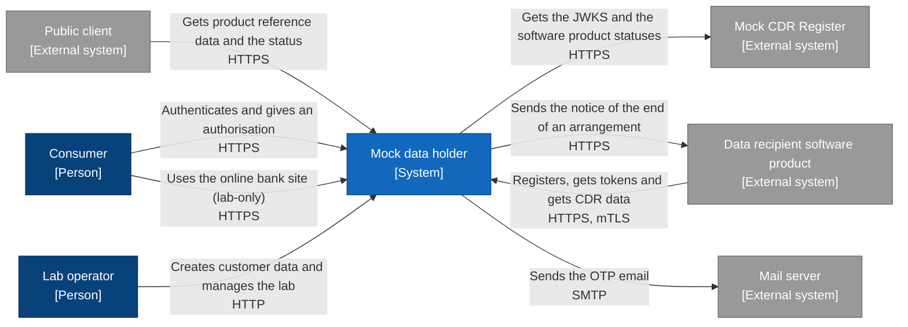

# Mock data holder

The mock data holder is one CDR data holder brand of the industry `banking`, as the CDS specifies it. Data recipients and public clients in the lab use it in the same way as a production data holder. A real component changes from the mock data holder to a production data holder with a change of configuration only ([portability](non-functional-requirements.md#dh-0013)). Each instance has one brand, from a preset brand or a brand directory. The lab-only operator interface, operator console and online bank site give test functions that production does not have.

## Context

## Areas

| Area | File | Summary |
|---|---|---|
| Brand | [brand.md](brand.md) | The brand directory, the preset brands, and the name, logo and colours that the data holder shows. |
| Product reference data | [product-reference-data.md](product-reference-data.md) | The products of the brand, their load, Get Products, Get Product Detail, Get Status and Get Outages. |
| API standards | [api-standards.md](api-standards.md) | The endpoints, versions, headers, errors, CORS and transport security of all CDR APIs. |
| Authorisation server | [authorisation-server.md](authorisation-server.md) | The choices of the data holder for its authorisation server, the authorisation request and the tokens of an arrangement. |
| Registration | [registration.md](registration.md) | The registration of a software product with an SSA, and the validation of the request. |
| Registration management | [registration-management.md](registration-management.md) | Registration management, the participant statuses from the Register and the reaction to them. |
| Consumer authentication | [consumer-authentication.md](consumer-authentication.md) | The authentication of a consumer with a one-time password, and the OTP email. |
| Authorisation | [authorisation.md](authorisation.md) | The authorisation page, the authorisation response, the CDR arrangement and the presentation of the consumer pages. |
| End of an arrangement | [end-of-an-arrangement.md](end-of-an-arrangement.md) | CDR arrangement revocation, withdrawal, the end of the sharing period and of eligibility, and the notice to the data recipient. |
| Banking APIs | [banking-apis.md](banking-apis.md) | The customers and accounts, the APIs that give the CDR data of an arrangement, and the record of disclosures. |
| Operator interface | [operator-interface.md](operator-interface.md) | The lab-only HTTP API that creates customer data, loads a set of customers, closes accounts and withdraws authorisations. |
| Operator console | [operator-console.md](operator-console.md) | The lab-only browser UI for the lab operator. |
| Operator console actions and create forms | [operator-console-create.md](operator-console-create.md) | The actions and the create forms of the operator console. |
| Operator console API | [operator-console-api.md](operator-console-api.md) | The console API of the operator console. |
| Online bank site | [online-bank-site.md](online-bank-site.md) | The pages of the lab-only online bank site and their presentation. |
| Online bank site sign-in | [online-bank-site-sign-in.md](online-bank-site-sign-in.md) | The sign-up, sign-in, sign-out and session of the online bank site. |
| Online bank site accounts | [online-bank-site-accounts.md](online-bank-site-accounts.md) | The accounts on the online bank site, and the opening and the close of an account. |
| Consumer dashboard | [consumer-dashboard.md](consumer-dashboard.md) | The consumer dashboard, where a consumer sees and withdraws each authorisation. |
| Online bank site API | [online-bank-site-api.md](online-bank-site-api.md) | The API of the online bank site. |
| Deployment | [deployment.md](deployment.md) | The four preset brands in the lab, and the publication of the image and the Helm chart. |
| Non-functional requirements | [non-functional-requirements.md](non-functional-requirements.md) | Performance, restart, telemetry, secrets, least privilege, portability, conformance, local run and health. |

## Library specifications

| Library | Specification |
|---|---|
| `pkg/authserver` | [Authorisation server library](../../../pkg/authserver/design/README.md) |
| `pkg/cds` | [CDS HTTP library](../../../pkg/cds/DESIGN.md) |
| `pkg/eventsourcing` | None. |
| `pkg/platform/asset` | [Fixed file library](../../../pkg/platform/asset/DESIGN.md) |
| `pkg/platform/branddir` | [Brand directory library](../../../pkg/platform/branddir/DESIGN.md) |
| `pkg/platform/consolehttp` | [Web UI library](../../../pkg/platform/consolehttp/DESIGN.md) |
| `pkg/platform/database` | [Database library](../../../pkg/platform/database/DESIGN.md) |
| `pkg/platform/httproute` | None. |
| `pkg/platform/httpserver` | [HTTP server library](../../../pkg/platform/httpserver/DESIGN.md) |
| `pkg/platform/jobs` | None. |
| `pkg/platform/jsonhttp` | [JSON body library](../../../pkg/platform/jsonhttp/DESIGN.md) |
| `pkg/platform/lifecycle` | None. |
| `pkg/platform/operatorhttp` | [Operator interface library](../../../pkg/platform/operatorhttp/DESIGN.md) |
| `pkg/platform/problem` | [Problem details library](../../../pkg/platform/problem/DESIGN.md) |
| `pkg/platform/telemetry` | [Telemetry library](../../../pkg/platform/telemetry/DESIGN.md) |

## Goals

- One data holder brand of the industry `banking` for each instance. The brand comes from a brand directory that the configuration selects, or from a preset brand. It gives the name, logo and colours on the consumer pages, the OTP email and the shell of the operator console, and the product catalogue ([brand](brand.md)).
- For public clients: Get Products, Get Product Detail, Get Status and Get Outages on the public listener ([product reference data](product-reference-data.md)).
- For data recipient software products:
  - the OpenID Provider configuration and the JWKS of the brand ([authorisation server](authorisation-server.md))
  - registration with an SSA, and registration management ([registration](registration.md), [registration management](registration-management.md))
  - the token endpoint, for the client credentials, authorisation code and refresh token grants, and the PAR, authorisation, introspection, token revocation and CDR arrangement revocation endpoints ([authorisation server](authorisation-server.md))
  - Get Customer, Get Accounts, Get Account Detail, Get Account Balance, Get Bulk Balances, Get Balances For Specific Accounts, Get Transactions For Account, Get Transaction Detail and UserInfo ([banking APIs](banking-apis.md))
- For consumers: authentication with a one-time password, and the authorisation page in a browser ([consumer authentication](consumer-authentication.md), [authorisation](authorisation.md)).
- The end of an arrangement: a revocation by the data recipient, a withdrawal by the consumer, the end of the sharing period and the end of the eligibility of the consumer, with the notice to the data recipient ([end of an arrangement](end-of-an-arrangement.md)).
- The reaction to the participant status of a software product on the Register ([registration management](registration-management.md)).
- The customers, accounts and transactions of the brand ([banking APIs](banking-apis.md)).
- For the lab operator (lab-only):
  - the operator interface, which creates customer data, loads a set of customers, closes accounts and withdraws authorisations for a consumer ([operator interface](operator-interface.md))
  - the operator console ([operator console](operator-console.md))
  - the load of product reference data ([product reference data](product-reference-data.md))
- For consumers (lab-only): the online bank site of the brand. It has a landing page, the current products, sign-up, sign-in and sign-out, the accounts with their balances and transactions, the opening and the close of an account, and the consumer dashboard ([online bank site](online-bank-site.md)).
- The four preset brands in the lab at the same time, each as its own instance, behind a lab-only compose profile ([deployment](deployment.md)).
- The publication of the data holder image and of a Helm chart from `main` by CI. An operator then deploys a brand to Kubernetes with configuration only ([deployment](deployment.md)).

## Non-goals

- The other banking APIs: payees, direct debits, scheduled payments and instalment plans. Also Get Customer Detail ([banking APIs](banking-apis.md)).
- The amendment of an authorisation ([authorisation](authorisation.md)).
- Customers that are organisations, joint accounts, secondary users and nominated representatives ([banking APIs](banking-apis.md)).
- Redirect to App and decoupled authentication. The data holder has no app ([consumer authentication](consumer-authentication.md)).
- A change of the signing key of the data holder.
- Encryption of ID tokens and of authorisation responses ([no encryption of ID tokens or authorisation responses](../../../pkg/authserver/design/configuration.md#auth-0017)).
- The admin APIs: Get Metrics and Metadata Update.
- The traffic thresholds of the CDS, and the 429 response for a request above them ([no throttle at the traffic thresholds](non-functional-requirements.md#dh-0021)).
- A CDR policy of the data holder. Rule 7.2(8) requires that each online service of the data holder makes it readily available, also the online bank site ([online bank site](online-bank-site.md)).
- Real authentication of a consumer on the online bank site. The site checks no password ([online bank site sign-in](online-bank-site-sign-in.md)).
- An email from the data holder to the consumer, other than the OTP email. For example, the data holder sends no email at the end of an arrangement. It notifies the data recipient, not the consumer ([end of an arrangement](end-of-an-arrangement.md)).
- The brand in the content of the operator console. Only the shell and the link and primary action colours show the brand ([operator console](operator-console.md)).
- A run of the conformance suite or of the OpenID conformance suite in CI against a preset brand other than the default preset brand ([deployment](deployment.md)).
- A change of the brand of a running instance. A change needs a restart ([brand](brand.md)).
- Other industries.
- Deprecated endpoint versions. The data holder serves only the current version of each endpoint ([API standards](api-standards.md)).
- A change of the outcome of Get Status and Get Outages by the lab operator ([product reference data](product-reference-data.md)).
- The mock CDR PKI. It is a separate component ([PKI specification](../../../pki/DESIGN.md)).

## Withdrawn

- **DH-0232** Removed.
- **DH-0323** Moved to [the tokens of a brand directory](../../../pkg/platform/branddir/DESIGN.md#brand-0001).
- **DH-0324** Moved to [the logo of a brand directory](../../../pkg/platform/branddir/DESIGN.md#brand-0002).
- **DH-0325** Moved to [the PNG logo for an email](../../../pkg/platform/branddir/DESIGN.md#brand-0003).
- **DH-0326** Moved to [the mark of a brand directory](../../../pkg/platform/branddir/DESIGN.md#brand-0004).
- **DH-0330** Moved to [the attribution file of the photos](../../../pkg/platform/branddir/DESIGN.md#brand-0005).
- **DH-0332** Moved to [the length of the `brandName`](../../../pkg/platform/branddir/DESIGN.md#brand-0006).
- **DH-0333** Moved to [no control character in the `brandName`](../../../pkg/platform/branddir/DESIGN.md#brand-0007).
- **DH-0336** Moved to [each token of a brand of the design system](../../../pkg/platform/branddir/DESIGN.md#brand-0008).
- **DH-0338** Moved to [no unknown field and no unknown file](../../../pkg/platform/branddir/DESIGN.md#brand-0009).
- **DH-0339** Moved to [no format version](../../../pkg/platform/branddir/DESIGN.md#brand-0010).
- **DH-0340** Moved to [no entry whose name starts with `..`](../../../pkg/platform/branddir/DESIGN.md#brand-0011).
- **DH-0341** Moved to [fonts from the fixed set](../../../pkg/platform/branddir/DESIGN.md#brand-0012).
- **DH-0342** Moved to [colours in the sRGB gamut](../../../pkg/platform/branddir/DESIGN.md#brand-0013).
- **DH-0345** Moved to [the SVG files](../../../pkg/platform/branddir/DESIGN.md#brand-0014).
- **DH-0347** Moved to [a square mark](../../../pkg/platform/branddir/DESIGN.md#brand-0015).
- **DH-0348** Moved to [the size of `logo.png`](../../../pkg/platform/branddir/DESIGN.md#brand-0016).
- **DH-0349** Moved to [the aspect ratio of `logo.png`](../../../pkg/platform/branddir/DESIGN.md#brand-0017).
- **DH-0350** Moved to [the size of each JSON file](../../../pkg/platform/branddir/DESIGN.md#brand-0018).
- **DH-0351** Moved to [a photo that is a WebP image and not animated](../../../pkg/platform/branddir/DESIGN.md#brand-0019).
- **DH-0354** Moved to [the size of an image from its header](../../../pkg/platform/branddir/DESIGN.md#brand-0020).
- **DH-0357** Moved to [the size of the brand directory](../../../pkg/platform/branddir/DESIGN.md#brand-0021).
- **DH-0359** Moved to [one error that names each file and rule](../../../pkg/platform/branddir/DESIGN.md#brand-0022).
- **DH-0376** Moved to [SVG files in the SVG namespace, and a square mark](../../../pkg/platform/branddir/DESIGN.md#brand-0030).
- **DH-0377** Moved to [a `logo.png` 96 pixels high and at most 768 pixels wide](../../../pkg/platform/branddir/DESIGN.md#brand-0031).
- **DH-0497** Removed.
- **DH-0637** Removed.
- **DH-0678** Removed.
- **DH-0707** Removed.
- **DH-0848** Moved to [no script in an SVG file of the brand](../../../pkg/platform/branddir/DESIGN.md#brand-0024).
- **DH-0854** Removed.
- **DH-0863** Moved to [no script in an SVG file of the brand](../../../pkg/platform/branddir/DESIGN.md#brand-0032).
- **DH-1448** Moved to [the `detail` of a refusal in the dialog or the form of the action](../../../web/packages/web-platform/DESIGN.md#wcon-0014).
- **DH-1449** Moved to [the current state after each action](../../../web/packages/web-platform/DESIGN.md#wcon-0015).
- **DH-1450** Moved to [the UI never sends an action again by itself](../../../web/packages/ui/design/forms-and-dialogs.md#ui-0301).
- **DH-1451** Moved to [the result of a success in a toast](../../../web/packages/web-platform/DESIGN.md#wcon-0016).
- **DH-1473** Moved to [the filter, the search, the sort and the page of a list are in the URL](../../../web/packages/web-platform/DESIGN.md#wcon-0001).
- **DH-1480** Removed.
- **DH-2091** Moved to [the selector of the stylesheet of the brand](../../../pkg/platform/branddir/DESIGN.md#brand-0023).
