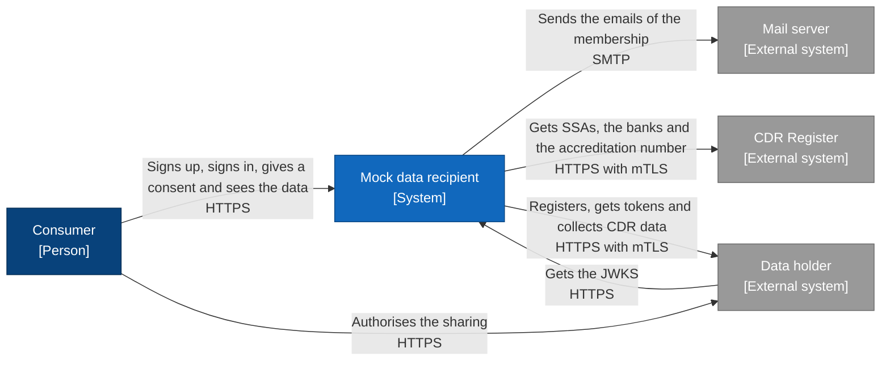

# Mock data recipient

The mock data recipient is one accredited data recipient brand with a consumer web app. A consumer becomes a member of the brand, connects the accounts of one or more data holders, and sees the CDR data of those accounts. Engineers use it as a test client for data holders, as a demonstration of the lab, and as a reference implementation. Each instance has one brand, from a preset brand or a brand directory.

## Context

## Areas

| Area | File | Summary |
|---|---|---|
| Brand | [brand.md](brand.md) | The brand directory, the preset brands, and the name, logo and colours that the data recipient shows. |
| Web app | [web-app.md](web-app.md) | The listener, the pages and their presentation, the statements and the policies of the web app. |
| Sign-up | [sign-up.md](sign-up.md) | The sign-up of a member, the verification of the email address and the member details. |
| Sign-in | [sign-in.md](sign-in.md) | The sign-in, the sign-out, the session and the password reset of a member. |
| Participation | [participation.md](participation.md) | The software product, the public listener and the JWKS, the client certificate, the Register, the list of banks and the registration with each bank. |
| Consent | [consent.md](consent.md) | The selection of a bank, the consent page, the redirection notice, the record of a consent and its end. |
| Authorisation | [authorisation.md](authorisation.md) | The authorisation flow at a bank, the callback, the tokens and the connection. |
| Data collection | [data-collection.md](data-collection.md) | The collection runs: the schedule, the calls, the storage of the data, the record of each run and its failure. |
| Accounts and transactions | [accounts-and-transactions.md](accounts-and-transactions.md) | The connections, the accounts, the balances and the transactions in the web app. |
| Email | [email.md](email.md) | The emails to a member, their content and their presentation. |
| Deployment | [deployment.md](deployment.md) | The preset brands in the lab, the ports, the Register record, and the deployment from the umbrella chart. |
| Non-functional requirements | [non-functional-requirements.md](non-functional-requirements.md) | Telemetry, secrets, restart, portability and health. |

## Library specifications

| Library | Specification |
|---|---|
| `pkg/cds` | [CDS HTTP library](../../../pkg/cds/DESIGN.md) |
| `pkg/platform/branddir` | [Brand directory library](../../../pkg/platform/branddir/DESIGN.md) |
| `pkg/platform/consolehttp` | [Web UI library](../../../pkg/platform/consolehttp/DESIGN.md) |
| `pkg/platform/database` | [Database library](../../../pkg/platform/database/DESIGN.md) |
| `pkg/platform/httproute` | None. |
| `pkg/platform/httpserver` | [HTTP server library](../../../pkg/platform/httpserver/DESIGN.md) |
| `pkg/platform/lifecycle` | None. |
| `pkg/platform/telemetry` | [Telemetry library](../../../pkg/platform/telemetry/DESIGN.md) |

## Goals

- One data recipient brand for each instance. The brand comes from a brand directory that the configuration selects, or from a preset brand ([brand](brand.md)).
- For consumers: a web app that is mobile-first, with a landing page, sign-up, the verification of the email address, the member details, sign-in, sign-out and a password reset ([web app](web-app.md), [sign-up](sign-up.md), [sign-in](sign-in.md)).
- The emails of the membership, through the mail server of the deployment ([email](email.md)).
- The participation of the brand in the CDR: a software product on the Register, a JWKS, a client certificate, the list of banks and a registration with each bank, through the [CDR client library](../../../pkg/cdrclient/DESIGN.md) ([participation](participation.md)).
- A connection to a bank: a collection consent and a use consent with the information of the CDR Rules, and an authorisation at the bank with PAR, PKCE and JARM ([consent](consent.md), [authorisation](authorisation.md)).
- A collection of the accounts, the balances and the transactions after the connection, each day and when the member asks, with a record of each consent and each collection run ([data collection](data-collection.md)).
- The connections, the accounts, the balances and the transactions in the web app ([accounts and transactions](accounts-and-transactions.md)).
- The preset brand in the lab, and a deployment of the brand from the umbrella chart ([deployment](deployment.md)).

## Non-goals

- Multi-factor authentication and passkeys. The password is the single factor ([sign-in](sign-in.md)).
- A check of the identity of a member, for example with the Document Verification Service. The data recipient checks only the format of the member details ([sign-up](sign-up.md)).
- A change of the email address of a member, and a change of the password with the current password. A member changes the password with a password reset ([sign-in](sign-in.md)).
- The removal of a member.
- An operator interface and an operator console. Engineers use the telemetry ([non-functional requirements](non-functional-requirements.md)).
- A native mobile app.
- The consumer dashboard, the withdrawal of a consent, the CDR Arrangement Revocation endpoint, the CDR receipts and the notifications after 90 days. A later project adds them ([no endpoint for the end of an arrangement](participation.md#dr-0751)).
- The amendment of a consent. The data holder does not support the amendment of an authorisation ([data holder non-goals](../../dataholder/design/README.md#non-goals)).
- An election to delete redundant data, and de-identification. Each brand deletes all redundant data ([no election to delete](consent.md#dr-0853)).
- Direct marketing consents, de-identification consents and disclosure consents.
- The detailed account data and the customer data of a bank. The consent asks only for the data that the web app shows ([the data clusters](consent.md#dr-0851)).
- The tests of the data recipient as a participant in the conformance suite.

## Withdrawn

None.
