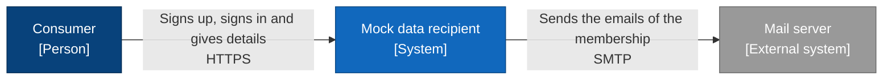

# Mock data recipient

The mock data recipient is one accredited data recipient brand with a consumer web app. A consumer becomes a member of the brand, connects the accounts of one or more data holders, and sees the CDR data of those accounts. Engineers use it as a test client for data holders, as a demonstration of the lab, and as a reference implementation. Each instance has one brand, from a preset brand or a brand directory.

## Context

## Areas

| Area | File | Summary |
|---|---|---|
| Brand | [brand.md](brand.md) | The brand directory, the preset brands, and the name, logo and colours that the data recipient shows. |
| Web app | [web-app.md](web-app.md) | The listener, the pages and their presentation, the statements and the policies of the web app. |
| Sign-up | [sign-up.md](sign-up.md) | The sign-up of a member, the verification of the email address and the member details. |
| Sign-in | [sign-in.md](sign-in.md) | The sign-in, the sign-out, the session and the password reset of a member. |
| Email | [email.md](email.md) | The emails to a member, their content and their presentation. |
| Deployment | [deployment.md](deployment.md) | The preset brands in the lab, the ports, and the deployment from the umbrella chart. |
| Non-functional requirements | [non-functional-requirements.md](non-functional-requirements.md) | Telemetry, secrets, restart, portability and health. |

## Library specifications

None.

## Goals

- One data recipient brand for each instance. The brand comes from a brand directory that the configuration selects, or from a preset brand ([brand](brand.md)).
- For consumers: a web app that is mobile-first, with a landing page, sign-up, the verification of the email address, the member details, sign-in, sign-out and a password reset ([web app](web-app.md), [sign-up](sign-up.md), [sign-in](sign-in.md)).
- The emails of the membership, through the mail server of the deployment ([email](email.md)).
- The preset brand in the lab, and a deployment of the brand from the umbrella chart ([deployment](deployment.md)).

## Non-goals

- Multi-factor authentication and passkeys. The password is the single factor ([sign-in](sign-in.md)).
- A check of the identity of a member, for example with the Document Verification Service. The data recipient checks only the format of the member details ([sign-up](sign-up.md)).
- A change of the email address of a member, and a change of the password with the current password. A member changes the password with a password reset ([sign-in](sign-in.md)).
- The removal of a member.
- An operator interface and an operator console. Engineers use the telemetry ([non-functional requirements](non-functional-requirements.md)).
- A native mobile app.

## Withdrawn

None.
