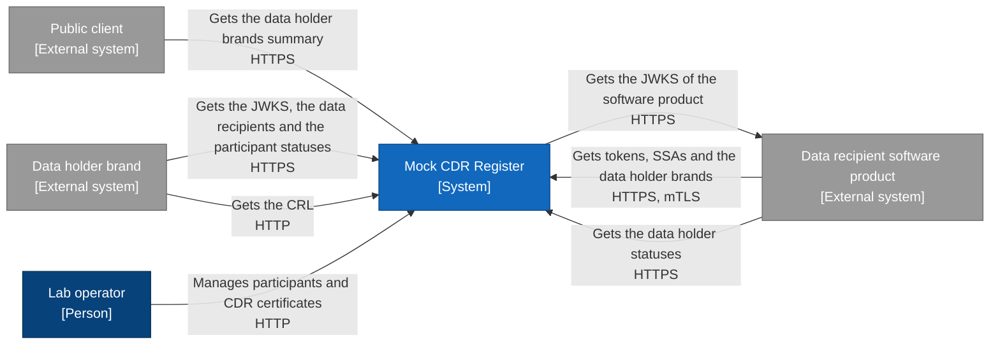

# Mock CDR Register

The mock CDR Register is the CDR Register as the CDS specifies it. Data holders, data recipients and public clients in the lab use it in the same way as the production Register that the ACCC operates. A real component changes from the mock Register to the production Register with a change of configuration only ([portability](non-functional-requirements.md#reg-0005)). In a running lab, the Register is also the mock CDR intermediate CA ([ADR 0022][adr-0022]). The lab-only operator interface, operator console and participant load give test functions that the production Register does not have.

## Context

## Areas

| Area | File | Summary |
|---|---|---|
| Participants | [participants.md](participants.md) | The participant model, the participant statuses and the cascades of a status change. |
| Register APIs | [register-apis.md](register-apis.md) | The endpoints, versions, headers, errors, caching, pagination, CORS and transport security of the Register APIs. |
| Software statement assertion | [software-statement-assertion.md](software-statement-assertion.md) | Get SSA, the claims and the signature of an SSA, and Get JWKS. |
| Authorisation server | [authorisation-server.md](authorisation-server.md) | The choices of the Register for its authorisation server, the token endpoint and the signing keys. |
| Certificate management | [certificate-management.md](certificate-management.md) | The issue of CDR client and server certificates from a CSR, and the CDR CA bundle. |
| Certificate revocation | [certificate-revocation.md](certificate-revocation.md) | The revocation of a CDR certificate, the CRL, and the revocation check of client certificates. |
| Operator interface | [operator-interface.md](operator-interface.md) | The lab-only HTTP API that creates and changes participants and changes their statuses. |
| Operator console | [operator-console.md](operator-console.md) | The lab-only browser UI for the lab operator: its views, the history, the presentation and the listener. |
| Operator console actions | [operator-console-actions.md](operator-console-actions.md) | The actions of the operator console, also the actions on CDR certificates. |
| Operator console forms | [operator-console-forms.md](operator-console-forms.md) | The create, add and change forms of the operator console. |
| Operator console API | [operator-console-api.md](operator-console-api.md) | The console API for the reads, the history, the key sets and the status actions. |
| Operator console change API | [operator-console-change-api.md](operator-console-change-api.md) | The console API for the creates, the adds, the changes and the CDR certificates. |
| Deployment | [deployment.md](deployment.md) | The participant load, the seed of the Helm chart, the example seed of the four preset brands, and the publication of the image and the chart. |
| Non-functional requirements | [non-functional-requirements.md](non-functional-requirements.md) | Propagation, performance, restart, telemetry, secrets, portability, conformance, local run and health. |

## Library specifications

| Library | Specification |
|---|---|
| `pkg/authserver` | [Authorisation server library](../../../pkg/authserver/design/README.md) |
| `pkg/ca` | [CA library](../../../pkg/ca/DESIGN.md) |
| `pkg/cds` | [CDS HTTP library](../../../pkg/cds/DESIGN.md) |
| `pkg/eventsourcing` | None. |
| `pkg/platform/consolehttp` | [Web UI library](../../../pkg/platform/consolehttp/DESIGN.md) |
| `pkg/platform/database` | [Database library](../../../pkg/platform/database/DESIGN.md) |
| `pkg/platform/httproute` | None. |
| `pkg/platform/httpserver` | [HTTP server library](../../../pkg/platform/httpserver/DESIGN.md) |
| `pkg/platform/jobs` | None. |
| `pkg/platform/jsonhttp` | [JSON body library](../../../pkg/platform/jsonhttp/DESIGN.md) |
| `pkg/platform/lifecycle` | None. |
| `pkg/platform/operatorhttp` | [Operator interface library](../../../pkg/platform/operatorhttp/DESIGN.md) |
| `pkg/platform/problem` | [Problem details library](../../../pkg/platform/problem/DESIGN.md) |
| `pkg/platform/telemetry` | [Telemetry library](../../../pkg/platform/telemetry/DESIGN.md) |

## Goals

- The participants of the CDR: data holder legal entities and brands, data recipient legal entities and brands, and software products, with their statuses and the cascades of a status change ([participants](participants.md)).
- For public clients and participants: the public Register APIs on TLS, and the secure Register APIs on mTLS ([Register APIs](register-apis.md)).
- For data recipient software products:
  - the Register authorisation server: the OpenID Provider configuration, the token endpoint and the access token signing keys ([authorisation server](authorisation-server.md))
  - Get SSA, with each SSA signed with a key that Get JWKS gives ([software statement assertion](software-statement-assertion.md))
- For the lab operator (lab-only), the Register as the mock CDR intermediate CA ([ADR 0022][adr-0022]):
  - the issue of CDR client and server certificates from a CSR, and the CDR CA bundle ([certificate management](certificate-management.md))
  - the revocation of CDR certificates, and the CRL that the Register signs and serves ([certificate revocation](certificate-revocation.md))
- The revocation check of the client certificates of the Register with its own CRL ([certificate revocation](certificate-revocation.md)).
- For the lab operator (lab-only):
  - the operator interface, which creates and changes participants, registers client certificates and changes statuses ([operator interface](operator-interface.md))
  - the operator console ([operator console](operator-console.md))
  - the load of a full set of participant data from a file ([deployment](deployment.md))
- The load of a participant seed file by the Helm chart, and an example seed file of the four preset brands of the data holder ([deployment](deployment.md)).
- The publication of the Register image and of a Helm chart from `main` by CI. An operator then deploys the Register to Kubernetes with configuration only ([deployment](deployment.md)).

## Non-goals

- Register calls to data holders: Get Metrics and Metadata Update. The ACCC has not implemented the Metadata Update trigger ([standards-maintenance #537][dsb-537]).
- Deprecated endpoint versions. The Register serves only the current version of each endpoint ([Register APIs](register-apis.md)).
- The Participant Portal, the accreditation workflow and the processes of the CDR Rules.
- The automatic archive of dormant entries ([CDS: Archiving][cds-archiving]).
- The set-up of the mock CDR PKI: the CAs, and the certificates of the lab services and tests. It is a separate component ([PKI specification](../../../pki/DESIGN.md)). The [CA library](../../../pkg/ca/DESIGN.md) gives the profiles of the certificates that the Register issues.

## Withdrawn

None.

[adr-0022]: ../../../docs/adr/0022-run-the-mock-cdr-intermediate-ca-in-the-register.md
[dsb-537]: https://github.com/ConsumerDataStandardsAustralia/standards-maintenance/issues/537
[cds-archiving]: https://consumerdatastandardsaustralia.github.io/standards-archives/standards-1.36.0/#archiving
