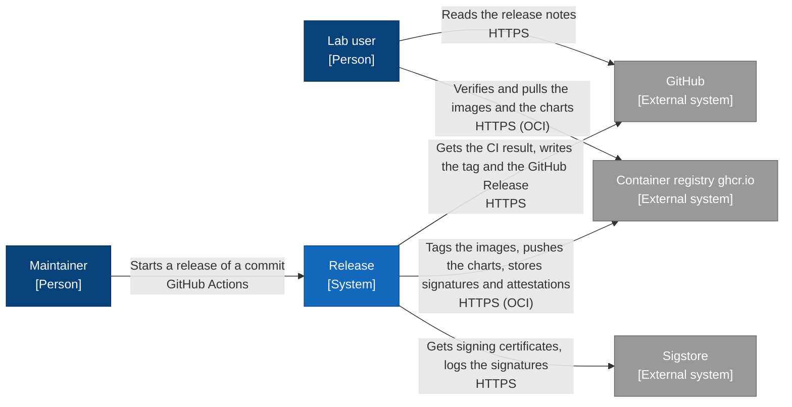

# Release

A release gives one version, `vX.Y.Z`, to the artifacts of one commit of `main`. It promotes the tested image of each service with no rebuild, packages the charts of the version, signs and attests the artifacts, and publishes a GitHub Release with the release notes. A maintainer starts each release by hand. The publications from `main` are in the deployment area of each service.

## Context

## Library specifications

None.

## Goals

- One version for the images and the charts of one tested commit of `main`.
- Release notes that tell a lab user what changed, and whether an upgrade needs a fresh deployment.
- Signatures, provenance and an SBOM that a lab user can verify before a deployment.

## Non-goals

- The publication of the images and the charts from `main`. The deployment areas of the [Register](../../services/register/design/deployment.md) and the [data holder](../../services/dataholder/design/deployment.md) give it.
- A data promise across an upgrade. While the major version is 0, a release makes none ([ADR 0027][adr-0027]).
- `service.version` in telemetry. It stays [the short commit ID of the build](../../pkg/platform/telemetry/DESIGN.md#tele-0003).

## Start and version

- **RLS-0001** A maintainer starts a release by hand, for one commit of `main`. CI never starts a release. ([GitHub Actions: `workflow_dispatch`][gha-workflow-dispatch]; [Judgement: one version from a manual workflow on main (ADR 0027)][adr-0027])
- **RLS-0002** When the commit is not in the first-parent history of `main`, the release refuses it. ([Judgement: one version from a manual workflow on main (ADR 0027)][adr-0027])
- **RLS-0003** The release pushes no commit to a branch. Its only change to the repository is the git tag of the version. ([Judgement: one version from a manual workflow on main (ADR 0027)][adr-0027])
- **RLS-0004** The version is a SemVer 2.0.0 version with the prefix `v`, and with no prerelease and no build metadata. For example, `v0.3.1`. ([SemVer 2.0.0][semver]; [Judgement: one version from a manual workflow on main (ADR 0027)][adr-0027])
- **RLS-0005** The release calculates the version from the Conventional Commits after the earlier version tag, up to the release commit. ([Conventional Commits 1.0.0][conventional-commits]; [cocogitto: configuration][cog-config]; [Judgement: one version from a manual workflow on main (ADR 0027)][adr-0027])
  - A breaking change gives the next major version. While the major version is 0, it gives the next minor version.
  - With no breaking change, a `feat` commit gives the next minor version.
  - With no breaking change and no `feat` commit, a `fix` commit gives the next patch version.
- **RLS-0006** When the repository has no version tag, the version is `v0.1.0`. ([SemVer 2.0.0: FAQ][semver-faq-initial]; [Judgement: one version from a manual workflow on main (ADR 0027)][adr-0027])
- **RLS-0007** When no commit after the earlier version tag changes the version, the release refuses the commit. For example, the commits after the tag are all `docs` commits. ([Judgement: no release with the same version as the earlier release](#rls-0100))
- **RLS-0008** When the version already has a git tag, the release refuses it. ([SemVer 2.0.0, item 3][semver]; [Judgement: a published version never changes](#rls-0101))
- **RLS-0009** Each artifact of a release has the version of the release. ([Judgement: one version from a manual workflow on main (ADR 0027)][adr-0027])
  - the image of each service
  - the chart of each service
- **RLS-0010** Two releases never run at the same time. ([GitHub Actions: concurrency][gha-concurrency]; [Judgement: one release at a time](#rls-0102))

## Checks

- **RLS-0020** When the CI run on `main` of the release commit did not pass, the release refuses the commit. For example, the run failed, the run was cancelled, the run is not complete, or the commit has no run. ([Judgement: promote the tested image with no rebuild (ADR 0029)][adr-0029])
- **RLS-0021** The [image commit](../../docs/spec/glossary.md#image-commit) of a service is the first commit with an image of that service, in the first-parent history of `main` from the release commit back. A commit has an image when the image of the service has its full commit ID as a tag. ([Judgement: promote the tested image with no rebuild (ADR 0029)][adr-0029])
- **RLS-0022** For each service, when the image commit is not the last commit at or before the release commit that changes an input of the image, the release refuses the commit. ([Judgement: promote the tested image with no rebuild (ADR 0029)][adr-0029])
- **RLS-0023** The release and the path filter of CI get the inputs of the image of each service from one file in the repository. ([Judgement: promote the tested image with no rebuild (ADR 0029)][adr-0029])
- **RLS-0024** The release completes all checks of this group, and the checks of the version, before it tags or pushes an artifact. ([Judgement: the release fails closed](#rls-0103))
- **RLS-0025** Integrity: when a step of the release fails, the version has 0 git tags and 0 published GitHub Releases. ([Judgement: the release fails closed](#rls-0103))
- **RLS-0026** A release of the same commit after a failed release gets the same version, and it replaces each artifact that the failed release pushed. ([Judgement: the release fails closed](#rls-0103))

## Images

- **RLS-0030** For each service, the release adds the tag `vX.Y.Z` to the image of the image commit. ([Judgement: promote the tested image with no rebuild (ADR 0029)][adr-0029])
- **RLS-0031** The release builds no image. ([Judgement: promote the tested image with no rebuild (ADR 0029)][adr-0029])
- **RLS-0032** Integrity: for each service, the digest of the tag `vX.Y.Z` is the same as the digest of the full commit ID tag of the image commit. The release fails when the two digests are different. ([Judgement: promote the tested image with no rebuild (ADR 0029)][adr-0029])

## Charts

- **RLS-0040** The release packages the chart of each service from the release commit. The chart version is `X.Y.Z`, with no `v`, and the `appVersion` is `vX.Y.Z`. For example, the chart of `v0.3.1` has the version `0.3.1`. ([Helm: charts and versioning][helm-chart-versions]; [Judgement: the chart version has no `v`](#rls-0104); [Judgement: promote the tested image with no rebuild (ADR 0029)][adr-0029])
- **RLS-0041** The release pushes each chart to the same OCI repository as the charts from `main`, `oci://ghcr.io/lukemundy/cdr-lab/charts/<chart>`. ([Judgement: one version from a manual workflow on main (ADR 0027)][adr-0027])
- **RLS-0042** When the values give no image tag, a chart of a release deploys the image with the tag `vX.Y.Z` of its service. ([the default image tag of the Register chart](../../services/register/design/deployment.md#reg-1514); [the default image tag of the data holder chart](../../services/dataholder/design/deployment.md#dh-2646); [Judgement: promote the tested image with no rebuild (ADR 0029)][adr-0029])

## Signatures and attestations

- **RLS-0050** The release signs the digest of each image and of each chart of the release with a keyless cosign signature. ([Sigstore: signing containers][sigstore-sign]; [Judgement: keyless cosign and GitHub artifact attestations (ADR 0031)][adr-0031])
- **RLS-0051** The certificate of each signature identifies the release workflow of the repository, run from `main`, with the OIDC issuer of GitHub Actions. ([cosign: verify][cosign-verify]; [Judgement: keyless cosign and GitHub artifact attestations (ADR 0031)][adr-0031])
- **RLS-0052** Each image of a release has a provenance attestation from GitHub artifact attestations. The CI run on `main` that built the image made the attestation. ([GitHub: artifact attestations][gh-attestations]; [Judgement: the provenance comes from the build that made the artifact](#rls-0105))
- **RLS-0053** Each chart of a release has a provenance attestation from GitHub artifact attestations. The release made the attestation. ([GitHub: artifact attestations][gh-attestations]; [Judgement: the provenance comes from the build that made the artifact](#rls-0105))
- **RLS-0054** Each image of a release has an SBOM attestation in SPDX JSON. The CI run on `main` that built the image made the attestation. ([GitHub: use artifact attestations][gh-attestations-use]; [SPDX 2.3][spdx]; [Judgement: an SBOM in SPDX JSON](#rls-0106))
- **RLS-0055** The SBOM of an image lists the Go modules of the service binary. ([Judgement: the SBOM does not list the npm packages](#rls-0107))
- **RLS-0056** Each attestation is in the attestations of the repository, and in the registry with the artifact. ([GitHub: use artifact attestations][gh-attestations-use]; [Judgement: the attestations also in the registry](#rls-0108))
- **RLS-0057** Security: the repository and its secrets hold 0 private signing keys. ([Judgement: keyless cosign and GitHub artifact attestations (ADR 0031)][adr-0031])
- **RLS-0058** Security: 0 jobs that run for a pull request have the permission to write packages, to write attestations, or to get an OIDC token. ([GitHub Actions: permissions][gha-permissions]; [Judgement: keyless cosign and GitHub artifact attestations (ADR 0031)][adr-0031])

## Release notes

- **RLS-0060** The release publishes one GitHub Release for the version, with the git tag `vX.Y.Z` on the release commit. ([Judgement: one version from a manual workflow on main (ADR 0027)][adr-0027])
- **RLS-0061** After the GitHub Release is published, its git tag and its assets cannot change. ([GitHub: immutable releases][gh-immutable-releases]; [Judgement: a published version never changes](#rls-0101))
- **RLS-0062** The release notes are only in the GitHub Release. The repository has no changelog file. ([Judgement: one version from a manual workflow on main (ADR 0027)][adr-0027])
- **RLS-0063** The release notes start with the section "Needs a fresh deployment". Each release has this section. ([Judgement: a fresh deployment from the migrations and the event golden files (ADR 0028)][adr-0028])
- **RLS-0064** When the diff from the earlier version tag to the release commit has one of these changes, the section says that the release needs a fresh deployment, and it lists the files. ([Judgement: a fresh deployment from the migrations and the event golden files (ADR 0028)][adr-0028])
  - a migration file of a service that the earlier version had is changed, renamed or deleted
  - an entry of an event golden file that the earlier version had is changed or removed
  - an event golden file that the earlier version had is deleted
- **RLS-0065** A new migration file and a new entry of an event golden file do not make a release need a fresh deployment. ([Judgement: a fresh deployment from the migrations and the event golden files (ADR 0028)][adr-0028])
- **RLS-0066** When the release does not need a fresh deployment, the section says so. When the repository has no earlier version tag, the section says that the release is the first release. ([Judgement: a fresh deployment from the migrations and the event golden files (ADR 0028)][adr-0028])
- **RLS-0067** The release notes give the changelog: one line for each Conventional Commit after the earlier version tag, up to the release commit. The lines are in groups by type, then by scope, and each breaking change has a mark. ([Conventional Commits 1.0.0][conventional-commits]; [Judgement: one version from a manual workflow on main (ADR 0027)][adr-0027])
- **RLS-0068** The release notes give, for each service, the image commit and the digest of the image. ([Judgement: promote the tested image with no rebuild (ADR 0029)][adr-0029]; [Judgement: the digests in the release notes](#rls-0109))
- **RLS-0069** The release notes give the digest of each chart of the release. ([Judgement: the digests in the release notes](#rls-0109))
- **RLS-0070** The release notes and the README of each chart say that the SBOM does not list the npm packages of the web UIs. ([Judgement: the SBOM does not list the npm packages](#rls-0107))
- **RLS-0071** The release notes link to the commands that verify the artifacts, in the README of each chart. ([Judgement: verify by digest, then install by digest](#rls-0110))

## Event golden files

- **RLS-0080** Each service that keeps events has an event golden file in the repository, with one entry for each event type that the service registers. ([Judgement: a fresh deployment from the migrations and the event golden files (ADR 0028)][adr-0028])
- **RLS-0081** An entry is a sample of the event type, encoded with the codec of the service. ([Judgement: a fresh deployment from the migrations and the event golden files (ADR 0028)][adr-0028])
- **RLS-0082** When a registered event type has no sample, the tests of the service fail. ([Judgement: a fresh deployment from the migrations and the event golden files (ADR 0028)][adr-0028])
- **RLS-0083** When the encoded sample of an event type is not the same as its entry in the event golden file, the tests of the service fail. ([Judgement: a fresh deployment from the migrations and the event golden files (ADR 0028)][adr-0028])
- **RLS-0084** The tests write the event golden file again only when a person asks for it. For example, with a flag of the test command. ([Judgement: a fresh deployment from the migrations and the event golden files (ADR 0028)][adr-0028])
- **RLS-0085** Each field of a sample has a value that is not the zero value of its type. This includes each field of a nested object, each item of a list and each value of a map. A list and a map have one or more items. When a field of a sample has the zero value, the tests of the service fail. ([Judgement: each field of a sample has a value](#rls-0111))
- **RLS-0086** When the codec of the service cannot decode an entry of the event golden file back to its sample, the tests of the service fail. ([Judgement: the codec decodes each entry](#rls-0112))
- **RLS-0087** When the event golden file has an entry for an event type that the service does not register, the tests of the service fail. ([Judgement: a fresh deployment from the migrations and the event golden files (ADR 0028)][adr-0028])
- **RLS-0088** The event golden file of a service is `services/<service>/internal/app/testdata/events.golden.json`. It is one JSON object, indented, with its keys in sorted order. The key of an entry is `<stream type>/<event type>`, and its value is an object with the fields `schemaVersion` and `payload`. ([Judgement: the path and the format of the event golden file](#rls-0113))

## Verification by a lab user

- **RLS-0090** The README of each chart gives the commands that verify these items of a release. ([cosign: verify][cosign-verify]; [GitHub CLI: `gh attestation verify`][gh-attestation-verify]; [Judgement: verify by digest, then install by digest](#rls-0110))
  - the cosign signature of the chart digest and of the image digest
  - the provenance attestation of the chart and of the image
  - the SBOM attestation of the image
- **RLS-0091** The README of each chart tells the lab user to verify the chart by its digest, and then to install the chart by that digest. ([Helm: provenance and integrity][helm-provenance]; [Judgement: verify by digest, then install by digest](#rls-0110))
- **RLS-0092** The verify commands require the identity of the release workflow on `main` and the OIDC issuer of GitHub Actions. ([cosign: verify][cosign-verify]; [Judgement: keyless cosign and GitHub artifact attestations (ADR 0031)][adr-0031])

## Judgements

### RLS-0100 No release with the same version as the earlier release

- Kind: choice
- Basis: Step 3.3. A `docs`, `chore` or `refactor` commit changes no part of a version ([Conventional Commits 1.0.0][conventional-commits]).
- Reason: A release with no version change has the same version as the earlier release, and a version cannot have two sets of artifacts. A refusal is simpler than a patch bump that no commit asks for.

### RLS-0101 A published version never changes

- Kind: choice
- Basis: Step 3.2. "Once a versioned package has been released, the contents of that version MUST NOT be modified" ([SemVer 2.0.0, item 3][semver]). GitHub immutable releases lock the tag and the assets of a published release ([GitHub: immutable releases][gh-immutable-releases]).
- Reason: A lab user who pins a version gets the same artifacts at each install. A fix needs a new version.

### RLS-0102 One release at a time

- Kind: choice
- Basis: Step 3.3. GitHub Actions can put the runs of a workflow in one concurrency group ([GitHub Actions: concurrency][gha-concurrency]).
- Reason: Two releases at the same time calculate the same version from the same tags. One run at a time is the simplest way to stop this.

### RLS-0103 The release fails closed

- Kind: choice
- Basis: Step 3.2. GitHub recommends a draft release that gets its assets before it is published ([GitHub: immutable releases][gh-immutable-releases]).
- Reason: A lab user sees a version only after each artifact has its version, its signature and its attestations. Before the GitHub Release is published, no user depends on the version, so a release again can replace the artifacts.

### RLS-0104 The chart version has no `v`

- Kind: choice
- Basis: Step 3.2. A chart version must be a SemVer 2 version ([Helm: charts and versioning][helm-chart-versions]). "v1.2.3" is not a semantic version ([SemVer 2.0.0: FAQ][semver-faq-v]).
- Reason: `X.Y.Z` is the SemVer form of the version, so `helm install --version` works with it. The `appVersion` keeps `vX.Y.Z`, because it is the image tag.

### RLS-0105 The provenance comes from the build that made the artifact

- Kind: choice
- Basis: Step 3.2. A SLSA provenance describes how an artifact was built: its build definition, its source and its builder ([SLSA: provenance][slsa-provenance]).
- Reason: The image commit of a service can be older than the release commit. A provenance from the release gives the wrong source commit for the image. A chart is built by the release, so the release attests it.

### RLS-0106 An SBOM in SPDX JSON

- Kind: choice
- Basis: Step 3.2. GitHub artifact attestations accept an SBOM in SPDX or CycloneDX JSON ([GitHub: use artifact attestations][gh-attestations-use]). `gh attestation verify` has a fixed predicate type for SPDX 2.3 ([GitHub: use artifact attestations][gh-attestations-use]).
- Reason: The two formats meet the need, and one format is the simplest. A lab user then verifies the SBOM with one fixed predicate type.

### RLS-0107 The SBOM does not list the npm packages

- Kind: gap
- Basis: Step 3.2. An SBOM lists each component of the software ([NTIA: minimum elements of an SBOM][ntia-sbom]).
- Reason: A service binary embeds the web UIs, and the image has no npm lock file, so a scan of the image does not find the npm packages. A scan of the lock file, filtered to the packages of each image, is more work than version 1 of the SBOM needs. The notes and the chart READMEs state the gap, so that a user does not trust the SBOM for the npm packages.

### RLS-0108 The attestations also in the registry

- Kind: choice
- Basis: Step 3.2. GitHub can push an attestation of an image to its registry ([GitHub: use artifact attestations][gh-attestations-use]), and `gh attestation verify` can read the attestation from the registry ([GitHub CLI: `gh attestation verify`][gh-attestation-verify]).
- Reason: A cluster tool reads the registry, not the attestations API of GitHub. The attestation then stays with the artifact when a team copies the artifact to its own registry.

### RLS-0109 The digests in the release notes

- Kind: choice
- Basis: Step 3.3. A lab user verifies and installs a chart by its digest ([Judgement: verify by digest, then install by digest](#rls-0110)).
- Reason: The notes then give each value that the verify and install commands need, and a lab user can compare each digest with the registry.

### RLS-0110 Verify by digest, then install by digest

- Kind: choice
- Basis: Step 3.2. Helm verifies only PGP provenance files ([Helm: provenance and integrity][helm-provenance]). cosign verifies the signature of a digest ([cosign: verify][cosign-verify]).
- Reason: `helm install` does not verify a cosign signature. A tag can move after the verification, but a digest cannot, so the installed chart is the verified chart.

### RLS-0111 Each field of a sample has a value

- Kind: choice
- Basis: Step 3.2. `encoding/json` does not encode a field with the `omitempty` option when the field has an empty value, and it encodes a nil pointer as `null` ([Go: encoding/json][go-json]).
- Reason: A field that is not in the encoded sample is not in the event golden file. Then a change of the name or the type of that field does not change the file, and the release does not find the change.

### RLS-0112 The codec decodes each entry

- Kind: choice
- Basis: Step 3.3. ADR 0028 compares the encoded samples with the file. A field can encode but not decode, for example a type with a `MarshalJSON` method and no `UnmarshalJSON` method.
- Reason: The release must know whether the new version can read the stored events. A decode of each entry with the codec of the service shows this directly, at a small cost.

### RLS-0113 The path and the format of the event golden file

- Kind: choice
- Basis: Step 3.3. The codecs of a service are in its `internal/app` package, and Go tools ignore a `testdata` directory ([Go: test packages][go-testdata]). An event type name is unique only in its codec.
- Reason: The release finds the files with one pattern, and it compares the entries by key. Indented JSON lets a reviewer see a payload change in the diff. The stream type in the key keeps two codecs of one service apart.

## Withdrawn

None.

[adr-0027]: ../../docs/adr/0027-release-all-artifacts-with-one-version-from-a-manual-workflow-on-main.md
[adr-0028]: ../../docs/adr/0028-find-the-need-for-a-fresh-deployment-from-the-migrations-and-the-event-golden-files.md
[adr-0029]: ../../docs/adr/0029-promote-the-tested-image-of-each-service-to-a-release-with-no-rebuild.md
[adr-0031]: ../../docs/adr/0031-sign-releases-with-keyless-cosign-and-attest-provenance-and-an-sbom.md
[cog-config]: https://docs.cocogitto.io/reference/config.html
[conventional-commits]: https://www.conventionalcommits.org/en/v1.0.0/#specification
[cosign-verify]: https://docs.sigstore.dev/cosign/verifying/verify/
[gh-attestation-verify]: https://cli.github.com/manual/gh_attestation_verify
[gh-attestations]: https://docs.github.com/en/actions/concepts/security/artifact-attestations
[gh-attestations-use]: https://docs.github.com/en/actions/how-tos/secure-your-work/use-artifact-attestations/use-artifact-attestations
[gh-immutable-releases]: https://docs.github.com/en/code-security/concepts/supply-chain-security/immutable-releases
[gha-concurrency]: https://docs.github.com/en/actions/reference/workflows-and-actions/workflow-syntax#concurrency
[gha-permissions]: https://docs.github.com/en/actions/reference/workflows-and-actions/workflow-syntax#permissions
[gha-workflow-dispatch]: https://docs.github.com/en/actions/reference/workflows-and-actions/events-that-trigger-workflows#workflow_dispatch
[go-json]: https://pkg.go.dev/encoding/json#Marshal
[go-testdata]: https://pkg.go.dev/cmd/go#hdr-Test_packages
[helm-chart-versions]: https://helm.sh/docs/topics/charts/
[helm-provenance]: https://helm.sh/docs/topics/provenance/
[ntia-sbom]: https://www.ntia.gov/report/2021/minimum-elements-software-bill-materials-sbom
[semver]: https://semver.org/spec/v2.0.0.html
[semver-faq-initial]: https://semver.org/spec/v2.0.0.html#how-should-i-deal-with-revisions-in-the-0yz-initial-development-phase
[semver-faq-v]: https://semver.org/spec/v2.0.0.html#is-v123-a-semantic-version
[sigstore-sign]: https://docs.sigstore.dev/cosign/signing/signing_with_containers/
[slsa-provenance]: https://slsa.dev/spec/v1.0/provenance
[spdx]: https://spdx.github.io/spdx-spec/v2.3/
