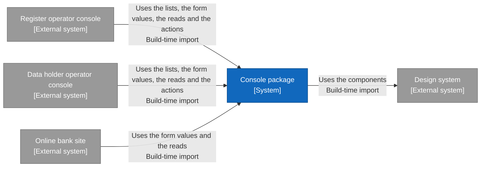

# Console package

The console package is the shared code of the lab web UIs that get their data from a lab API: the two operator consoles and the online bank site. It gives the state of a list in the URL, the form values that a UI sends, the retry and the errors of a read, and the actions of a record in a console. Thus each UI has the same behaviour, and each rule has one place. The [design system](../ui/design/README.md) gives the components and the patterns that the package uses.

## Context

## Library specifications

None.

## Goals

- One URL format for the filter, the search, the sort and the page of a list.
- One rule for the white space of the values of a form.
- One retry rule and one error for a read that fails.
- One behaviour for the refusal, the result and the refresh of an action of a record in a console.

## Non-goals

- The components, the dialogs, the forms and their errors. The [design system](../ui/design/README.md) gives them.
- The rules of one UI, for example its lists, its actions and its forms. The specification of the service that has the UI gives them.
- The history entry of a search. The specification of each console gives it.
- The test helpers of the package. They give no behaviour of a UI.

## Lists in the URL

- **WCON-0001** The filter, the search, the sort and the page of a list are in the URL, when the list has them. For example, a reload of a list shows the same filter, sort and page. ([Judgement: the state of a list is in the URL](#wcon-0020))
- **WCON-0002** The URL of a list uses the names and the values of the query of the console API. For example, `?status=ACTIVE&q=bank&page=2`. ([Judgement: the state of a list is in the URL](#wcon-0020))
- **WCON-0003** The URL of a list has no parameter for an empty value or for page 1. For example, the URL of the first page of a list with no search has no query. ([Judgement: the state of a list is in the URL](#wcon-0020))
- **WCON-0004** When the URL gives no sort column, the list uses its default sort column. When the URL gives no order, the sort is ascending. ([Judgement: the state of a list is in the URL](#wcon-0020))
- **WCON-0005** When a value in the URL of a list is not valid, the UI ignores that value and shows the list. For example, a link with a status that the filter does not have shows the list with no filter. ([Judgement: a value that is not valid in a link is ignored](#wcon-0021))
- **WCON-0006** A change of the filter, the search or the sort of a list shows page 1. ([Judgement: a change of a list goes back to page 1](#wcon-0022))
- **WCON-0007** Each page of a list has 25 records. The URL has no page size. ([the default page size of a list](../../../pkg/platform/consolehttp/DESIGN.md#cnsl-0015))

## Form values

- **WCON-0008** The UI removes the white space at the start and at the end of each value of a form. ([Judgement: the UI removes the white space at the ends of each value](#wcon-0023))
- **WCON-0009** For a text area with one value on each line, the UI removes the white space at the start and at the end of each line, and ignores each empty line. For example, an empty last line gives no value. ([one text area with one value on each line](../ui/design/forms-and-dialogs.md#ui-0310); [Judgement: the UI removes the white space at the ends of each value](#wcon-0023))

## Reads and refusals

- **WCON-0010** When a read fails with a status of 500 or more, or with no response, the UI sends it again, 2 times at most. ([Judgement: only a server or network failure of a read is tried again](#wcon-0024))
- **WCON-0011** When the service refuses a read with a status below 500, the UI does not send it again. ([Judgement: only a server or network failure of a read is tried again](#wcon-0024))
- **WCON-0012** When a read fails with no problem details, the error state has the title `The console cannot get data from {service}` and the detail `Make sure that {service} runs, and then try again.`, with the name of the service in a sentence. For example, the title is "The console cannot get data from the Register". ([the error state](../ui/design/components.md#ui-0276); [Judgement: a read failure with no problem details names the service](#wcon-0025))
- **WCON-0013** The UI takes field errors only from a problem with the field-errors type. A refusal with a different problem shows in the error summary of the form. ([the field-errors problem type](../../../pkg/platform/problem/DESIGN.md#prob-0002); [the error of the form in the error summary](../ui/design/forms-and-dialogs.md#ui-0329))

## Actions of a record

These rules apply to the operator consoles. The specification of each console gives its actions.

- **WCON-0014** When the service refuses an action, the console shows the `detail` of the problem in the dialog or in the form of the action. For example, a stale version shows its `detail` in the confirmation dialog. ([WCAG 2.2, SC 3.3.1][wcag-3-3-1])
- **WCON-0015** After an action, also after a refused action, each view shows the current state with no reload of the page. For example, after a refused close of an account that a different tab closed, the detail shows the account as closed. ([Judgement: each view gets the current state after a refusal](#wcon-0026))
- **WCON-0016** The console shows the result of a successful action in a toast. The view also shows the new state, so the toast is never the only place of the result. ([WCAG 2.2, SC 4.1.3][wcag-4-1-3]; [a toast is never the only place of its information](../ui/design/forms-and-dialogs.md#ui-0339))
- **WCON-0017** When the refresh after a refused action removes the action, its dialog stays as it was when it opened, with the problem, until the lab operator closes it. ([the dialog stays open after a failure](../ui/design/forms-and-dialogs.md#ui-0299))
- **WCON-0018** When the action does not exist after a confirmed action, the focus moves to the group of the actions of the record. ([the focus when the control that opened a dialog does not exist](../ui/design/forms-and-dialogs.md#ui-0292))

## Judgements

### WCON-0020 The state of a list is in the URL

- Kind: choice
- Basis: Step 3.3. The CDS and the ACCC give no rule for a lab UI.
- Reason: The user can share a view, or go back to it, with its URL. The names and the values of the console API query give one format for the URL and the request. Defaults that are not in the URL give one URL for each view.

### WCON-0021 A value that is not valid in a link is ignored

- Kind: choice
- Basis: Step 3.3. The CDS and the ACCC give no rule for a lab UI.
- Reason: A link that a user changed, or an old link after a change of the UI, still shows a list. An error page for a value in a link does not help the user.

### WCON-0022 A change of a list goes back to page 1

- Kind: choice
- Basis: Step 3.3. The CDS and the ACCC give no rule for a lab UI.
- Reason: The earlier page can be after the end of the changed list. Page 1 shows the first records of the change.

### WCON-0023 The UI removes the white space at the ends of each value

- Kind: choice
- Basis: Step 3.3. The CDS and the ACCC give no rule for a lab UI.
- Reason: A value that the user pastes often has white space or an empty last line. A space at the end of a URI or an identifier is never intended. This is not a rule of the service, which still checks each value.

### WCON-0024 Only a server or network failure of a read is tried again

- Kind: choice
- Basis: Step 3.2. A read is a `GET`, which is idempotent ([RFC 9110, section 9.2.2][rfc9110-idempotent]).
- Reason: A short failure of a service or of the network can stop before the next request. A refusal gives the same answer again. Two retries limit the wait before the error state shows.

### WCON-0025 A read failure with no problem details names the service

- Kind: choice
- Basis: Step 3.3. The design system gives the error state of a problem, but not the text for a failure with no problem ([the error state](../ui/design/components.md#ui-0276)).
- Reason: In the lab, the most probable cause of a failure with no response is a service that does not run. The text names the service, so the user knows which one to start.

### WCON-0026 Each view gets the current state after a refusal

- Kind: choice
- Basis: Step 3.3. The CDS and the ACCC give no rule for a tool of the lab operator.
- Reason: A refusal often means that the view is not current. For example, a stale version means that a different tab changed the record.

## Withdrawn

None.

[rfc9110-idempotent]: https://www.rfc-editor.org/rfc/rfc9110#name-idempotent-methods
[wcag-3-3-1]: https://www.w3.org/TR/WCAG22/#error-identification
[wcag-4-1-3]: https://www.w3.org/TR/WCAG22/#status-messages
