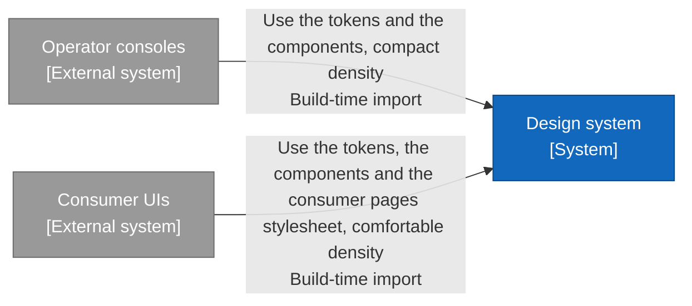

# Design system

The design system gives all lab web UIs one set of design tokens, React components and a stylesheet for the consumer pages, with the rules for their use. The UIs then look and act the same, and a change to a rule has one place. The UIs are operator consoles for desktop and consumer UIs for mobile. Each mock data holder and each data recipient is a different brand, so one set of components takes more than one brand ([ADR 0016][adr-0016]).

## Context

## Areas

| Area | File | Summary |
|---|---|---|
| Tokens and brands | [tokens-and-brands.md](tokens-and-brands.md) | The token tiers, the colour roles and their contrast, the scales, the densities, the brands and the fonts. |
| Layout | [layout.md](layout.md) | The layout of a console and its shell, the layout of a consumer UI, the control size and the supported browsers. |
| Components | [components.md](components.md) | The components that more than one UI uses, their states, and the rules for all components. |
| Forms and dialogs | [forms-and-dialogs.md](forms-and-dialogs.md) | The dialogs, the form fields, the forms, the alerts and the toasts. |
| Consumer pages | [consumer-pages.md](consumer-pages.md) | The design guide of the consumer pages: the visual pattern of each part of a page. |
| Accessibility | [accessibility.md](accessibility.md) | The accessibility level of each type of UI, the automated checks and the names of repeated links. |
| Content | [content.md](content.md) | The language, and the format of dates, times, amounts and identifiers. |
| Non-functional requirements | [non-functional-requirements.md](non-functional-requirements.md) | The supply chain, the single source of the tokens and the components, and the third-party notices of each UI. |

## Library specifications

None.

## Goals

- The design tokens: their tiers, the colour roles and their contrast, the densities, the brands and the fonts ([tokens and brands](tokens-and-brands.md)).
- The components that more than one UI uses, and their states ([components](components.md), [forms and dialogs](forms-and-dialogs.md)).
- The layout of a console and of a consumer UI, and the supported browsers ([layout](layout.md)).
- The design guide of the consumer pages of the data holder ([consumer pages](consumer-pages.md)).
- The accessibility level of each type of UI, and the automated checks ([accessibility](accessibility.md)).
- The content rules: language, dates, times and amounts ([content](content.md)).

## Non-goals

- A dark theme. The semantic tier of the tokens permits a second theme ([ADR 0016][adr-0016]).
- The rules of each CDR flow, for example an authorisation, and the content of each page. The specification of the service that has the flow gives them. The design system gives the components that the flows use.
- The rules of one UI, for example its brand or its pages. The specification of the service that has the UI gives them.
- A component catalogue ([ADR 0016][adr-0016]).
- Manual screen-reader audits ([ADR 0016][adr-0016]).

## Withdrawn

None.

[adr-0016]: ../../../../docs/adr/0016-design-system-on-shadcn-base-ui-and-dtcg-tokens.md
